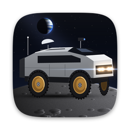

# SI CDM

A high-performance CAD / CAM desktop application written in C++20.

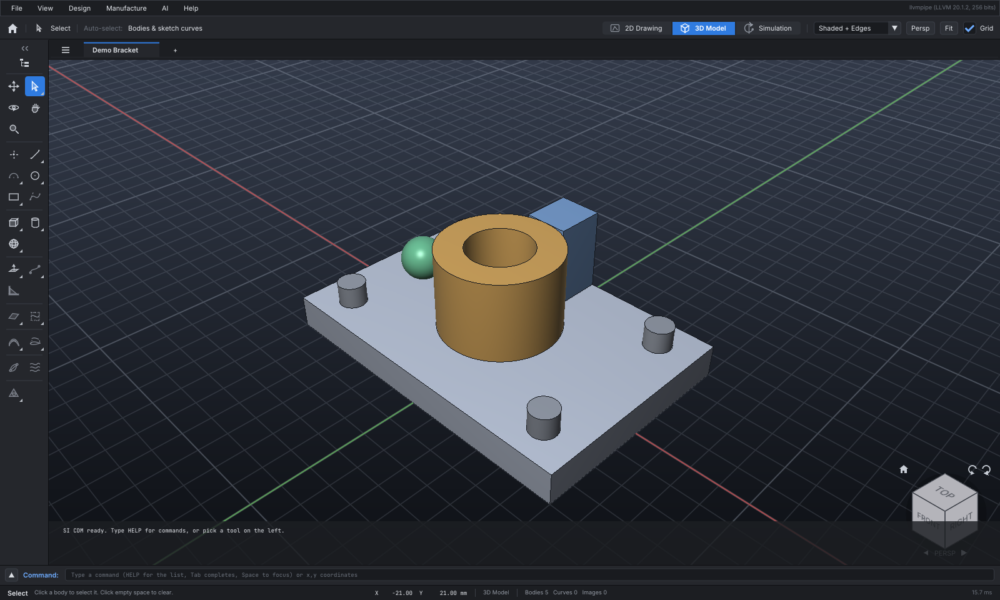

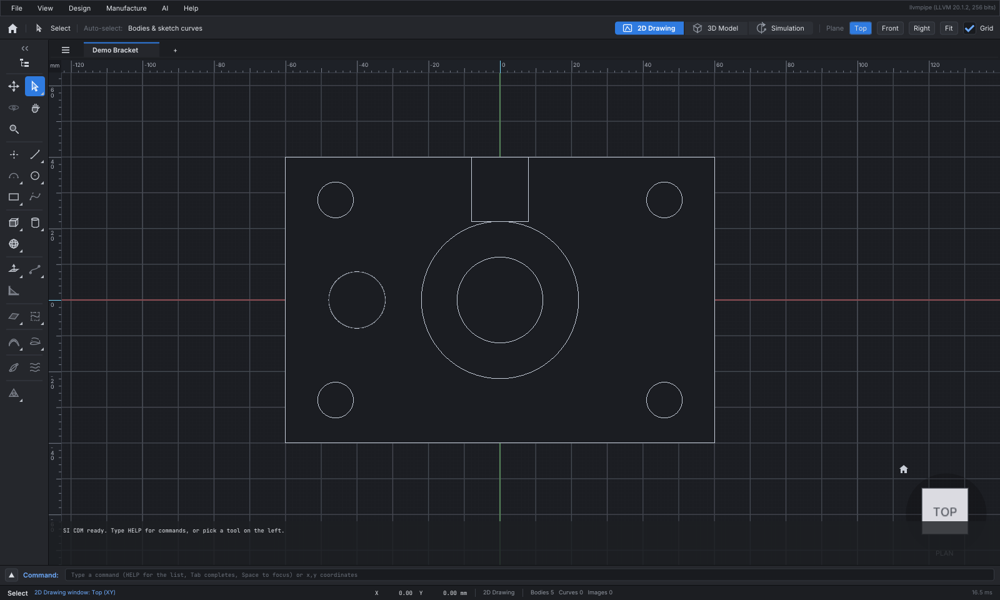

## Run

Requires CMake 3.24+ (`brew install cmake`) and, on macOS, Xcode 15+.

```bash
./run.sh            # build (Release) and launch the app (also builds sicdm-mcp)
./run.sh debug      # build (Debug) and launch
./run.sh test       # build and run the unit tests
./run.sh xcode      # generate build/xcode/SICDM.xcodeproj and open it in Xcode (macOS)
./run.sh clean      # delete the build folder
```

In Xcode, select the **sicdm** scheme and press ⌘R.

## Launch: icon and splash screen

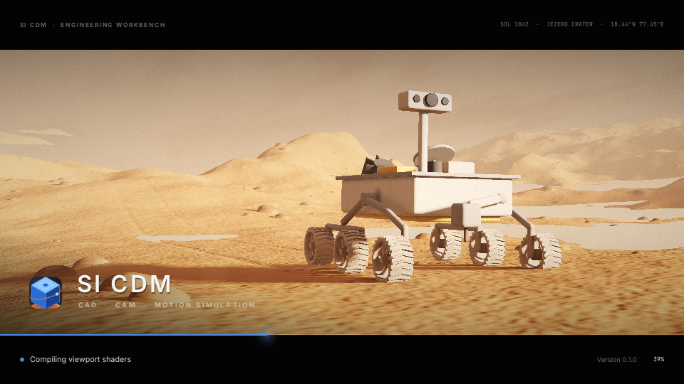

The app starts with a cinematic splash: a four-wheeled crew rover (big treaded tyres on gold dish
rims, raked windscreen, glowing headlamps, roof antenna, dish and mast camera) crossing the lunar plain
under a black, star-filled sky, a crescent Earth over the horizon. It is rendered live on the GPU:
ray-marched regolith with craters, boulders, tyre tracks and smooth highlands, a low hard sun with long
shadows, lunar (Lommel-Seeliger) surface scattering, headlight beams with an anamorphic lens streak,
filmic grade and grain, slow camera push-in. Over it, a digital-twin network of glowing nodes and links
drifts and is revealed left to right with a scanning sweep. The rounded, borderless window carries the
headline "Super Intelligence Computer Designing and Manufacturing", the SI CDM title card (icon,
brushed-metal title, "Super Intelligence CAD · CAM · CAE · Digital Twin") and a status panel with the real
loading step and subsystem (graphics, fonts, shaders, part library, workspace, MCP server, the file being
opened), the percentage and a glowing progress bar; the main window appears when loading is done. Click or press Esc to skip it.

```bash
sicdm --no-splash            # start straight into the workbench
sicdm --splash-seconds 6     # keep the splash up longer (default 3.2 s minimum)
```

The splash renders at a resolution adapted to the GPU, so it stays smooth on integrated graphics.
`--screenshot` runs never show it.

The app icon (the crew rover from the splash, gold rims and glowing headlamps, on the lunar horizon under a crescent Earth) is drawn by
`tools/make_icon.py` (Python + Pillow + NumPy) into `resources/icon/*.png` and
`resources/macos/SICDM.icns`. The macOS bundle uses the `.icns` for the Dock and Finder; on
Windows and Linux the PNGs are compiled into the app and set as the window icon.

## Interface

Dark graphite workbench in the style of AutoCAD, Maya and Photoshop: Inter for the interface,
JetBrains Mono for the command line and numeric readouts (both SIL OFL, embedded in the app from
`resources/fonts`), 22 pt controls on an 8 pt spacing grid, one accent blue for selection and the
active window. Text is rasterised at the display's pixel density, so it is sharp on Retina screens.
Colours, fonts and spacing live in `src/ui/Theme.hpp`.

## Files in tabs

Every open file has its own tab at the top of the canvas, AutoCAD style: `☰` (file menu and the list
of open files), one tab per file (`*` = unsaved, `×` or middle-click closes it) and `+` for a new file.
Each file keeps its own model, 2D / 3D window, cameras and selection, so switching tabs puts you back
exactly where you were. `Ctrl/⌘ N` and `+` open a new tab, Open opens the project in its own tab (or
shows it if it is already open; the untouched demo part is replaced), `Ctrl/⌘ W` closes the tab —
asking to save first if needed — and `Ctrl + Tab` / `Ctrl + Shift + Tab` cycle through the files. On the
command line, `FILES` lists the tabs, `FILES 2` or `FILES part` switches, `CLOSE [DISCARD]` closes.

## View windows

The top bar of the canvas switches between three windows of the active file (also `Tab`; Simulation is described below):

- **3D Model** – perspective / orthographic model view with Shaded, Shaded + Edges, Wireframe and
  Hidden Line display.
- **2D Drawing** – exact orthographic plan view of the Top, Front or Right plane, rendered as a
  hidden-line drawing with mm rulers, a plane grid and cursor coordinates. Drag pans, the wheel
  zooms at the cursor; the view never tilts.

Each window keeps its own camera, so switching back and forth never loses your view.

**ViewCube** (bottom right): click any face, edge or corner for one of 26 views, drag it to orbit,
use Home, the roll arrows (top right: spin the view 90° around the viewing direction, Shift for 15°)
and the ◀ ▶ arrows by the projection badge (turn 90° around Z). The badge shows the roll angle;
right-click for more views, including Level View to reset the roll. Picking a face, edge or corner
always comes back level. In the 2D window its faces pick
the drawing plane; edges and corners open the 3D window at that angle.

## Simulation window (motion control)

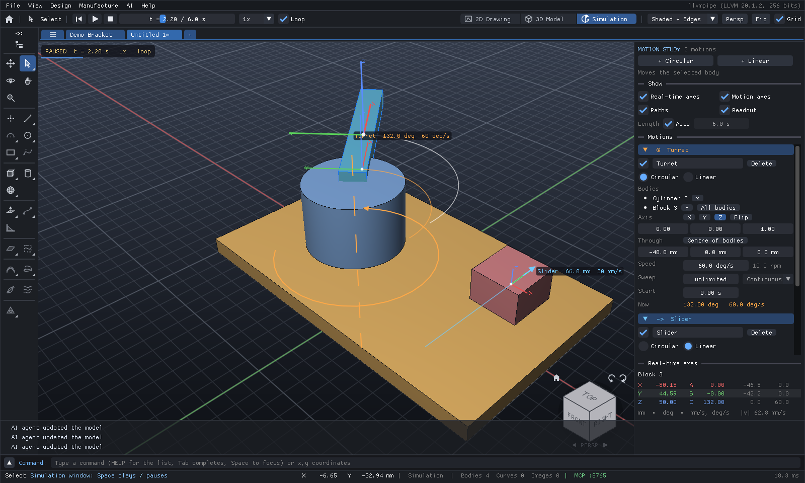

The third window, **Simulation** (top bar, *View → Simulation Window* or `Shift + Tab`), plays motions
of the 3D model without changing it — Stop puts every body back where it was modelled.

- **Circular motion:** rotation about an axis (X / Y / Z or any direction) through a point, in deg/s
  (or rpm). The axis point defaults to the centre of the moved bodies, so a wheel spins about its hub;
  *Each body about its own centre* (`EACH`) lets one motion spin all the wheels of a vehicle.
- **Linear motion:** travel along a direction in mm/s.
- **Rolling drive:** a linear motion can *roll with* a circular one (`FOLLOW`): travel = wheel angle × radius
  (default: the wheel's size), so the wheels drive the vehicle — stop or reverse them and it stops or backs up.
- **Range & mode:** an optional sweep (deg) or stroke (mm) with Continuous, Loop, Oscillate (back and
  forth) or Once; a start delay; negative speeds reverse. Each motion can be switched on and off.
- **Keyframes & hard stops:** a motion can follow keyframes (`KEYS t:v,...`), moving from key to key on
  a minimum-jerk path (smooth start and stop, the way people and tuned servos move), and can have hard
  stops (`LIMITS lo hi`) it never passes, even when it follows another motion.
- **Chained motions:** a body in several motions gets them in list order, the first outermost — e.g. a
  linear *Drive* on all bodies listed before a circular *Wheel spin* on the wheels carries the spinning
  wheels along.
- **Playback** (options bar): rewind, play / pause (`Space`), stop, a timeline to scrub (`←` / `→` step
  1/30 s, `Home` rewinds), speed 0.1×–10× and loop. The length follows the motions or is set by hand.
- **Real-time axes:** live X / Y / Z triads on the moving parts and the selection, the rotation axes
  with a turning arrow and travel arrows with live values, optional paths, and a digital readout of
  the selected body — position X Y Z, rotation A B C and their velocities.
- **Motion Study panel** (right): add motions for the selected body (or all), edit every parameter
  live, add / remove bodies.

Motions are saved in the project. On the command line:

```text
MOTION LINEAR Drive DIR X SPEED 20 STROKE 200 OSC BODIES ALL
MOTION CIRCLE "Wheel spin" AXIS Y RPM 30 EACH BODIES "Wheel 1" "Wheel 2" "Wheel 3"
MOTION LINEAR Drive FOLLOW "Wheel spin"        # the body rolls with the wheels (RADIUS r to override)
MOTION CIRCLE Turntable AXIS Z AT 0,0,0 SPEED -45 RANGE 90 ONCE START 2
MOTION CIRCLE Arm KEYS 0:0,1.5:90,2:90,3.5:0 LIMITS -10 95 BODIES Arm   # keyframed, with hard stops
MOTION   MOTION OFF Drive   MOTION DELETE Drive
SIM PLAY   SIM PAUSE   SIM STOP   SIM TIME 2.5   SIM SPEED 2   SIM DURATION 12   SIM AXES OFF   SIM AT 3
```

`SIM AT t` (also headless) reports every motion value and moving body position at time t.

## Physics environment

The Simulation can also move bodies by **forces**. Give bodies mass, velocity, charge and temperature,
and give the world gravity (uniform, or Newton's between all masses), a floor, air, E and B fields, and
optionally special relativity. The engine then covers kinematics, Newton's laws, momentum-conserving
collisions, work and energy with a live conservation check, Coulomb and Lorentz forces, wave sources
with Doppler-shifted wavefronts, heat (impacts, friction, conduction, cooling), relativistic motion
(γ, proper time, length contraction) and quantum readouts (de Broglie wavelength).

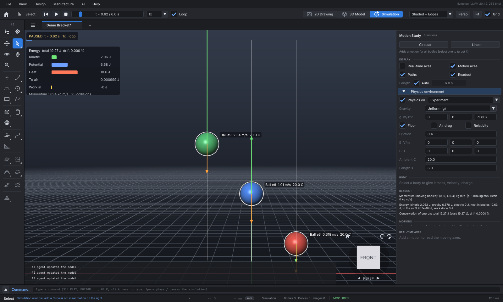

```text
PHYSICS DEMO drop | projectile | collision | orbit | charges | cyclotron | heat | doppler | relativity
PHYSICS BODY "Ball 1" VELOCITY 2m,0,1m BOUNCE 0.8 CHARGE 1e-6 TEMP 60     PHYSICS GRAVITY NEWTON
PHYSICS FIELD B 0,0,1    PHYSICS AIR ON    PHYSICS RELATIVITY ON C 2    PHYSICS AT 1.5
```

In the app: *Motion Study → Physics environment*. The 3D view shows velocity and force arrows,
temperature halos, trails, field arrows, wavefronts and an energy-balance panel. Details:
[docs/physics.md](docs/physics.md).

## Digital sculpting and cuts

Two sections at the bottom of the tool rail turn any body into digital clay and cut it like a CAD solid.

- **Digital Sculpting:** 17 brushes: Draw, Clay, Clay Strips, Layer, Carve, Inflate, Blob, Grab, Snake
  Hook, Nudge, Pinch, Crease, Smooth, Flatten, Scrape, Fill and Mask. Drag over a body; Ctrl inverts,
  Shift smooths, `[` `]` resize. There are falloff curves, X / Y / Z and radial symmetry, and masking.
  The mesh refines itself under the brush (dynamic topology). Also: voxel remesh, Loop subdivision,
  symmetrize, decimate, undo and redo.
- **Cuts & Booleans:** Drill Hole (through, or blind with a drill point), Pocket (box, round, ball end),
  Channel (drag a groove), Knife / Trim (drag a line: the smaller side goes, the cut is capped),
  Add Volume (boss, pad, dome), and exact Union / Subtract / Intersect of two bodies.

Booleans are exact, and the results stay closed meshes, ready for STL / OBJ export to slicers and CAM.

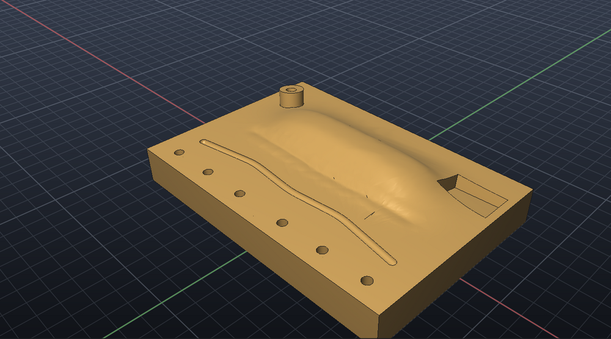

```text
SCULPT "Plate" CLAY AT -40,0,20 40,0,20 RADIUS 15 SYMMETRY      HOLE "Plate" AT 30,-40,20 DIAMETER 5
POCKET AT 60,30,20 BOX WIDTH 18 LENGTH 28 DEPTH 5                 CHANNEL PATH -60,-30,20 60,-30,20 WIDTH 4
TRIM PLANE 0,0,5 NORMAL 0,0,-1      BOSS AT -60,30,20 DIAMETER 14 HEIGHT 9      BOOLEAN A SUBTRACT B     UNDO
```

`REMESH` fuses bodies into one evenly meshed solid with filleted joins (like a DynaMesh), so forms
can be blocked out from stretched primitives and then sculpted. A whole head-and-shoulders bust is
sculpted this way by a 92-command script ([docs/examples/head-bust.txt](docs/examples/head-bust.txt)):
`RUN docs/examples/head-bust.txt`.

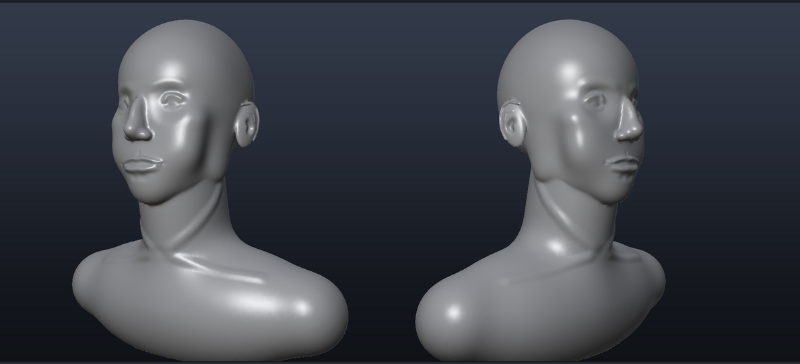

Details: [docs/sculpting.md](docs/sculpting.md).

## Armour and exoskeletons

The **Armour & Exoskeleton** section of the tool rail turns sculpted or CAD shapes into wearable parts
over a human or robot base.

- **Shell / Hollow:** hollows a solid to a wall, or solidifies a surface. It can open one side, for a
  helmet or gauntlet.
- **Armour Offset:** a closed shell around a body part, with a clearance gap and a wall. It moves with
  the part.
- **Joint / Hinge:** a pin or ball joint with a limited swing.
- **Lighten (Lattice):** keeps a skin and fills the inside with a gyroid lattice.
- **Interference Check:** sweeps the motions and lists every pair of parts that collide or come too
  close.

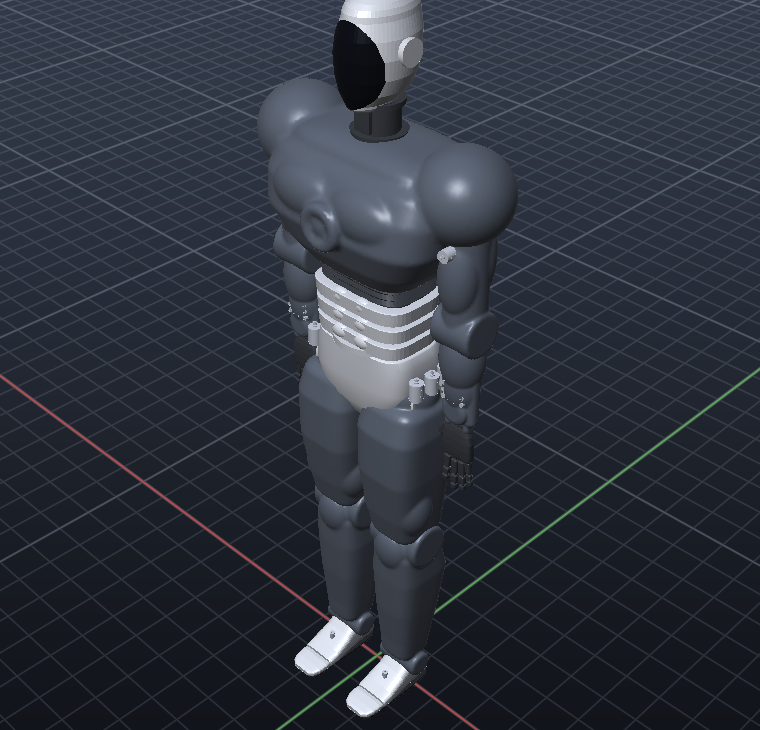

```text
ARMOR "Male Humanoid Robot 1" PART chest, motor right shoulder, motor left shoulder MERGE CLEARANCE 4 THICKNESS 4
ARMOR "Male Humanoid Robot 1" PART forearm      SHELL "Helmet" THICKNESS 3 OPEN 0,0,1600 NORMAL 0,0,-1
JOINT "Visor" TO "Helmet" AT 0,-120,1700 AXIS X RANGE 0 80      LIGHTEN "Back Plate" CELL 12      INTERFERENCE CLEARANCE 2
```

Details: [docs/armour.md](docs/armour.md).

## Part features (CAD)

The *Design* menu (or the command line) adds part features to sketches and solids:

- **Constraint sketcher:** coincident, horizontal, vertical, parallel, perpendicular, tangent,
  equal, concentric, on, midpoint and fix, plus driving dimensions. It counts the degrees of
  freedom left. Change a dimension and the part is rebuilt from the history.
- **Revolve, sweep and loft:** from closed sketch curves.
- **Pattern:** linear, in rows, or circular. The copies can be joined into a part or cut from it.
- **Mirror.**
- **Fillets and chamfers:** on chosen edges, by number, filter or point. They are exact,
  including inside corners, round rims and ball corners. Or use rolling-ball rounds of every edge.
- **Mass properties:** volume, mass, centre of mass and the inertia tensor.
- **Measure:** distances between points and between bodies.

Every model command goes into a **feature history**. Edit, insert or delete a step and the part
is rebuilt (`REGEN`), as in a parametric CAD system.

```text
REVOLVE "Profile" AXIS V        SWEEP "Circle 3" ALONG "Path"        LOFT "Base" "Neck" AT 40 SMOOTH
PATTERN "Boss" CIRCULAR 6 AXIS Z      PATTERN "Pin" LINEAR 3 SPACING 20 SUBTRACT "Plate"
MIRROR "Half" PLANE YZ UNION    FILLET "Housing" RADIUS 2 EDGES TOP      CHAMFER "Housing" DISTANCE 1 EDGES VERTICAL
CONSTRAIN TANGENT "Line 1" "Circle 2"      DIM "Polyline 1" SIDE 1 60      CONSTRAINT EDIT D1 80      MASSPROPS "Housing"
HISTORY      HISTORY EDIT 2 HOLE "Block 1" AT -20,0,15 DIAMETER 10 THROUGH      REGEN
```

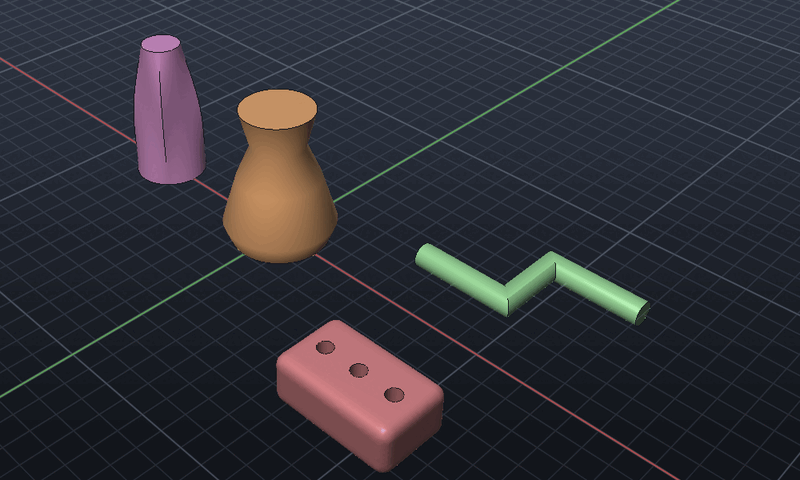

Details: [docs/cad.md](docs/cad.md).

## 3D printing

*Manufacture → 3D Print* (or the command line) gets a part ready for a printer.

- **Check Printability:** reports:
  - holes, non-manifold edges and inside-out faces;
  - overhangs that need support;
  - walls thinner than the nozzle can print;
  - whether the part fits the build volume;
  - grams, filament and time.
- **Repair Mesh:** welds seams, removes degenerate and duplicate faces, fixes the winding, turns
  inside-out shells the right way out, removes specks and fills holes.
- **Orient for Least Support:** turns the part so the least area needs support, then sets it on the bed.
- **Slice to G-code:** an FDM slicer with layers, walls, ±45° infill, solid top and bottom layers and
  retraction. It writes Marlin G-code with filament and time estimates.
- **Export 3MF:** the package that Fusion, Shapr3D, PrusaSlicer, Bambu Studio and Cura read.

```text
PRINTCHECK "Bracket" OVERHANG 45 WALL 0.8      REPAIR      ORIENT      EXPORT bracket.3mf
SLICE "Bracket" TO bracket.gcode LAYER 0.2 INFILL 20 WALLS 2 NOZZLE 210 BED 60
```

Details: [docs/printing.md](docs/printing.md).

## CNC milling (CAM)

*Manufacture* (or the `CAM` command) turns a part into G-code for a mill.

- **Setup and tools:** the stock, the work zero and the material. A tool library: flat, ball and
  bull-nose end mills, face mills, drills, spot drills and taps. Spindle speeds and feeds come
  from the material, with chip thinning at light stepovers.
- **Operations:**
  - facing;
  - 2D contour with lead arcs and tabs;
  - pocket, and 3D roughing (offset or zig-zag, ramped entries, stock to leave);
  - adaptive clearing: a light stepover, deep cuts, and trochoidal loops wherever the tool
    would be overloaded;
  - rest machining: a smaller tool clears only what the tools before it left;
  - 3+2 indexed versions of any operation (the table turned to A and C first);
  - 4-axis rotary wrapping (helical or along the axis, roughing in levels);
  - parallel and waterline finishing;
  - spot, peck, chip-break, tap and bore cycles at the holes found on the part;
  - helical boring.
- **Exact paths:** each path comes from an exact drop-cutter on the mesh. Walls sit at the tool
  radius and rounded corners come out as true arcs.
- **Simulation:** cuts the stock with each tool's shape. It reports stock left, gouges, rapid
  moves through stock, shank and holder collisions (with the stickout that would clear them)
  and cycle time, and shows the cut stock.
- **Post processors:** Fanuc, Haas, LinuxCNC and GRBL, with fitted arcs and canned cycles. For
  multi-axis jobs the posts add A and C words and inverse-time feed. Multi-axis jobs are
  simulated in voxels.
- **Machines and checked programs:** a machine definition (travel, work zero, A/C limits,
  tool pockets, spindle and feed limits, with presets). Every posted program is read back the
  way the control would run it and checked against the dialect, the machine and the toolpath
  before it is written. `CAM CHECK` does the same for any program. See
  [docs/cam.md](docs/cam.md#machines-and-program-checks).

```text
CAM SETUP "Bracket" STOCK 3 MATERIAL aluminium      CAM TOOL 1 FLAT 6      CAM TOOL 2 DRILL 6
CAM ROUGH ADAPTIVE LEAVE 0.3      CAM TOOL 3 FLAT 3 STICKOUT 15      CAM POCKET TOOL 3 REST      CAM CONTOUR TABS 4      CAM DRILL CYCLE PECK      CAM SIMULATE SHOW
CAM POST bracket.nc HAAS
```

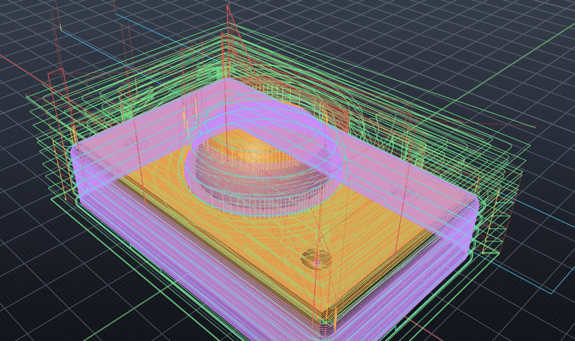

Details: [docs/cam.md](docs/cam.md).

## Library: motors and gears

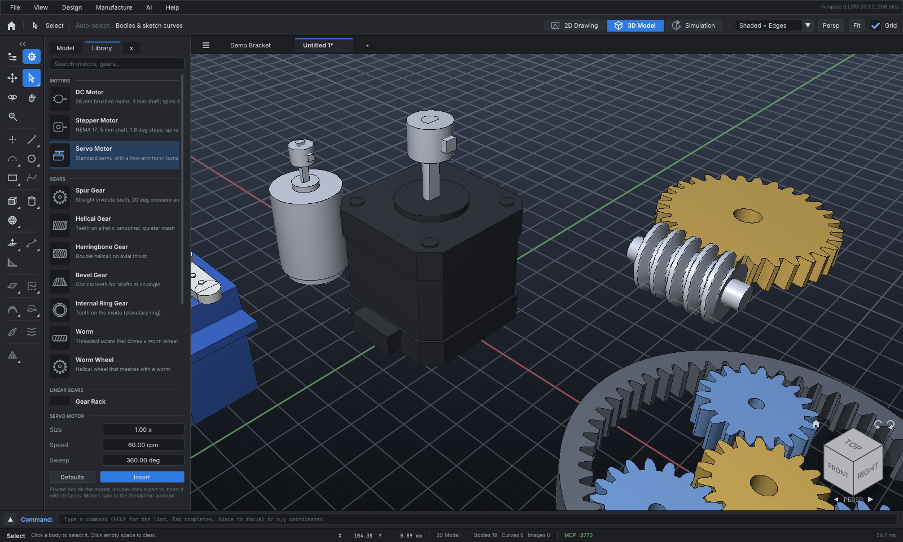

The gear button at the top of the tool rail (or `K`) opens the **Library** page of the docked panel:
search, pick a part, set its parameters and click **Insert** (or double-click a part). Parts are
parametric: they save as parameters and rebuild exactly when the project opens.

| Category | Parts |
| --- | --- |
| Motors | **DC motor** (28 mm can, 3 mm shaft), **Stepper motor** (NEMA 17, 1.8° steps), **Servo motor** (standard servo, two-arm horn), **Electric car motor (Foot)** (foot-mounted traction motor: ribbed end shield, terminal box, keyed hollow-end shaft), **Electric car motor (Flange)** (ribbed flange-mount EV motor, lifting eyes, splined shaft) |
| Gears | **Spur**, **Helical**, **Herringbone**, **Bevel**, **Internal ring**, **Worm**, **Worm wheel**: involute teeth, 20° pressure angle, module / teeth / face width / bore |
| Linear gears | **Gear rack** |
| Wheels & tyres | **Car wheel** (alloy rim, spokes, lug nuts, tyre), **Robot wheel**, **Caster wheel** (swivel plate, fork), **Omni wheel**, **Mecanum wheel**, **Tyre** (road / off-road / slick tread) |
| Chains & belts | **Sprocket** (ANSI 40 by default), **Steel roller chain** (plates, pins, rollers), **Chain drive**, **Pulley** (V-groove / timing GT2 / flat), **Rubber belt** (flat / V / timing), **Belt drive**, **O-ring / rubber band** |
| Gear trains | **Gear pair**, **Rack and pinion**, **Planetary set** (sun, 3 planets, carrier, ring), **Worm drive**: meshed, with linked motions |
| Robot arm & hand | **Robot arm** (shoulder pedestal with 3-DOF shoulder, upper arm, elbow, forearm rotation and the hand), **Robot hand** (palm, 4 fingers, opposable thumb, 2-DOF wrist; underactuated 6 motors or fully actuated 15), **Robot finger**, **Robot thumb**, **Finger link (phalanx)**, **Robot palm**, **Robot forearm**, **Upper arm link**, **Shoulder pedestal**: DC gear motors drive every joint within human-based limits, see [docs/robot-arm.md](docs/robot-arm.md) |
| Humanoid body | **Male humanoid robot** (ultra-muscular, 5.5 to 6 ft, default 5 ft 9 in) and **Female humanoid robot** (ultra-slim, 4.5 to 5.5 ft, default 5 ft): 20 body + 14 arm joints and two hands; real-size oval head with a full or half black glass face; armour or futuristic suit, gloves, shoes, helmet; range-of-motion, march-in-place or still demo, **Skeleton robot** (a human skeleton, bone for bone: skull, 24 vertebrae, 12 pairs of ribs, sternum, collarbones, shoulder blades, pelvis, arm, hand, leg and foot bones, on the same joints), **Robot head & neck**, **Robot upper body** (pelvis, gut, midriff, chest, heart), **Robot leg**, and the single **head**, **neck**, **chest**, **heart (power core)**, **gut (abdomen)**, **midriff**, **pelvis (low hip)**, **thigh**, **shin**, **foot**: every joint on a DC gear motor within human range of motion, see [docs/humanoid-body.md](docs/humanoid-body.md) |

- **Motors** are two bodies, a fixed housing and a rotor (shaft with coupler, or servo horn), and come
  with a **360° circular motion** on the rotor (speed in rpm, Loop 0–360°). Steppers move in 1.8°
  steps; a servo with a sweep under 360° swings back and forth.
- **Wheels** stand on the ground with the axle along Y and spin (rpm, 0 = no motion) so that positive
  speeds roll toward +X; omni and mecanum rollers follow the rolling circle exactly. **Chain and belt
  drives** turn the driven sprocket / pulley at the right ratio (same direction), and the **chain or
  belt travels along its loop** with the driver (travel = driver angle × pitch radius): links, rollers
  and timing teeth run round the sprockets / pulleys; smooth belts carry printed marks so their motion
  shows. Any linear motion can do this for a chain or belt body with *Travel along the chain / belt
  loop* in the Motion Study panel, or `MOTION LINEAR name PATH FOLLOW driver RADIUS r BODIES belt`.
- **Electric car motors** lie on their side: the shaft and the 360° drive run along +X at the shaft
  height (170 / 120 mm at size 1). Shaft end: plain or with a flange coupling (foot motor), splined
  or plain (flange motor).
- **Shafts:** DC, stepper and electric car motors have *Shafts* (None / Single / Dual), *Shaft length*, *Rear shaft*
  length (dual), *Shaft diameter* and *Shaft end* (plain or with a coupler). Servos choose a *Horn*
  (single arm, double arm, cross, disc). Set them before inserting, or afterwards: select the motor and
  edit *Properties → Shaft* (live), or `PARAM "Stepper Motor 1" SHAFTS DUAL REAR_LENGTH 20`. Gears and
  racks are editable the same way (teeth, module, width, bore...).
- **Scalable:** every motor (and any body) has a **Size** factor, set in the Library before inserting,
  or afterwards in *Properties → Scale* or with `SCALE`. A component scales as a whole: its bodies,
  their spacing and its motions.
- **Gear trains** drive each other: a circular motion can be *Driven by* another one at a ratio
  (−z₁/z₂ for an external mesh), chained as far as you like (motor → gear → gear); a linear motion rolls
  with a circular one (rack = pinion angle × pitch radius). Set it in the Motion Study panel or with
  `MOTION ... FOLLOW name RATIO r`.

- **Robot arm and hand** joints (shoulder ×3, elbow, forearm rotation, wrist, MCP, PIP, DIP, thumb CMC / MCP / IP) each follow a library DC motor at
  `1 / GEAR` and stop at their mechanical limit (MCP 90°, PIP 100°, DIP 80° by default); any joint
  can be re-wired to your own motor with `MOTION ... FOLLOW`. Anatomy mapping, limits and wiring:
  [docs/robot-arm.md](docs/robot-arm.md).
- **Humanoid body** joints (neck ×3, waist, trunk ×2, hip ×3, knee, ankle ×2, toe; shoulders ×3 on the
  chest) work the same way, within human range of motion; the Male and Female Humanoid Robots put it all together, head
  to toe, at standard heights, with optional armour or futuristic suits, gloves, shoes and helmets. Anatomy mapping, limits and demos: [docs/humanoid-body.md](docs/humanoid-body.md).
- **Standard range of motion:** every robot joint moves both ways between hard stops from the human
  standard (AAOS): e.g. hip −30° … 120°, ankle −20° (dorsiflexion) … 50°, neck rotation ±80°, finger MCP
  −30° … 110°.
- **Postures and gestures:** `POSE` and `GESTURE` (or *Motion Study → Robot pose*) move any library robot
  into presets (stand, squat, T-pose, salute, fist, OK...) or exact joint angles, and play gestures (wave,
  nod, point, count, march, and `walk`: a real gait cycle from normative human kinematics that travels
forward without the stance foot slipping). Moves are clamped to the hard stops, use minimum-jerk paths within the
  motors' rated speed, and keep a humanoid's feet flat on the floor all along the move:
  [postures and gestures](docs/humanoid-body.md#postures-and-gestures).

```text
PART                              (lists the library)
PART DCMOTOR SIZE 1.5 RPM 60      PART STEPPER @100,0,0 RPM 30 STEP 1.8      PART SERVO NAME Pan SWEEP 180
PART STEPPER SHAFTS DUAL SHAFT_LENGTH 30 REAR_LENGTH 20 SHAFT_DIA 8 FITTING PLAIN      PART SERVO HORN DISC
PART CARWHEEL DIAMETER 650 RIM_DIA 432 SPOKES 5      PART TYRE TREAD OFF-ROAD      PART MECANUM DIAMETER 100
PART CHAINDRIVE TEETH1 12 TEETH2 36 CENTER 250      PART BELTDRIVE TYPE TIMING DIA1 40 DIA2 80      PART ORING INNER_DIA 30
PART EVMOTOR SIZE 0.8 SHAFT_LENGTH 150      PART EVFLANGE SHAFTS DUAL FITTING SPLINED      PARAM "DC Motor 1" SHAFTS NONE      PARAM "Spur Gear 1" TEETH 32      PARAM "Stepper Motor 1"   (lists them)
PART SPUR MODULE 2 TEETH 24 WIDTH 10 BORE 4      PART HELICAL TEETH 30 HELIX 20      PART RACK TEETH 40
PART GEARPAIR TEETH1 16 TEETH2 48      PART PLANETARY SUN_TEETH 18 PLANET_TEETH 18      PART WORMDRIVE
SCALE "DC Motor 1" 2      SCALE "Gear Pair 1 Driver" TO 1
MOTION CIRCLE Output FOLLOW "DC Motor 1 Drive" RATIO -0.25 BODIES "Spur Gear 1"
PART HUMANOID DEMO STILL    POSE squat    POSE stand IN 2    POSE right elbow 90 neck yaw -30    GESTURE wave
```

## Tools (left rail)

Photoshop-style tool rail. `<<` / `>>` switches between two columns and one.
The tree button at the top of the rail (or `M`) shows the **Model panel**, docked beside the rail (its
*Library* page holds motors and gears, see above):
bodies, sketches and properties of the selection. It is hidden by default; drag its right edge to resize.
Slots with a small corner triangle hold several tools: right-click or hold to open the flyout.

- **Navigate & select:** Move (V), Select (S), Orbit (O), Pan (H), Zoom (Z)
- **2D sketch:** Point, Line (L), Polyline, Rectangle (R), Circle (C) on the active plane, in either
  window. Grid and endpoint snapping, Shift locks horizontal / vertical, live dimensions,
  Enter / double-click finishes a polyline, Esc cancels.
- **3D solids:** Block (B), Wedge, Pyramid, Prism, Cylinder (Y), Cone, Sphere, Torus.
  Pick one and click the grid or a face to place it.
- **Extrude (E):** turns a closed sketch profile (rectangle, circle or closed polyline, concave shapes
  included) into a solid along its plane's normal. Click the profile (its outline or anywhere inside),
  drag to set the depth with a live preview — or type it in the options bar or command line — then
  click or press Enter. Options: symmetric (both sides of the plane), keep sketch visible. Negative
  depths go the other way. The profile is hidden after extruding (show it again in the Model panel).
  Extrusions are parametric: they save and reopen as features.
- **Planned:** the remaining 2D tools, other form features (revolve, sweep, loft…), surfaces, Class-A, generative and mesh tools
  are in the rail with descriptions and will be enabled in later milestones.

Shift + a tool key cycles through that slot's tools.

## Units

Lengths can be typed and shown in **mm, cm, m, in, ft or pt** (the DTP / PostScript point, 1/72 in).
The model itself is always stored in millimetres, so changing units never changes the geometry.

- **Exact factors.** 1 in = 25.4 mm and 1 ft = 304.8 mm (international inch), 1 pt = 127/360 mm.
  They are held as fractions, and everything you type is evaluated as an exact fraction, then
  rounded once: `0.1mm+0.2mm` is exactly 0.3 mm, and `1/3in+2/3in` is exactly 25.4 mm.
- **Type any length, anywhere** (command line, typed sketch input, every length field in the panels):

  ```text
  12.5        bare numbers use the document unit
  12.5mm  1.2cm  0.5m  3in  3"  2ft  2'  10pt  1.5e3mm
  1/8in  3-1/2"  5'6"  5'-6 1/2"  5ft 6in      (a bare number after feet is inches)
  1m+25mm  2ft - 1cm                            (explicit + / - mixes units)
  BOX 2in 30mm 1/2"      CIRCLE 0,0 3/4"      LINE 0,0 5'6-1/2",0      MOVE 1in,0,0
  ```

- **Display** in decimals (0-10 places, or each unit's default) or, for inches and feet, as
  fractions down to 1/256 in: `3-1/2"`, `5'-6 1/2"`. What is shown parses back to the same length.
- **Where to set it:** the units chip in the status bar (next to the cursor coordinates), *View ▸
  Units*, or the command line:

  ```text
  UNITS                          show the current units and resolution
  UNITS IN | MM | CM | M | FT | PT
  UNITS PRECISION 4 | AUTO       decimals
  UNITS FT FRACTION 1/16         feet-inches to 1/16 in      (FRACTION OFF: decimal)
  CONVERT 5'6-1/2" TO mm         1689.1 mm   (without TO: every unit)
  ```

The units are saved with each project (each file tab has its own), and the status bar, rulers,
Properties, Motion Study, live sketch dimensions and command messages all follow them. The MCP tools
for AI agents keep taking and returning millimetres; `run_command` reads bare numbers in the
document's units, and `get_scene` reports them under `project.display_units`.

Bodies and sketches are stored as 32-bit floats in millimetres: about 7 significant digits, roughly
0.1 µm on a 1 m part. Unit conversion and typed input are exact up to that final storage step.

## Command line

The full-width command line above the status bar runs every operation by typing, AutoCAD style.
`Space` focuses it, `Tab` completes a command name, `↑` / `↓` recall earlier input, and the ▲ button
shows the history. Type `HELP` for the full list.

```text
LINE 0,0 @50,0 @0,30          RECT 0,0 @40,20          CIRCLE 10,10 5        PLINE 0,0 10,0 10,10 CLOSE
BOX 40 30 20 @10,0,5          CYLINDER 10 30           SPHERE 8              TORUS 20 4
EXTRUDE 15                    EXTRUDE "Circle 2" 20 SYMMETRIC KEEP
SELECT Block 1   MOVE 0,0,10   ERASE        VIEW FRONT   2D RIGHT   3D   ROLL 90   DISPLAY HIDDEN
IMPORT "plans/scan.jpg" WIDTH 150 @0,0      EXPORT part.stl      SAVE project.sicdm      OPEN project.sicdm
RUN docs/examples/head-bust.txt               (a script: one command a line, # comments)
```

With a sketch tool active, typed coordinates place points exactly: `x,y`, `@dx,dy` (relative) or
`@length<angle` (polar); for a circle, a single number is the radius; `Enter` finishes a polyline.

## Files

| Menu (shortcut) | Formats |
| --- | --- |
| **New / Open / Save / Save As** (Ctrl/⌘ N, O, S, Shift+S) | `.sicdm` project (JSON): parametric solids, meshes, sketches, reference images |
| **Import** (Ctrl/⌘ I) | `.step` `.stp` → exact solids (assemblies placed, units converted) · `.igs` `.iges` → exact solids (trimmed surfaces sewn) or surfaces · `.stl` `.obj` → body · `.dxf` → sketch curves on the active plane · `.png .jpg .bmp .tga .gif .psd .hdr .pnm` → reference image |
| **Export** (Ctrl/⌘ E) | `.step` (AP214: exact B-reps, other meshes as planar faces) · `.igs` (IGES 5.3 trimmed surfaces) · `.stl` `.obj` `.3mf` (visible bodies) · `.dxf` `.svg` (sketch curves of the active plane) |

**STEP and IGES:** imports keep their exact geometry (planes, cylinders, cones, spheres, tori, NURBS),
tessellated watertight for display and written back unchanged. IGES trimmed surfaces are sewn into
solids. Primitives, extrusions and revolves export exactly too. Details: [docs/step.md](docs/step.md).

Unsaved changes are tracked (`*` in the tab and title); closing a tab or quitting asks before discarding them.

**Safe saving and recovery:**

- **Saves can't half-write.** Every file is written to a temporary file beside it, flushed to
  the disk, then renamed over the old one. A crash or a full disk during a save leaves the
  old file whole.
- **Autosave.** While a file has unsaved changes, a copy of it is kept in the recovery
  folder, written once the changes are a minute old. The copy goes when you save, close the
  file, or quit normally.
- **Recovery.** If SI CDM ends without closing (a crash, a power cut, a killed process), the
  next start offers the kept work back. Restored files open in their own tabs, still
  unsaved, and Save puts them back where they came from. Any time, `RECOVER` lists what is
  kept, `RECOVER n` reopens one, and `RECOVER DISCARD n` (or `ALL`) deletes them.
- **Recovery folder:** `~/.local/state/sicdm/recovery` on Linux,
  `~/Library/Application Support/SI-CDM/Recovery` on macOS, and
  `%LOCALAPPDATA%\SI-CDM\Recovery` on Windows. Set `SICDM_RECOVERY_DIR` to use another.
- **File versions.** Projects record their format version and the oldest format a reader
  needs. A project from a newer SI CDM opens when it only adds things, with a note on what
  was left out. A project that needs a newer reader is refused, with a message saying to
  update.

**Reference images** (scanned drawings, photos, blueprints) lie on the active sketch plane and show in
both windows: under the sketch in 2D for tracing, in place in 3D. Select one to set its width (mm),
centre and opacity in the Model panel, or drag it with the Move tool.

## AI agents (MCP)

SI CDM includes a [Model Context Protocol](https://modelcontextprotocol.io) server so AI agents can read
and edit the 2D and 3D model and its motion. Tools: `get_scene`, `create_sketch`, `create_solid`, `extrude`, `modify`, `delete`,
`create_motion`, `delete_motion`, `simulate` (play / pause / seek, or body poses at a time — headless too),
`insert_part`, `list_parts` (library motors, gears and gear trains; `modify` takes a `scale`),
`set_pose`, `play_gesture` (robot postures and gestures), `set_physics`, `physics_report` (physics environment),
`sculpt` (brushes, cuts, booleans), `armor` (shell, armour, joints, lattice, interference),
`print` (printability check, repair, orient, slice to G-code, 3MF),
`cam` (CNC milling: setup, tools, operations, simulation, G-code post),
`cad` (sketch constraints and dimensions, revolve, sweep, loft, pattern, mirror, edge fillets and chamfers, mass properties, measure, feature history),
`set_view`, `run_command`, `list_commands`, `new_project`, `open_project`, `save_project`,
`import_file`, `export_file`.

- **Live app (HTTP):** enable *AI → MCP Server* or start with `--mcp-port 8765`, then
  `claude mcp add --transport http si-cdm http://127.0.0.1:8765/mcp`. The agent drives the open
  window (views, 2D / 3D / Simulation switch and file tabs included: `run_command` with `FILES`, `CLOSE`). Listens on localhost only.
- **Headless (stdio):** `sicdm-mcp [project.sicdm]` works on files without a window:
  `claude mcp add si-cdm-files -- /path/to/build/release/sicdm-mcp`.

*AI → Connect an AI Agent…* shows ready-to-copy settings.

## Controls

- `Tab`: switch 2D Drawing / 3D Model window; `Shift + Tab`: Simulation window
- Simulation: `Space` play / pause, `←` / `→` step, `Home` rewind
- `Ctrl + Tab` / `Ctrl + Shift + Tab`: next / previous file tab; `Ctrl/⌘ W`: close the file tab
- `Space`: command line
- Right drag (or left drag on empty space): orbit in 3D, pan in 2D
- Middle drag / Shift + left drag: pan
- Scroll: zoom at the cursor
- Delete: remove the selected body, sketch curve or image
- `F`: fit to view
- `1` / `3` / `7` / `0`: Front / Right / Top / Isometric (in 2D: pick the drawing plane)
