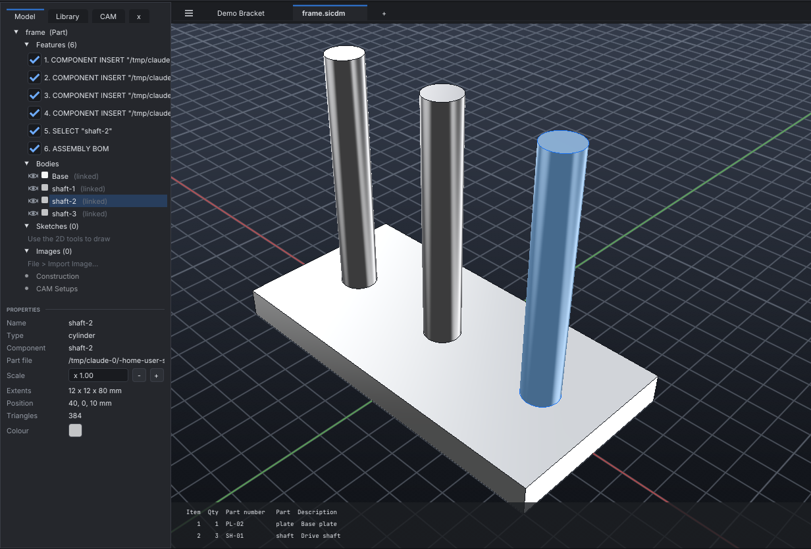
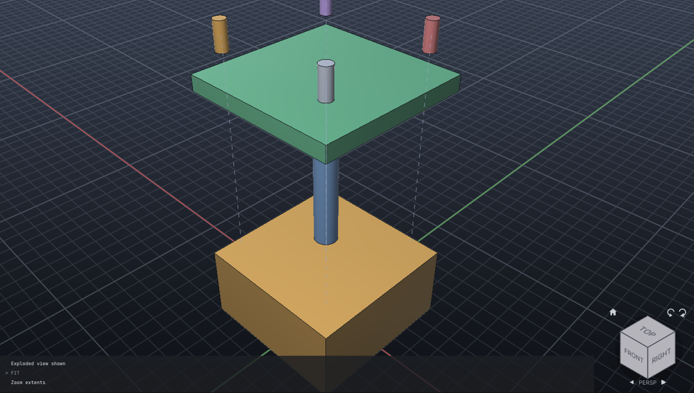

# Assemblies

SI-CDM puts parts together the way a fitter does:

- **Mates** set one face against another. A pin goes into its hole, a cover sits on its
  housing, and the solver moves the parts into place.
- **The assembly tree** groups the parts into sub-assemblies. STEP files keep the tree,
  both when they are read and when they are written.
- **The interference check** finds where parts overlap and by how much.
- **The parts list** counts each part.
- **Part files**: a part, or a whole sub-assembly, kept in a file of its own and linked
  into any number of assemblies. Change the part file and every assembly that uses it
  updates.

```text
MATE CONCENTRIC "Plate" AT 19,0,5 "Pin" AT 115,50,24     the pin's axis on the hole's
MATE FLUSH "Plate" AT 0,0,0 "Pin" AT 15,0,-3            its end level with the plate's underside
ASSEMBLY GROUP "Base" "Plate" "Pin"
ASSEMBLY INTERFERENCE
EXPORT base.step
```

In the app, use the **Assembly** menu:

- Choose a mate type.
- Click a face on the part that stays.
- Click a face on the part to move.

The Model panel shows the sub-assemblies as folders, and a **Mates** list. Right-click a mate
to suppress, flip or delete it. A mate that isn't met shows in red.

## Assemblies of part files



Each part can be a project file of its own (`shaft.sicdm`, `plate.sicdm`). An assembly links
them in as **components**:

```text
COMPONENT INSERT shaft AT 40,0,10                    shaft.sicdm, as "shaft-1"
COMPONENT INSERT shaft AS Spindle AT 0,0,10 ROTATE 0,90,0
COMPONENT INSERT gearbox.sicdm AT 0,200,0            a sub-assembly file: all its parts
COMPONENT LIST                                       each instance, its file, up to date or changed
COMPONENT RELOAD                                     bring in parts whose files changed
COMPONENT OPEN shaft-1                               edit the part file itself
COMPONENT REPLACE shaft-1 shaft-long                 another file, in the same place
COMPONENT MOVE shaft-1 0,0,5                         move or turn an instance as one
COMPONENT ROTATE shaft-1 0,0,90 ABOUT 0,0,0
COMPONENT MAKE Bracket FILE bracket FROM "Block 3"   turn bodies of this assembly into a part file, linked in place
COMPONENT BREAK shaft-1                              stop linking: the bodies become this project's own
COMPONENT PACK delivery                              the assembly and every file it uses, copied into one folder
```

In the app, these are at the top of the **Assembly** menu (Insert Component..., Make a Part
File from the Selection..., Open the Component's File, Reload Components, Pack and Go...). Linked
bodies are marked *(linked)* in the Model panel, and their properties show the part file.

How it behaves:

- **Updates.** A part file can be saved from another tab, by a colleague, or checked in from
  the [vault](pdm.md). The assembly updates by itself within two seconds when it is open, or as
  soon as it is opened. Each instance keeps the place, turn and mates it has in the assembly, and
  only the shape comes from the file. If a linked body was reshaped in the assembly, the file's
  shape replaces it, and the update says so. `UNDO` takes an update back.
- **Reuse.** The same file can be inserted any number of times. The parts list counts the
  instances of each file as one part. It shows the part number and description saved in the
  part file (`PROPERTY NUMBER ...` there).
- **One part, one unit.** An instance moves as one, even when its file holds several bodies,
  which are then named `instance:body`. The mate solver treats it the same way.
- **Paths.** Files are kept relative to the assembly when it is saved, so a folder of parts
  and its assemblies can be moved or zipped together. `COMPONENT PACK` gathers files from
  elsewhere into one folder and points the copies at each other.
- **Missing files.** `COMPONENT LIST` marks a file that is gone as *missing*. Its bodies keep
  the last shape that was loaded, so nothing disappears.
- **No loops.** An assembly can't contain itself, directly or through one of its parts.

## Mates

```text
MATE type [value] "A" AT x,y,z "B" AT x,y,z [FLIP]
```

**How faces are picked:**

- A face is picked by a point on it, in mm in world coordinates (what a click in the 3D window
  gives).
- `B` moves to meet `A`.

**What a face gives the mate:**

| Face | Gives |
| --- | --- |
| Flat | A **plane**: a point on it and its outward normal |
| Round: cylinder, cone, torus, revolved | Its **axis** |
| Sphere | Its **centre** point |

**Exact solids** (primitives, extrusions, revolves, STEP and IGES imports) give their faces'
true geometry.

**Meshes** (after a hole, a boolean or a sculpt) use the smooth patch under the point:

- If its normals all point the same way, it is a plane.
- If they all lie square to one direction and the points lie on a circle about it, it is a
  round face. For example, a drilled hole gives its axis.

| Type | Takes | Meets when |
| --- | --- | --- |
| `COINCIDENT` | planes, axes, points | Planes face each other and touch. Axes line up. A point lies on the plane or axis, or on the other point |
| `FLUSH` | planes | The planes are level and face the same way |
| `CONCENTRIC` | axes (or an axis and a sphere) | The axes line up (either way round) |
| `DISTANCE mm` | planes, axes, points | Facing planes this far apart (`FLUSH`-style with `FLIP`); axes or points this far apart |
| `ANGLE deg` | planes, axes | The normals or axes are at this angle |
| `PARALLEL` | planes, axes | The normals or axes are parallel |
| `PERPENDICULAR` | planes, axes | The normals or axes are square to each other |
| `FIX` | a part | The part holds still |

| Command | What it does |
| --- | --- |
| `MATE` | Lists the mates, each met or how far off |
| `MATE FIX "part"` | Holds a part still |
| `MATE EDIT n value` | A new distance or angle |
| `MATE FLIP n` | Planes facing each other become flush, or the other way round |
| `MATE SUPPRESS n` · `UNSUPPRESS n` | Leaves a mate out of the solve, or puts it back |
| `MATE DELETE n` · `MATE CLEAR` | Removes mates. The parts stay where they are |
| `MATE SOLVE` | Places the parts again (after you moved one by hand, say) |

Mates are named M1, M2, and so on. Commands take a mate's name or its number.

### Solving

The solver moves the free parts as little as it can to meet every mate.

- **Parts that hold still:**
  - Parts with `MATE FIX` stay where they are.
  - When none is fixed, the first part mated stays.
  - A part mated earlier moves less readily than one mated later. Mating a new part to an
    assembly moves the new part, not the assembly.
- **Parts that move together:**
  - The bodies of a library component move as one.
  - Bodies attached to a part (its armour, its pins) move with it.

After each solve, the command says:

- which parts moved;
- how many **degrees of freedom** the mates leave. A pin in a hole has 2: it can slide and
  spin. Seated on a face, it has 1. "Fully placed" means 0.
- which mates **can't be met** together.

A new mate that conflicts with the mates already there is refused, and nothing moves.

Mates are saved in the project file. The feature history records `MATE` commands, so REGEN
rebuilds the parts and puts the mates back.

## The assembly tree

```text
ASSEMBLY                                  the tree: sub-assemblies in [ ], parts under them
ASSEMBLY GROUP "Gearbox/Input" "Shaft" "Gear 1"
ASSEMBLY UNGROUP "Gear 1"                 back to the top level
```

**Paths:** a part's sub-assembly is a path. `a/b` is a sub-assembly `b` inside `a`.

**STEP files:**

- **Writing:** STEP export writes each sub-assembly as an assembly product, with the parts placed
  in it (`NEXT_ASSEMBLY_USAGE_OCCURRENCE`). Other CAD systems open it with the same tree.
- **Reading:** STEP import reads the tree of an assembly file. Each part lands in the
  sub-assembly path of its instance.

## Interference

```text
ASSEMBLY INTERFERENCE [part...]
```

**Which parts:** the named parts, or every visible one.

**What it reports for each pair that overlaps:**

- the volume they share (mm³);
- where that volume is;
- the size of its box.

The largest overlaps come first.

**What counts:** parts that only touch, such as a block standing on another or faces held
together by a mate, are not reported. The check counts overlaps of 0.001 mm³ or more, and of
at least a ten-thousandth of the smaller part.

## Parts list

`ASSEMBLY BOM` counts the parts. Copies count as the same part: "Bolt", "Bolt 2" and
"Bolt (3)" are one part, quantity 3. So are bodies with the same part number
(`PROPERTY "Bolt 1" NUMBER B-6`), and the instances of one linked part file. Any of a part's
bodies can give its description and material. On a drawing, the parts list shows the drawn
parts in a table above the title block ([Drawings](drawing.md#assembly-drawings)).

## Exploded views



An exploded view shows how an assembly goes together: the parts drawn apart, each along a
line from where it sits. It is a way of *showing* the assembly. The parts stay where they are,
mates and measurements are unchanged, and tools that pick a part work on it where it really is.

```text
EXPLODE AUTO                                  stack the parts apart, up along Z
EXPLODE AUTO ALONG X FACTOR 1.5               along X, wider gaps
EXPLODE AUTO RADIAL                           out from the middle
EXPLODE AUTO "Gearbox"                        only the parts of a sub-assembly
EXPLODE ADD "Cover" ALONG Z DISTANCE 60       a step by hand
EXPLODE ADD shaft-1 "Bearing 2" DIR 1,1,0 DISTANCE 40
EXPLODE                                       list the steps
EXPLODE EDIT 2 DISTANCE 80                    change a step (or its ALONG / DIR)
EXPLODE DELETE 2 | CLEAR
EXPLODE SHOW | HIDE                           exploded or together in the 3D window
EXPLODE TRAILS OFF                            without the trail lines
```

A step moves its parts a distance along a direction. Its parts can be bodies, component
instances (all of the instance's bodies) or sub-assemblies (`Gearbox` or `Gearbox/Input`).
Parts attached to a part go with it. The steps run one after another: a later step starts from
where the earlier ones left its parts. In the 3D window they play in that order when the view
explodes or collapses.

`EXPLODE AUTO` takes the assembly apart along an axis. The largest part stays put. The others
go to the side of it their middles are on, and each moves until it clears, by a gap, every
part between it and the largest one that lies in its way. Parts side by side, like the screws
of a cover, move together. `FACTOR` scales the gaps. `RADIAL` instead moves each part away
from the middle of the assembly, as far again as it is from it. AUTO replaces any steps there
were. They are ordinary steps afterwards, so you can edit or delete them.

In the app, **Assembly > Explode** has the automatic ways and a quick way to move the
selected part out along an axis. It also has *Show Exploded*, *Trail Lines* and *Remove the
Exploded View*. **Fit** frames the exploded parts.

The exploded view is saved with the project and taken back by UNDO. REGEN keeps it. A
released revision keeps its exploded view: it can be shown and hidden but not changed. Drawings
show it in exploded views ([Drawings](drawing.md#assembly-drawings)).

## For AI agents

The MCP tool `assembly` does all of this. Its operations are:

- `mate` (with `type`, `part`, `at`, `moving`, `moving_at`, `value` and `flip`);
- `fix`, `list` and `solve`;
- `edit`, `flip`, `suppress`, `unsuppress`, `delete` and `clear`;
- `tree`, `group` and `ungroup`;
- `interference` and `bom`.

The MCP tool `component` handles part files: `insert`, `list`, `reload`, `replace`, `make`,
`break`, `move`, `rotate` and `pack`.

The MCP tool `explode` makes exploded views: `auto` (with `along` and `factor`), `add` (with
`parts`, `along` or `direction`, and `distance`), `edit`, `delete`, `clear`, `show`, `hide`,
`trails` and `list`.
