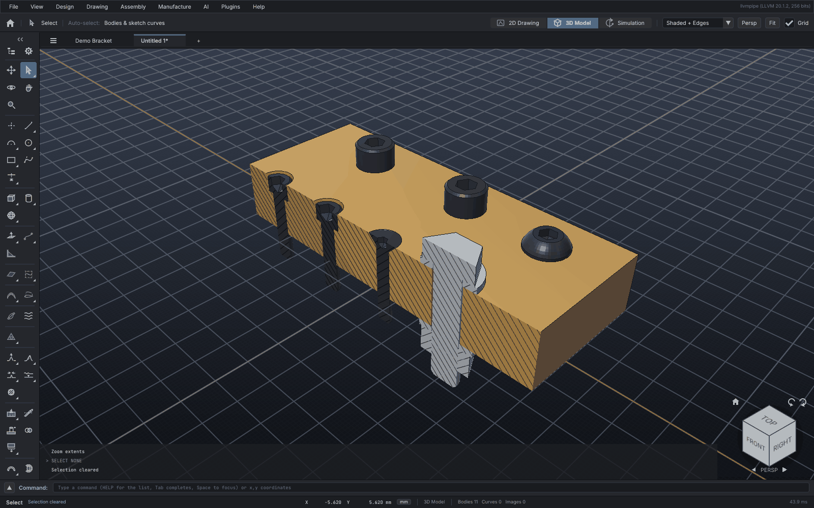
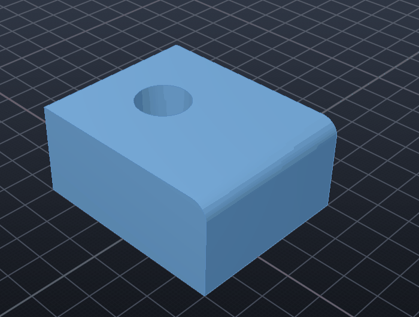
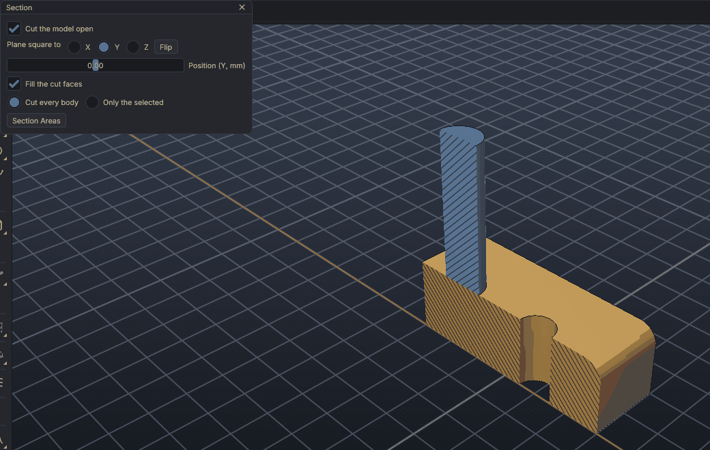
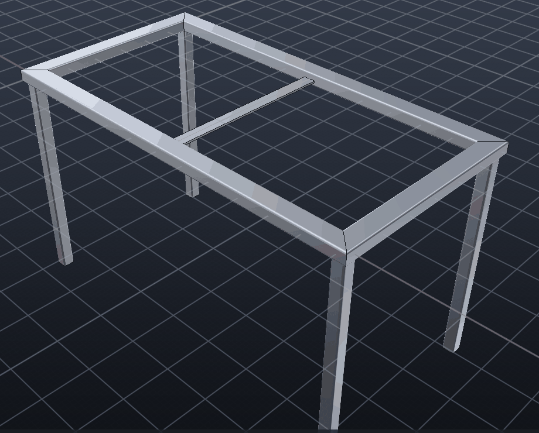
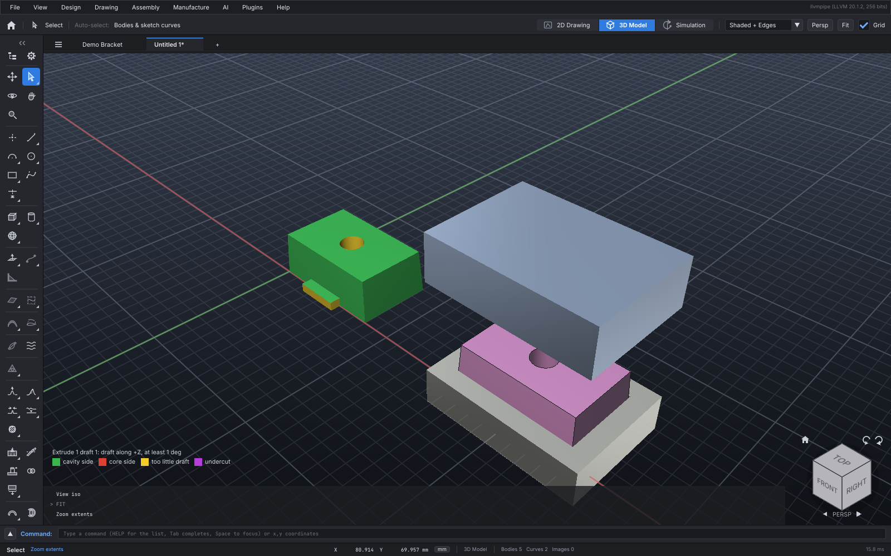
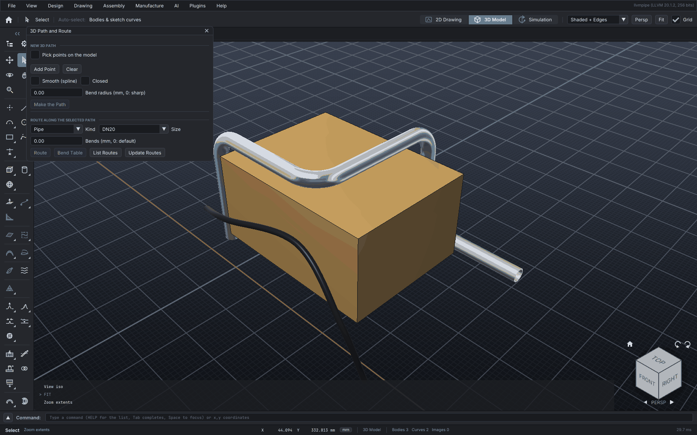

# Part features and the feature history

These features complete the solid modelling tools. They work on sketch curves and on bodies,
from *Design* in the menu, the command line, or the `cad` MCP tool.

| Kind | Features |
| --- | --- |
| Sketch planes and references | `PLANE`: Top, Front, Right, and datum planes anywhere or on a face; `REFAXIS`, `REFPOINT` |
| Multibody | `SPLIT` a body in two; `BOOLEAN` joins, cuts and intersects bodies |
| Sketch constraints | `CONSTRAIN`, `DIM`, `CONSTRAINTS` and `CONSTRAINT EDIT` / `DELETE` |
| Solids from sketch curves | `EXTRUDE`, `REVOLVE`, `SWEEP` and `LOFT` |
| Holes and threads | `HOLE`: standard sizes, counterbored, countersunk and tapped; `THREAD`: modelled threads |
| Copies of bodies | `PATTERN` and `MIRROR` |
| Moulding | `DRAFT`: side faces tilted to come out of a mould |
| Sheet metal | `SHEETMETAL`: base plate, flanges, flat pattern |
| Edge rounds and bevels | `EDGES`, `FILLET` and `CHAMFER` |
| Direct editing | `FACE`: push / pull, move and delete faces of any solid, without a history |
| Looking inside | `SECTION`: a live section view of the 3D window, with section areas |
| Frames | `WELDMENT`: structural members along sketch lines, their joints, the cut list |
| Analysis | `MASSPROPS`, `MEASURE` and `FEA` (stress analysis) |
| Design intent | `VAR`: global variables and equations; `CONFIG`: configurations and design tables |

Every model command goes into a **feature history** that can be edited and regenerated.


The picture comes from [examples/cad-demo.txt](examples/cad-demo.txt) (`RUN docs/examples/cad-demo.txt`).

## Sketching

### Sketch planes and datum planes

```text
PLANE TOP | FRONT | RIGHT | name                       the sketch plane
PLANE OFFSET d [FROM plane]                            parallel to a plane, d along its normal
PLANE ANGLE deg [ABOUT U | V] [FROM plane]             a plane turned about its own u or v axis
PLANE THROUGH x,y,z x,y,z x,y,z                        through three points
PLANE AT x,y,z NORMAL x,y,z [U x,y,z]                  through a point, square to a direction
PLANE FACE x,y,z [ON body]                             on the face of a body nearest the point
PLANE LIST | PLANE DELETE name
```

New curves go on the **sketch plane**. Besides the three main planes, any plane can be a sketch
plane: each of the forms above makes a **datum plane** (named "Plane 1", "Plane 2"... or with
`NAME`) and makes it the sketch plane. `FROM` starts from a main plane or a datum plane, by
default the sketch plane itself.

- A datum plane's u axis is level where it can be (so v points up), and along X on level
  planes. The main planes come out the same: `PLANE AT 0,0,0 NORMAL 0,-1,0` is Front.
- Sketches drawn on a datum plane stay on it. `EXTRUDE`, `REVOLVE` (about the plane's u or v
  axis, or a line on it) and `SWEEP` work on them as on the main planes, and circles extrude
  to exact cylinders along the plane's normal.
- `2D name` opens the 2D Drawing window square to a datum plane, u to the right. The options
  bar lists the datum planes beside Top, Front and Right.
- Datum planes are saved with the project, and the `PLANE` steps are in the feature history:
  REGEN makes them again (a `FACE` plane finds its face on the rebuilt bodies).
- DXF and SVG export and import work on a datum plane; images go on the main planes.

```text
BOX 60 40 15 @0,0,0
PLANE FACE 10,10,40 NAME Lid
CIRCLE 0,0 6
EXTRUDE 12
PLANE THROUGH 0,0,15 30,0,40 0,20,15
RECT 5,5 20,15
EXTRUDE 4
```

### Reference axes and points

```text
REFAXIS name THROUGH p p | AT p DIR x,y,z | PLANES plane plane | OF body
REFPOINT name AT x,y,z | CENTRE body
REFAXIS LIST | REFPOINT LIST | REFAXIS DELETE name | REFPOINT DELETE name
```

- **Axes:** through two points, through a point along a direction, where two planes meet,
  or a round body's own axis (`OF`: its axis of symmetry, through its centre of mass).
- **Points:** at a position, or a body's centre of mass.
- Planes take them: `PLANE AT P1 NORMAL A1`, `PLANE THROUGH P1 P2 P3`; so do `PATTERN ...
  CIRCULAR n AXIS A1` (about that line) and `REVOLVE ... AXIS A1` (an axis lying in the
  profile's plane).
- They are drawn in the 3D window with their names (datum planes as framed squares, the
  sketch plane's highlighted), saved with the project, and REGEN makes them again.

### Splitting a body

```text
SPLIT [body] BY plane              TOP, FRONT, RIGHT or a datum plane
SPLIT [body] [PLANE] x,y,z NORMAL x,y,z
```

SPLIT cuts a body in two along a plane and keeps both pieces, the cuts capped: the piece the
normal points to becomes *Body (2)*. Hole wizard callouts stay with the piece they're in.

### Curves

```text
LINE 0,0 40,0            PLINE 0,0 40,0 40,20 CLOSE        RECT 0,0 40,20        CIRCLE 20,10 5
ARC 10,0 0,10 -10,0      (start, a point on it, end)       ARC CENTER 0,0 10,0 0,10
SPLINE 0,0 10,8 20,-3 30,5 [CLOSE]                         ELLIPSE 0,0 20,0 8    (centre, major axis end, minor radius)
SKETCHSLOT 0,0 30,0 5    (end centres, radius)             POLYGON 0,0 10 6 [CIRCUMSCRIBED] [ANGLE deg]
```

**Construction curves:** add `CONSTRUCTION` at the end of any of these to make a reference
curve. Construction curves:

- are dashed and grey;
- guide the sketch and can be dimensioned and constrained;
- are never part of a profile.

`CONSTRUCTION "Line 3" [ON|OFF]` switches a curve either way. The tool options bar has the same
switch for new curves.

**Splines:**

- A spline passes through every point it is given.
- It is a centripetal Catmull-Rom curve, so it has no loops or cusps between close points.
- `CLOSE` joins it into a loop.

**Polygons:**

- `POLYGON` makes a closed polyline with its first corner along +u.
- The radius reaches the corners. With `CIRCUMSCRIBED` the radius reaches the middle of the sides
  instead (a nut across flats).

**What extrudes:**

- closed polylines, rectangles, circles, ellipses, slots and closed splines;
- lines, arcs, open polylines and splines that meet end to end in a closed loop. Picking any one
  of them uses the whole loop, so a slot drawn as two lines and two arcs extrudes like a slot.

### Trim, extend and offset

```text
TRIM "Line 1" AT 10,0          the piece at 10,0, back to the curves crossing it
EXTEND "Line 2" [START|END|AT x,y]
OFFSET "Circle 3" 2 [SIDE x,y]  (a negative distance: inside / right)
```

**Trim:**

- Removes the piece of a curve between its nearest crossings on either side of the point. A
  crossing at an end doesn't count.
- A line becomes two lines, a circle an arc, a rectangle or closed polyline an open polyline, and
  an ellipse or spline a spline.
- A curve nothing crosses goes altogether.
- `TRIM body PLANE ...` still slices a body.

**Extend:**

- Carries a line's or open polyline's end straight on, or an arc's end round its circle, to the
  nearest curve it meets.

**Offset:**

| Curve | Offset copy |
| --- | --- |
| Line | Parallel |
| Circle, arc | Concentric |
| Rectangle, slot | Grown or shrunk |
| Polyline | Each side moved, the corners mitred |
| Ellipse, spline | A spline through points the distance away along the normal |

The side is the one `SIDE` names. Without it, a closed curve grows outwards, an arc moves away
from its centre, and an open curve moves to its left. A negative distance turns each of these
around.

**In the app:**

- *Trim* (T): click the piece to cut away.
- *Extend*: click near the end to carry on.
- *Offset*: click the curve on the side to offset to; the distance is in the options bar.

### Fillets, chamfers, mirrors and patterns

```text
SKETCHFILLET curve [CORNER n...] radius      every corner of a polyline or rectangle, or those named
SKETCHFILLET line line radius                where two lines meet (or would, extended)
SKETCHCHAMFER ...                            the same, bevelled by a distance
SKETCHMIRROR curve... ABOUT line | ABOUT x,y x,y
SKETCHPATTERN curve... LINEAR n dx,dy [ROWS m dx,dy] | CIRCULAR n [ABOUT x,y] [ANGLE deg]
```

- **Fillet / chamfer:** a rounded rectangle or polyline becomes lines and arcs end to end,
  which still extrude as one profile. Corners count from 1 along the curve (a rectangle's
  counter-clockwise from its first corner). Two lines are trimmed (or extended) to the
  arc. A fillet too big for a side is refused.
- **Mirror:** copies across a line (a construction centreline, say) or through two points.
  Arcs stay counter-clockwise; a rectangle mirrored across a slanted line becomes a closed
  polyline.
- **Pattern:** `LINEAR` n copies (the original the first) `dx,dy` apart, in `ROWS` too;
  `CIRCULAR` n round a point, evenly round a full turn, or spread over `ANGLE`.

### Sketching from bodies

```text
PROJECT body [EDGES | SECTION] [CONSTRUCTION]
```

- **EDGES:** the body's edges seen square to the sketch plane, as lines and polylines
  (edges seen end on, or lying on others, once).
- **SECTION:** where the sketch plane cuts the body, as closed polylines: profiles to
  extrude, revolve or cut from.
- `CONSTRUCTION` makes them reference curves.

### Dragging

With the **Select** tool, drag sketch geometry and the constraints hold while it moves:

- **A point:** an end, corner, vertex or centre. A small square marks each point of the selected
  curve, and the one under the cursor lights up.
- **A circle's or arc's rim:** changes its radius.
- **Anything else on a curve:** moves the whole curve without changing its shape.

The curves joined to it by constraints follow, moving as little as they must; curves not
connected to it stay put. When the constraints stop the grip short of the cursor, it goes as far as
they let it, and the status bar says how far short ("held 5.8 mm short by its constraints"). A
dimension or a fixed point holds firm. Esc during a drag puts everything back.

Each drag is recorded as a `DRAG` command, so it is in the history and undoes:

```text
DRAG "Polyline 1" POINT 3 TO 60,50      a point (START, END, CENTRE, POINT n, CORNER n)
DRAG "Circle 2" RIM TO 45,20            the radius, through 45,20
DRAG "Line 1" BY 5,0                    a whole curve, moved by 5,0
DRAG "Line 1" TO 10,10 FROM 0,0         a whole curve, the point 0,0 on it going to 10,10
```

**Undo:** every sketch edit undoes and redoes, with Ctrl+Z and Ctrl+Shift+Z (or Ctrl+Y; Cmd on
macOS), or `UNDO` / `REDO` and the File menu:

- new curves;
- trims, extends and offsets;
- construction changes;
- constraints and dimensions;
- drags.

The same UNDO and REDO cover the rest of the model, one command at a time, in the order the
changes were made:

- bodies (made, cut, moved, sculpted) and their parameters (`PARAM`, `REGEN`);
- mates, together with the move each one made;
- the drawing sheet;
- variables, configurations, datum planes, reference axes and points;
- motions, poses and physics (a body's and the world's settings);
- robot rigs and terrain;
- CAM and lathe jobs.

Undoing a change that isn't a history step (the sheet, a CAM job) leaves the feature
history as it is.

### Constraint status

The solver works out how free each curve still is.

- **Green:** fully constrained.
- **Red:** has a constraint that can't be met.
- **The usual colour:** can still move.

The status bar sums it up, for example "Sketch: 3 fully constrained, 2 free".

**Constraining arcs:**

- An arc is constrained like a circle: its radius, concentric, tangent, point on.
- `START` and `END` pick its ends, and `CENTRE` its centre.
- `DIM "Arc 1" 15` sets its radius.

### Files

Projects keep every kind. DXF export handles each kind as follows:

| Kind | DXF entities |
| --- | --- |
| Arc | `ARC` |
| Slot | Two `LINE`s and two `ARC`s |
| Spline, ellipse | Fine polylines (DXF R12 has neither) |

Construction curves export on their own layer.

DXF import reads `ARC` as an arc, `SPLINE` through its fit (or control) points, and `ELLIPSE` as an
ellipse.

## Sketch constraints and dimensions

```text
CONSTRAIN kind curve [START|END|CENTRE|POINT n|SIDE n] [curve [...]]
DIM [HORIZONTAL|VERTICAL|RADIUS|DIAMETER|ANGLE] curve [selector] [curve [selector]] [value]
CONSTRAINTS
CONSTRAINT EDIT D1 value      CONSTRAINT DELETE C2
```

Sketch curves can be tied together by constraints and sized by dimensions, as in a parametric
CAD sketcher. Each new constraint is solved at once: the curves move as little as they must.

| Constraint | Between |
| --- | --- |
| `COINCIDENT` | two points |
| `HORIZONTAL`, `VERTICAL` | a line or side, or two points |
| `PARALLEL`, `PERPENDICULAR` | two lines or sides |
| `TANGENT` | a line and a circle, or two circles (outside or inside, from where they are) |
| `EQUAL` | two lines' lengths, or two circles' radii |
| `CONCENTRIC` | two circles |
| `ON` | a point on a line or circle |
| `MIDPOINT` | a point at the middle of a line or side |
| `FIX` | a point, held where it is |

`DIM` sizes a line's length, the distance of two points or of a point from a line, a circle's
radius or diameter, or the angle between two lines. Without a value it keeps the size there is
now. It picks its kind from what it is given: two lines make an angle, a circle a radius.

**Selectors:**

- `START` / `END`: a line's ends.
- `CENTRE`: a circle's centre.
- `POINT n` / `CORNER n`: a polyline vertex or rectangle corner.
- `SIDE n`: a polyline segment or rectangle side.

A closed polyline stays closed.

**How it is solved:** damped least squares (Levenberg–Marquardt) on the constraints' errors. A
constraint that can't be met with the others is refused, and nothing moves. Afterwards the rank
of the constraints' Jacobian gives the **degrees of freedom** left. Every reply says either
"fully constrained" or "free in N ways". `CONSTRAINTS` lists them all with their names (C1, D2...),
values and whether each is met. In the 2D view they are labelled on the sketch, in red when not
met.

**Driving the model:** constraints and dimensions are history steps. `CONSTRAINT EDIT D5 80`
rewrites that dimension's step and regenerates the history. So a part extruded from the sketch
is rebuilt at the new size, and so is everything done to it afterwards.

```text
PLINE 0,0 48,2 50,31 -1,29 CLOSE
CONSTRAIN HORIZONTAL "Polyline 1" SIDE 1      CONSTRAIN VERTICAL "Polyline 1" SIDE 2
CONSTRAIN HORIZONTAL "Polyline 1" SIDE 3      CONSTRAIN VERTICAL "Polyline 1" SIDE 4
DIM "Polyline 1" SIDE 1 60      DIM "Polyline 1" SIDE 2 40      CONSTRAIN FIX "Polyline 1" START
EXTRUDE "Polyline 1" 10
CONSTRAINT EDIT D5 80           (the block is rebuilt 80 long)
```

The constraints are saved with the project.

## Extrude

```text
EXTRUDE [curve] distance [SYMMETRIC | TWO d2] [REVERSE] [DRAFT deg] [THIN t] [CUT | JOIN [body]] [KEEP]
EXTRUDE [curve] THROUGH [SYMMETRIC] [REVERSE] ...          through every body (or the CUT body)
EXTRUDE [curve] UPTO NEXT | body | x,y,z [REVERSE] ...     up to the next face, a body, a point's level
```

EXTRUDE pushes a closed sketch curve (or a loop of curves end to end) along its plane's
normal into a solid.

- **Depth:** `distance` along the normal (negative or `REVERSE`: the other way), `SYMMETRIC`
  half each way, or `TWO d2`: `distance` one way and `d2` back the other.
- **THROUGH:** past every visible body along the normal (both ways with `SYMMETRIC`), the
  usual end for a hole.
- **UPTO:** `NEXT` stops where the whole profile has met a face ahead of it; a body's name
  stops at that body; a point stops at the plane through it, square to the normal.
- **DRAFT deg:** the sides lean in by that angle going away from the sketch plane (out when
  negative); both ways from the plane with `SYMMETRIC` or `TWO`. Too steep for the depth and
  it is refused.
- **THIN t:** a wall `t` thick inside the outline instead of the whole area. An open curve
  (a line, polyline, arc or spline) makes a rib `t` thick, centred on it.
- **CUT / JOIN:** cuts the solid from the bodies it meets, or joins them into one (`CUT body`,
  `JOIN body`: just that one). A cut that meets nothing is refused and nothing changes.

A plain extrusion stays parametric, with exact circles; drafts and walls from straight-sided
profiles are exact too (flat faces).

```text
BOX 60 40 20 @0,0,0
PLANE FACE 0,0,30 NAME Lid
CIRCLE 0,0 5
EXTRUDE THROUGH REVERSE CUT        a hole through the block
RECT -25,-15 -15,-5
EXTRUDE 8 DRAFT 5 JOIN             a tapered boss on the lid
PLINE -20,10 20,10
EXTRUDE 6 THIN 2 JOIN              a rib
```

## Holes

```text
HOLE [body] [AT] x,y,z [x,y,z...] [DIR x,y,z] SIZE size [FIT CLOSE | NORMAL | LOOSE]
     [DEPTH h | THROUGH] [CBORE [d depth] | CSINK [d [deg]]] [TAPPED [THREAD depth]] [FLAT]
HOLE [body] [AT] x,y,z [DIR x,y,z] DIAMETER d [DEPTH h | THROUGH]
HOLE SIZES                      the standard sizes and what goes with them
HOLE LIST [body]                the holes made, with their callouts
```

The hole wizard drills holes at points on a body's surface, square to it (or along `DIR`),
one or many at once.

- **SIZE:** ISO metric coarse, M1.6 to M24, or UNC, #2-56 to 1-8 (`M6`, `M6x1`, `1/4-20`,
  `10-24`). A plain hole is that size's clearance hole (ISO 273): `FIT CLOSE`, `NORMAL` (the
  default) or `LOOSE`. `DIAMETER` overrides the drill.
- **CBORE:** a counterbore for a socket head cap screw of that size (ISO 4762), or the
  diameter and depth given. **CSINK:** a countersink for a flat head screw (90 degrees
  metric, 82 inch), or the diameter and angle given.
- **TAPPED:** the tap drill, with the thread as a cosmetic thread in the hole's callout.
  A blind tapped hole's thread stops two pitches short of the drill depth unless `THREAD`
  says how deep.
- **DEPTH** is the drilled depth from the surface; blind holes end in a 118 degree drill
  point (`FLAT`: a flat bottom).
- Each hole keeps its callout on the body, saved with the project: `M8 tapped 12.5 deep
  (drill 6.8 x 15)`, `dia 6.6 thru (M6 clearance), counterbore 11 x 6.4`.

```text
BOX 80 60 20 @0,0,0
HOLE "Block 1" AT -25,-15,20 25,-15,20 SIZE M6 CBORE THROUGH
HOLE "Block 1" AT -25,15,20 25,15,20 SIZE M8 TAPPED DEPTH 15
HOLE "Block 1" AT 0,0,20 SIZE 1/4-20 CSINK THROUGH
```

## Threads

```text
THREAD [body] AT x,y,z AXIS x,y,z SIZE M10 | DIAMETER d PITCH p  LENGTH l [INTERNAL] [LEFT]
THREAD [body] HOLES | HOLE n
```

THREAD cuts a modelled ISO metric thread (60 degree flanks, the basic profile) into a body:
on a rod `LENGTH` long from `AT` along `AXIS` (the rod's diameter is the thread's), or with
`INTERNAL` into the wall of a hole drilled at the minor diameter. `HOLES` threads the
body's tapped hole wizard holes (each once; `HOLE n`: just that one, numbered as `HOLE
LIST` shows them). `LEFT` makes a left-hand thread. A tapped hole is otherwise a cosmetic
thread: the tap drill and its callout.

```text
CYLINDER 5 30
THREAD "Cylinder 1" AT 0,0,30 AXIS 0,0,-1 SIZE M10 LENGTH 20
```

## Fasteners

```text
FASTENER [LIST]                         the types and their size ranges
FASTENER SIZES type                     a type's sizes and the dimensions that matter
FASTENER type size[xlength] [LENGTH l] [AT x,y,z] [DIR x,y,z | -Z...] [NAME n]
FASTENER INTO [body] [HOLE n,...] [type] [SIZE s] [LENGTH l] [GRIP g] [WASHER] [NUT]
```

Standard fasteners, modelled from their standards' dimensions, each an exact solid carrying
its designation for the parts list:

| Type (typed as) | Metric | Inch |
| --- | --- | --- |
| Hex bolt (`BOLT`, `HEXBOLT`) | ISO 4017, M1.6 to M24 | ASME B18.2.1 hex cap screw, 1/4-20 to 1-8 |
| Socket head cap screw (`SHCS`) | ISO 4762, M1.6 to M24 | ASME B18.3, #2-56 to 1-8 |
| Countersunk screw (`FHCS`, `CSK`) | ISO 10642 (90 deg), M3 to M20 | ASME B18.3 flat head (82 deg), #2-56 to 1-8 |
| Button head screw (`BHCS`, `BUTTON`) | ISO 7380-1, M3 to M16 | ASME B18.3, #4-40 to 5/8-11 |
| Set screw (`SETSCREW`, `GRUB`) | ISO 4026 (flat point), M1.6 to M24 | ASME B18.3, #2-56 to 1-8 |
| Hex nut (`NUT`) | ISO 4032, M1.6 to M24 | ASME B18.6.3 (#2 to #10), B18.2.2 (1/4 to 1) |
| Plain washer (`WASHER`) | ISO 7089, M1.6 to M24 | ASME B18.22.1 type A narrow, #2 to 1 |
| Dowel pin (`DOWEL`, `PIN`) | ISO 8734, 1 to 20 mm | ASME B18.8.2, 1/16 to 1 |

- **Size and length:** `M6x20`, `1/4-20x3/4` (an inch size's length is in inches unless it
  says otherwise: `LENGTH 20mm`), a pin `6x20` or `1/4x1`. With no length, a standard
  length about three diameters. A screw's length is under its head; a countersunk screw's
  is overall, as its standard measures it.
- **Where:** the origin is the bearing face (a countersunk screw's: the top of its head,
  flush with the part; a dowel pin's: its middle) and the shank runs along `DIR` (default
  `-Z`). Without `AT` it lands beside the model.
- **The parts list:** `NUMBER` is the designation (`ISO 4762 M6x20`, `ASME B18.3 1/4-20 x
  3/4`), so like fasteners count as one item; `DESCRIPTION` (`Socket head cap screw M6x20`),
  `MATERIAL` (8.8 bolts, 12.9 cap screws, grade 5 inch bolts...: change it with `PROPERTY`)
  and `THREAD` (`M6x1`, `1/4-20 UNC`). They follow the size when it changes.
- **The library:** every type is in the Library panel under *Fasteners*, and `PART` places
  them too (`PART socket_head_cap_screw SIZE M8 LENGTH 30`); `PARAM` or the Properties panel
  changes a placed one's size and length.
- **INTO** fills the holes made with the hole wizard (`HOLE ... SIZE`), all of a body's or
  those numbered (as `HOLE LIST` shows them): a countersunk screw in a countersink, a cap
  screw sunk in a counterbore or into a tapped hole, a hex bolt in a plain hole, unless a
  type is given (`SETSCREW`, `DOWEL`, `BHCS`...). The length is the standard one that
  reaches: through the part (measured beside the hole) and 1.5 diameters into what lies
  behind it; with `NUT`, through a washer and the nut and two threads past it; into a
  tapped hole, 1.5 diameters of thread (no deeper than the thread). A set screw sits flush
  in its thread; a dowel pin goes half its length into the hole. `WASHER` puts washers under
  the heads (not in a counterbore, where they don't fit) and under the nuts; `GRIP g` leaves
  room for a part `g` thick clamped under the head. `SIZE` gives a size where a hole has
  none (one drilled by `DIAMETER`).
- **Threads** are cosmetic: the shank is modelled at the nominal diameter, so a screw in a
  tapped hole (drilled at the tap drill) shows as an overlap in an interference check.
  Chamfers and the socket's drill point are simplified; hex heads and nuts have sharp
  corners.
- The *Design > Fasteners* menu places one by type and size, and fills the selected part's
  holes (with washers and nuts if ticked).

```text
BOX 120 60 20
HOLE "Block 1" AT -45,-15,20 -20,-15,20 SIZE M6 CBORE THROUGH
HOLE "Block 1" AT 5,-15,20 SIZE M8 TAPPED DEPTH 16
HOLE "Block 1" AT 30,-15,20 SIZE M10 THROUGH
FASTENER INTO "Block 1" HOLE 1,2,3        two ISO 4762 M6x25 and an M8x12
FASTENER INTO "Block 1" HOLE 4 WASHER NUT ISO 4017 M10x40, two ISO 7089 M10, ISO 4032 M10
FASTENER SHCS M5x16 AT 0,40,0 DIR X       one on its own, pointing along +X
ASSEMBLY BOM
```



## Revolve

```text
REVOLVE [curve] [ANGLE deg] [AXIS U | V | "sketch line" | x,y x,y] [CUT | JOIN [body]] [KEEP]
```

REVOLVE turns a closed sketch curve (rectangle, circle, closed polyline) about an axis in its
plane.

- **Axis:** the plane's vertical axis by default, falling back to the horizontal one. `AXIS`
  can also name a sketch line, or give two points.
- **Angle:** 360° gives a closed solid of revolution. Less gives a solid capped at both ends.
- **Profile:** it may touch the axis, as a vase's does, but not cross it.
- **CUT / JOIN:** cuts the revolved solid from the bodies it meets (a groove), or joins it on.

```text
PLANE FRONT
PLINE 0,0 20,0 23,8 17,28 11,42 15,58 0,58 CLOSE
REVOLVE "Polyline 1" AXIS V
```

## Sweep

```text
SWEEP [profile] ALONG path [KEEP]
SWEEP [profile] HELIX PITCH p TURNS n [AXIS U | V | x,y x,y] [LEFT] [KEEP]
```

SWEEP carries a closed profile along a path curve: a line, polyline, rectangle or circle.
With `HELIX PITCH p TURNS n` it goes round a helix instead (springs, coils): about the
profile plane's vertical axis by default (`AXIS U`, `V` or two points `x,y x,y` in that
plane), from the profile, rising `p` a turn (`LEFT`: left-handed). The profile must stay off
the axis and the coils clear of each other.

- **Placement:** the profile is centred on its centroid and turned square to the path's start.
- **Corners:** the profile is carried round each corner by that corner's own rotation (parallel
  transport). Each corner is cut on the plane that halves its angle, so the section stays true
  through the bend.
- **Closed paths:** a rectangle or circle path closes the tube. Any twist left after going
  round is spread along the path.

## Loft

```text
LOFT "section" [AT d] "section" [AT d] ... [SMOOTH | RULED] [KEEP]
```

LOFT makes a solid through two or more closed sections in order.

- **Offsets:** `AT d` places a section `d` along its plane's normal. Sections can lie on
  different planes.
- **Matching:** each section is resampled evenly and wound the same way. It starts where it
  best matches the section before it, so the solid doesn't twist.
- **Shape:** `RULED` joins the sections with straight lines. `SMOOTH` (the default) runs a
  Catmull-Rom curve through them.
- **Ends:** both ends are capped.

## Pattern

```text
PATTERN [body] LINEAR n SPACING d [DIR X|Y|Z|x,y,z] [ROWS m SPACING2 d DIR2 x,y,z]
PATTERN [body] CIRCULAR n [ANGLE a] [AXIS X|Y|Z|x,y,z] [AT x,y,z]
PATTERN [body] ALONG curve n [ALIGN]
PATTERN [body] POINTS [REF x,y,z]
PATTERN [body] FILL curve SPACING d [SPACING2 d] [STAGGER] [MARGIN m] [REF x,y,z]
        [UNION "target" | SUBTRACT "target"]
```

PATTERN makes copies of a body: `n` along a line, or `n` × `m` in rows, or `n` round an axis.

- **Along a curve:** `n` spaced evenly along a sketch curve, the original at its start
  (round a closed one, evenly all the way). `ALIGN` turns each copy with the curve.
- **At sketch points:** a copy at each visible sketch point (`POINT x,y`). The body's
  reference point goes onto each: its centre, on the points' plane, or `REF`.
- **Filling a region:** copies on a grid `SPACING` apart (rows `SPACING2` apart, the same by
  default) inside a closed sketch profile, `MARGIN` in from its edge; `STAGGER` shifts every
  other row by half. The grid runs through the reference point (as for `POINTS`), where the
  original stays.

- **Circular:** a full turn spaces the copies evenly. A partial `ANGLE` puts the first and last
  copies at its ends.
- **Names:** copies are named *Body (2)*, *Body (3)*, and so on.
- **Joining:** `UNION` joins the copies, and the original, into a target. `SUBTRACT` cuts them
  from it. For example, three holes through a plate:

```text
CYLINDER 4 20 @-20,0,-5
PATTERN "Cylinder 2" LINEAR 3 SPACING 20 SUBTRACT "Plate"
```

## Mirror

```text
MIRROR [body] [PLANE XY|YZ|XZ] [AT x,y,z] [NORMAL x,y,z] [COPY | MOVE] [UNION]
```

- **Plane:** the YZ plane through the origin by default. `AT` gives a point on the plane.
- **Copy:** a mirrored copy is the default. `MOVE` flips the body itself.
- **UNION:** joins the copy to the body, which makes a half model whole.

## Sheet metal

```text
SHEETMETAL BASE curve THICKNESS t [RADIUS r] [K k]     a base plate from a closed profile
SHEETMETAL EDGES [body]                                the edges a flange can go on
SHEETMETAL FLANGE [body] EDGE n | NEAR x,y,z LENGTH l [ANGLE deg] [DOWN] [RADIUS r] [INSET a b]
SHEETMETAL MITER [body] EDGES n,m,... LENGTH l [ANGLE deg] [GAP g] [DOWN]   flanges round corners
SHEETMETAL HEM [body] EDGE n | NEAR x,y,z LENGTH l [OPEN gap | CLOSED] [DOWN]
SHEETMETAL JOG [body] EDGE n | NEAR x,y,z OFFSET h LENGTH l [ANGLE deg] [DOWN]
SHEETMETAL RELIEF [body] [SIZE s]                      corner reliefs where flanges meet
SHEETMETAL CONVERT body FACE x,y,z [RADIUS r] [K k]    a plate or shelled box as sheet metal
SHEETMETAL FLAT [body] [SKETCH]                        the flat pattern
SHEETMETAL INFO [body]
```

A sheet metal part is one sheet, `t` thick, bent along straight lines. It starts as a base
plate (any closed profile, on its plane) and grows flanges: strips on a free edge of the
base, or on a flange's far edge, bent through `ANGLE` (90 by default, up to 180; `DOWN`
bends the other way) with an inside radius (`RADIUS`, the part's by default, which is `t`
unless given). `LENGTH` is the flat beyond the bend; the bend is added outside the edge.

- **Bends:** the sheet follows the arc in each bend, its neutral layer `K t` from the inside
  (`K` 0.44 by default) keeping its length, so a bend's flat length is the bend allowance
  `BA = angle x (r + K t)`. `SHEETMETAL INFO` lists each bend's allowance and the flat size.
- **Flat pattern:** the part is kept as its flat pattern folded, so the two always agree.
  `FLAT` makes the flat plate as a body beside the part; with `SKETCH` also its outline
  (one closed polyline) and the bend lines (construction lines) as sketch curves, ready for
  `EXPORT flat.dxf`.
- Edges are numbered as `SHEETMETAL EDGES` lists them (each takes one flange); `NEAR x,y,z`
  picks the one nearest a point. The part is parametric: saved, undone and rebuilt as such.

**More flanges:**

- **INSET a b** holds a flange back from its edge's ends, by `a` at the edge's start and `b`
  at its end.
- **MITER** puts flanges on several base edges at once. Where two of them meet at a corner,
  each is cut on the corner's bisector: across the bend zone (so the bends don't run into
  each other) and, for walls that lean out (`ANGLE` under 90), along the wall too. The
  corners then close, `GAP` apart (a tenth of the sheet by default).
- **HEM** folds an edge back flat on itself (180 degrees). **OPEN gap** leaves that gap
  between the sheets (the inside radius is half of it). **CLOSED**, the default, leaves
  none.
- **JOG** makes two bends the opposite way, so the next flat steps `OFFSET` away (mid-sheet
  to mid-sheet) and runs on `LENGTH`. The flat between the bends is worked out exactly.
  A jog smaller than its two bends' rise is refused.
- **RELIEF** holds back the flanges at each corner where two of them meet (the bend radius
  plus the thickness by default, or `SIZE`). This is a rectangular relief, so the bends
  clear each other.
- **CONVERT** turns a thin-walled solid into sheet metal: a plate, or a box hollowed by
  `SHELL ... FACE`. Pick the outside of the base with `FACE`:
  - The thickness is measured under it.
  - Walls standing on its edges become 90-degree flanges, `r + t` shorter, so the part
    keeps its outside size.
  - Where two walls meet, the corner is mitered shut.
  - The body becomes a parametric sheet metal part with a flat pattern.

```text
RECT 0,0 80,50
SHEETMETAL BASE "Rectangle 1" THICKNESS 1.5 RADIUS 1.5
SHEETMETAL MITER "Sheet 1" EDGES 1,2,3 LENGTH 20     a tray: three walls, mitered corners
SHEETMETAL HEM "Sheet 1" EDGE 1 LENGTH 8 OPEN 1      a rolled front edge

BOX 60 40 20
SHELL "Block 2" THICKNESS 1.5 FACE 0,0,20
SHEETMETAL CONVERT "Block 2" FACE 0,0,0 RADIUS 1.5   a box that can be bent from a flat blank
```

```text
RECT 0,0 100,60
SHEETMETAL BASE "Rectangle 1" THICKNESS 2 RADIUS 1
SHEETMETAL FLANGE "Sheet 1" EDGE 1 LENGTH 20
SHEETMETAL FLANGE "Sheet 1" NEAR 0,30,0 LENGTH 10 DOWN
SHEETMETAL FLAT "Sheet 1" SKETCH
```

## Draft

```text
DRAFT [body] ANGLE deg [PULL x,y,z | X | Y | Z] [NEUTRAL x,y,z]
```

DRAFT tilts the faces that run along the pull direction (+Z by default), the sides a part
slides out of a mould along, by the angle: they lean in going along the pull (out with a
negative angle). They turn about the neutral plane, through `NEUTRAL` square to the pull,
by default the body's bottom (it keeps its size there). Corners stay mitred, so a block
becomes a frustum and a cylinder a cone. A draft that would fold faces over is refused.

```text
BOX 40 40 20 @0,0,0
DRAFT "Block 1" ANGLE 5
```

## Fillet and chamfer on chosen edges

```text
EDGES [body]
FILLET [body] RADIUS r EDGES ALL|CONVEX|CONCAVE|VERTICAL|HORIZONTAL|TOP|BOTTOM|n...|NEAR x,y,z...
FILLET [body] RADIUS r TO r2 EDGES ... [START x,y,z]      a variable fillet
FILLET [body] FULLROUND x,y,z                             a full round on the face at the point
CHAMFER [body] DISTANCE d [EDGES ...]
```

`EDGES` lists a solid's sharp edges, numbered. Faces meeting at more than 25° make an edge. Each
edge is a chain followed along the mesh: straight, or round like a cylinder's rim. The list says
whether each one is outside (convex) or an inside corner (concave), and gives its length and ends.

`FILLET ... EDGES` and `CHAMFER` treat just the chosen edges:

- by number, from the list;
- by a filter;
- or by the edge nearest each point (`NEAR`).

They are exact. The section at each point of the edge comes from its two faces. A cutter (or, on
an inside corner, a filler) is swept along it and cut from (or joined to) the solid. Where three
rounded outside edges meet, the corner becomes a ball, as in a CAD system. A chamfer sets each
face back by `d`. Without `EDGES`, CHAMFER takes the outside edges.

On a 40 × 30 × 20 box with R3 on every edge, the volume is within 0.03% of the exact rounded box.


**Variable fillets:** `RADIUS r TO r2` runs the radius from `r` to `r2` along each chosen
edge, from its end nearest `START` (its first end without one). Open edges only.

**Full rounds:** `FULLROUND x,y,z` rounds the face at the point, between two outside edges,
into one half circle: both edges at half the face's width.

```text
BOX 60 6 30
FILLET "Block 1" FULLROUND 0,0,30
```

## Fillet (rolling ball on every edge)

```text
FILLET [body] RADIUS r [CONVEX | CONCAVE | BOTH] [VOXEL v]
```

FILLET rounds a closed solid's edges with a rolling ball of radius `r`:

- **CONVEX** (the default) rounds the outside edges: a morphological opening.
- **CONCAVE** fills the inside corners: a closing.
- **BOTH** does the opening, then the closing.

**How it works:**

1. The solid's signed distance is computed on a voxel grid. The voxel is `r / 4` by default,
   up to 8 million voxels. Distances are exact near the surface, and closest points are spread
   by fast sweeping in all eight directions.
2. The set of ball centres (the solid shrunk by `r`) gets its own distance field.
3. Near the surface, each closest point is made exact by projected steps that keep it `r`
   from every face, so it settles on the shrunk solid's edges and corners.
4. The surface is remeshed from the field.

**Accuracy:** on a 40 × 30 × 20 box with R3, the surface is within 0.006 mm of the exact
rounded box on average and 0.06 mm at worst. The volume is within 0.3% of the Steiner formula.

**Limits:**

- Edges that aren't rounded stay sharp to within a voxel.
- A part thinner than the ball can't hold it, so FILLET refuses rather than erase it.
- It rounds all the edges of the kind chosen. To round only some, use `FILLET ... EDGES`
  (above).

## Shell, dome, rib and lettering

```text
SHELL   [body] THICKNESS t [OUTWARD] FACE x,y,z            hollow the part, open at that face
DOME    [body] FACE x,y,z HEIGHT h [CONCAVE]                raise (or dish in) a flat face
RIB     [curve] THICKNESS t [BODY name] [FLIP] [KEEP]       a wall from an open curve to the body
EMBOSS  [body] TEXT "words" FACE x,y,z HEIGHT h DEPTH d [ANGLE deg] [FONT sans|bold|mono]
ENGRAVE [body] TEXT "words" FACE x,y,z HEIGHT h DEPTH d [ANGLE deg] [FONT sans|bold|mono]
```

**SHELL ... FACE** hollows the part with walls `t` thick and leaves the face at the point
open, the way a CAD shell removes a chosen face. (`OPEN x,y,z NORMAL x,y,z` cuts the opening
along any plane instead.)

**DOME** raises the flat face at the point. Its outline shrinks inward by `R (1 - cos a)` as it
rises by `h sin a`, so it meets the face square and is flat on top. `R` is how far the outline
can shrink before it turns over. On a round face this is half an ellipsoid. **CONCAVE** dishes
the same shape into the face.

**RIB** grows a wall `t` thick, centred on the sketch plane, from an open curve to the body.
The wall runs square to the curve's chord, toward the body (**FLIP** for the other side). It
follows the surface under each point of the curve and reaches a little into it. The body is
the nearest one that way, unless you name one with `BODY`. The curve is hidden unless you add
**KEEP**.

**EMBOSS** raises lettering on the face at the point, and **ENGRAVE** cuts it in:

- **HEIGHT** is the height of the capitals and **DEPTH** how far the letters stand proud or go in.
- The words are centred on the point. They read along +X on a top face and upright on a side
  face, and **ANGLE** turns them. `\n` starts a new line.
- The letters come from the built-in fonts, read from their TrueType outlines: **bold** (Inter
  SemiBold, the default), **sans** (Inter) and **mono** (JetBrains Mono). These cover Latin
  letters, digits and the usual symbols.
- On a curved face the outlines are cut finer, and every point follows the surface along the
  face's normal. The letters then stand an even `DEPTH` proud of a cylinder or a sphere.
- Text that runs off the face is refused.

```text
BOX 80 30 10 @0,100,0
EMBOSS "Block 1" TEXT "SI CDM" FACE 0,100,10 HEIGHT 8 DEPTH 1
ENGRAVE "Block 1" TEXT "Part 42-B" FACE 0,85,5 HEIGHT 5 DEPTH 0.5

BOX 60 40 5
BOX 5 40 40 @-27.5,0,0
BOOLEAN "Block 2" UNION "Block 3"
PLANE FRONT
LINE -25,25 15,5
RIB THICKNESS 4                                            a 40 x 20 gusset in the corner
```

## Surfaces

Surfaces are open bodies with no thickness. Each one lies on an exact B-spline surface,
which is kept with the body, exported to STEP as a surface model and saved in the project.

```text
SURFACE LOFT curve curve [curve ...]                     through sections, in order
SURFACE BOUNDARY c1 c2 c3 c4                             filling four curves that meet end to end
SURFACE EXTRUDE curve DISTANCE d [DIR x,y,z]             an open (or closed) curve pulled straight
SURFACE REVOLVE curve AXIS x,y,z [AT x,y,z] [ANGLE deg]  a curve turned about an axis
SURFACE PLANAR curve                                     a flat surface filling a closed curve
SURFACE OFFSET body DISTANCE d                           a surface d away along its normals
SURFACE BLEND bodyA bodyB [WEIGHT w]                     a bridge between two surfaces' facing edges
THICKEN body THICKNESS t [BOTH]                          a solid from a surface
KNIT body body ... [TOLERANCE t]                         surfaces stitched into one (a solid when closed)
ANALYZE ZEBRA [body]                                     reflection stripes
ANALYZE CURVATURE [body] [MEAN|GAUSS]                    curvature in colour
ANALYZE OFF                                              back to normal
```

**How they are built:**

- Each surface interpolates its curves with cubic B-splines (degree 1 across two sections). The
  parameters follow chord length and the knots are averaged, so the surface passes through
  every section and point it is given.
- **LOFT** lines up closed sections at their nearest points and runs them the same way round.
  Sections must be all closed or all open.
- **BOUNDARY** takes the four curves in any order and either direction, and fills them with a
  bilinearly blended (Coons) patch. The patch has their exact edges.
- **BLEND** finds the edges of the two surfaces that face each other. It leaves each surface
  along that surface's own slope (a cubic Hermite bridge), so it meets both smoothly.
  **WEIGHT** sets how far the slope carries (default 1).

**Solids from surfaces:**

- **THICKEN** offsets the surface along its normals: one way, the other with a negative `t`,
  or both ways with **BOTH**. It walls the open edges.
- **KNIT** joins surfaces along edges they share. Points within the tolerance become one, and
  an edge with points the other side lacks is split there. The default tolerance is
  0.02 mm, or more on large parts. A tube and its two caps knit into a closed solid.

**Analysis:**

- **ZEBRA** paints stripes of the reflected view that move as you turn the model, like a
  striped light box. On a smooth surface the stripes run on smoothly. A kink or a jump in
  them shows a crease, or a change of curvature, where two surfaces meet.
- **CURVATURE** colours the surface blue to red by mean curvature (1/mm, signed), or by
  Gaussian curvature with **GAUSS**.
- Both draw on a copy finely tessellated from the exact surface and hide the original.
  **ANALYZE OFF** puts it back.

```text
CIRCLE 0,0 20
PLANE OFFSET 30
CIRCLE 0,0 10
PLANE OFFSET 30
CIRCLE 5,0 15
SURFACE LOFT "Circle 1" "Circle 2" "Circle 3"
ANALYZE ZEBRA "Surface 1"
```

## Direct editing

`FACE` changes a solid by its faces, whatever made it: a STEP or IGES import, a mesh, or
this project's own features. It needs no feature history. A face is picked by a point on it;
without a body name, the body nearest the point is used.

```text
FACE INFO [body] AT x,y,z                    what the face is: flat, cylinder, cone, sphere...
FACE OFFSET [body] AT x,y,z DISTANCE d       push / pull along the outward normal (negative: in)
FACE MOVE [body] AT x,y,z BY dx,dy,dz        move a hole or boss (a flat face: along its normal)
FACE DELETE [body] AT x,y,z                  take away a hole, boss, fillet or chamfer
```

- **A flat face** moves along its normal. Its neighbours stretch or shrink to meet it: planes
  at any angle, and cylinders or cones that run the way it moves. Fillets along its edges go
  with it and stay fillets. Where a neighbour can't follow, the slab between the face and
  where it goes is added or cut.
- **A round face** gets larger or smaller: a hole's wall pushed out makes the hole larger.
  A whole sphere or torus stays one.
- **Holes and bosses** move as a whole, and are filled or cut away by `DELETE`.
- **Fillets and chamfers** between two flat faces are taken off, and the two faces meet again.
- Exact solids stay exact: each face lies on the surface it lay on, or on its offset.
- An edit that would turn a face inside out, or open the solid, is refused and nothing changes.

In the window, the **Push / Pull Face** tool (in the side toolbar, next to the boolean tool)
drags a face along its normal; hold Shift for whole millimetres. **Delete Face** takes away
the hole, boss, fillet or chamfer that is clicked. Every edit can be undone.

```text
BOX 60 40 20 @0,0,0
HOLE "Block 1" AT 10,0,20 DIR 0,0,-1 DIAMETER 10 THROUGH
FILLET "Block 1" RADIUS 5 EDGES NEAR 30,0,20
FACE OFFSET AT -10,10,20 DISTANCE 8          the top up 8, the fillet with it
FACE MOVE AT 15,0,10 BY -20,5,0              the hole somewhere else
FACE OFFSET AT -15,5,14 DISTANCE -3          and 3 mm larger in radius
FACE OFFSET AT 0,20,10 DISTANCE 10           a side out 10
```



## Section view

`SECTION` cuts the model open in the 3D window, so its inside shows. A plane takes away the
material on one side, and where it cuts a solid the cut is filled and hatched, as on a
drawing. Neighbouring parts are hatched in opposite directions. Nothing in the model
changes, and the section is saved with the project.

```text
SECTION X | Y | Z | -X | -Y | -Z [AT d | AT x,y,z]   a plane square to an axis (default: through the middle)
SECTION PLANE nx,ny,nz [AT x,y,z]                    any plane
SECTION AT d | MOVE d | FLIP                         where it is; move it; keep the other side
SECTION ON | OFF                                     show or hide it (the plane is kept)
SECTION CAP ON | OFF                                 fill the cut faces, or see into the parts
SECTION ONLY body... | ALL                           cut only some bodies
SECTION                                              what it cuts: each body's section area and centroid
```

- The axis names the side taken away: `SECTION X AT 10` keeps x < 10, and `SECTION -X AT 10`
  keeps x > 10.
- Clicks go through what is taken away: they pick the cut faces and the parts behind them.
- Only closed solids are filled. An open surface is cut, but shows no fill.
- The report gives each solid's section area and centroid, a quick check of a wall or a rib:

```text
> BOX 60 40 20 @0,0,0
> HOLE "Block 1" AT 10,0,20 DIR 0,0,-1 DIAMETER 10 THROUGH
> FILLET "Block 1" RADIUS 5 EDGES NEAR 30,0,20
> CYLINDER 6 40 @-15,0,20
> SECTION Y AT 0
Section view on y = 0, keeping y < 0
  Block 1: section area 995 mm2, centroid (-2.163, 0, 9.952), 2 loops
  Cylinder 2: section area 480 mm2, centroid (-15, 0, 40)
```

In the window, *View → Section View...* opens the Section window. It has the plane's axis,
a slider that moves the plane through the model as it is dragged, *Flip*, the fill, and
which bodies are cut. The section works with exploded views and simulations.



## Weldments

`WELDMENT` builds frames from structural members: tubes, pipes, bars, angles, channels and
beams. Each member follows a straight segment of a sketch line, polyline or rectangle, or runs
between points. Where members meet, their ends are cut to fit. The cut list says what to saw.

```text
RECT 0,0 1200,600
WELDMENT MEMBER RHS 60x40x3 ALONG "Rectangle 1" GROUP Table     the top frame, mitred
WELDMENT MEMBER SHS 40x40x3 FROM 0,0,-720 TO 0,0,0               a leg up to a corner
LINE 600,0 600,600
WELDMENT MEMBER FLAT 40x6 ALONG "Line 2" ALIGN top               a bar across, cut to the sides
WELDMENT CUTLIST
```

```text
  1. FLAT 40x6  1 x 540 mm, 1.017 kg each (Steel)
  2. RHS 60x40x3  2 x 1260 mm, ends 45 and 45 deg off square, 5.095 kg each (Steel)
  3. RHS 60x40x3  2 x 660 mm, ends 45 and 45 deg off square, 2.547 kg each (Steel)
  4. SHS 40x40x3  4 x 700 mm, 2.312 kg each (Steel)
  FLAT 40x6: 0.54 m in all
  RHS 60x40x3: 3.84 m in all
  SHS 40x40x3: 2.8 m in all
  Mass: 25.55 kg
```



**Profiles** (`WELDMENT PROFILES` lists the standard sizes):

| Family | Size | Standard |
| --- | --- | --- |
| `SHS`, `RHS` | width x height x wall | EN 10219: corners 2t outside and t inside (2.5t and 1.5t over 6 mm walls) |
| `CHS` | diameter x wall | EN 10219 pipe sizes |
| `FLAT`, `ROUND` | width x thickness; diameter | bar |
| `ANGLE` (`L`) | leg x leg x thickness | EN 10056-1 root radii (the toes square) |
| `UPE` | 80 to 200 | DIN 1026-2 parallel flange channels |
| `IPE` | 80 to 300 | EN 10365 |
| `I`, `C` | h x b x web x flange [x root radius] | any |

Any size of the parametric families can be given by its dimensions (`SHS 45x45x2.5`). Areas
and masses use the exact section with its rounds, and match the standards' tables (an angle
comes out about 1% heavy, its toe radii left off).

**Placing a member:**

- The profile's up is the sketch plane's normal. For members by points, it is +Z (or +Y for a
  vertical member).
- `ALIGN top`, `bottom`, `left`, `right` or a corner puts the line on that edge of the profile
  instead of its middle.
- `ANGLE` turns the profile about its line. `MIRROR` flips it (an angle's legs the other way).
  `UP x,y,z` sets its up.
- `GROUP` names the weldment. It is the members' sub-assembly in the Model panel. Without it,
  a member goes in the last weldment.
- `MATERIAL` sets the material for the masses: steel (the default), stainless, aluminium...

**Joints:**

| Where | What happens |
| --- | --- |
| Two members' ends meet | mitred (`CORNER MITER`, the default); or `CORNER BUTT`: the first member runs through and the other stops at its face; or `CORNER NONE`: left square |
| An end on another member's side | cut to that member's face (a T), at any angle |
| A post at a frame's corner (three members, one square to the other two) | the frame keeps its corner, and the post stops under it |
| Members in line | square ends, butting |

`WELDMENT JOINT x,y,z MITER|BUTT|THROUGH|SQUARE [member]` changes one joint. With BUTT the
member named stops at the other; with THROUGH it runs past.

When a member is moved, remade (`WELDMENT EDIT`) or erased, the joints are found again: a
member left alone gets square ends. Undo takes back both.

**Editing and the cut list:**

- `WELDMENT EDIT member PROFILE "SHS 50x50x3"` remakes a member, as do `ANGLE`, `ALIGN`,
  `MIRROR` and `MATERIAL`. Its joints follow.
- A member that was drilled, cut, turned or otherwise changed keeps its shape. Its joints are
  left as they are, and it stays in the cut list.
- `WELDMENT CUTLIST [EXPORT cut.csv]` counts members alike (profile, length tip to tip, end
  angles, material) together, longest first. It also gives each profile's total length and the
  mass.
- Members alike share a part number (`Table-2`) and a description (`RHS 60x40x3, 1260 mm`).
  The drawing's parts list therefore counts them together.

The members are exact solids: planes, cylinders for the rounds, and the end cuts. They are
saved with the project.

## Mould tools

`MOLD` checks how a part comes out of a two-part mould along a pull direction, finds where the
mould opens (the parting line), and makes the mould's halves: the cavity, which comes off along
the pull, and the core, which goes the other way.

```text
RECT 0,0 80,50
EXTRUDE "Rectangle 1" 30 DRAFT 3
HOLE "Extrude 1" AT 40,25,30 DIR 0,0,-1 DIAMETER 16 DEPTH 20
MOLD DRAFT "Extrude 1" MIN 1                      its faces coloured by their draft
MOLD OFF
MOLD PARTING "Extrude 1"                          the parting line, as closed 3D paths
MOLD SPLIT "Extrude 1" AT 12 MARGIN 12 SHRINK 0.6 GAP 60
```

```text
  Mould of Extrude 1 along +Z: Cavity 1 and Core 1 in Mold 1, parted at 12 mm
    block 420.59 cm3: cavity 170.91 cm3, core 138.07 cm3, part 111.62 cm3 (grown 0.6% for shrinkage)
```



**Draft analysis** (`MOLD DRAFT [part] [PULL Z|-Z|X|...|x,y,z] [MIN deg]`): each face's draft is
its angle off the pull. The part is shown in four colours, with a legend, in place of the
part. `MOLD OFF` (or `ANALYZE OFF`) puts the part back.

| Colour | Faces |
| --- | --- |
| green | positive draft of at least `MIN` (1 degree by default): they come away with the cavity |
| red | negative draft of at least `MIN`: they come away with the core |
| yellow | less draft than `MIN`, upright walls among them: they need more |
| purple | undercuts: something of the part stands in their way in both directions; they would lock the part in |

The report gives each colour's share of the surface and the least draft on each side.

**Parting line** (`MOLD PARTING [part] [PULL ...] [AT h]`): the line round the part where cavity
and core meet. It runs where faces turn from facing the pull to facing away. On upright walls
it runs at the parting height: `AT h` (along the pull), or by default the height that needs
the least shut-off. The loops are added as closed 3D paths (`Parting Line 1`, ...) that `ROUTE`,
`SWEEP` and `PATH3D` can use. Undo takes them back.

**Core and cavity** (`MOLD SPLIT [part] [PULL ...] [AT h] [MARGIN m] [SHRINK %] [GAP g]`):

- The halves are cut from a block round the part, `MARGIN` mm larger on every side (by
  default a quarter of the part's largest size).
- Outside the part the halves meet on a flat parting plane at the parting height. Where the
  parting line steps off that height (a round part pulled at an angle, or a line given
  above or below the part's own), upright shut-off walls join it to the plane.
- Each half is the part's faces on its side, the shut-offs, the plane and the block. Both
  halves are closed solids, and with the part they fill the block exactly; this is checked.
- `SHRINK` grows the part first by the plastic's shrinkage (0.4 to 2% is usual).
- `GAP` shows the cavity lifted off along the pull. The halves go in a `Mold n` group, as
  tool steel.
- A part with undercuts along the pull is refused, with their area. `MOLD DRAFT` shows them;
  turn the pull or change the part (side actions are not made). A part that isn't a closed
  solid is refused too.
- With no `AT`, the part's own parting height is tried first. If the halves don't close there
  (a tangent line through rounded corners, say), the middle of the part is tried.

Meshes from booleans and roundings have their faces a hair off: walls under 0.6 degrees, slivers,
points a hundred-thousandth of the size apart, specks at creases. These are taken as what they
should be. Where three roundings meet (`FILLET ... EDGES ALL`) the corner leaves steps of a few
hundredths of a millimetre: they are passed over when the walls are sorted (a face goes with
part only seen from well clear of it), a sliver goes with the faces along its long sides, and
a strip of undercut that narrow isn't counted. Two cases still fail:

- a pull through those corners (a rounded block along X, say): give another pull, or round
  fewer edges;
- an `AT` height through a rounding's tangent line, or across the rounding itself, where the
  line must run along those steps: leave `AT` out, or give a height on the straight sides.

## 3D sketches and routes

`PATH3D` draws a path through points in space: a polyline whose corners bend at a radius, or a
smooth spline. `ROUTE` runs a pipe, tube, bar, cable or hose along it, and gives the bend table
a tube bender works from.

```text
BOX 400 300 200 @200,150,100
PATH3D -60,40,40 -60,40,320 250,40,320 250,380,320 250,380,60 520,380,60 BEND 60
ROUTE "3D Polyline 1" PIPE DN25                       a steel pipe over the block
PATH3D 460,-40,20 420,-60,150 300,-50,260 120,-80,240 -20,-40,180 SPLINE
ROUTE "3D Spline 2" CABLE 12                          a cable along a smooth curve
ROUTE BENDS "Pipe 1"
```

```text
  Pipe 1: Pipe DN25 (33.7 x 3.2), cut 1356.991 mm, 4 bends at R 60 mm (feed, rotate, bend):
    1. feed 220 mm, rotate 0 deg, bend 90 deg  (at (-60, 40, 320) mm)
    2. feed 190 mm, rotate 90 deg, bend 90 deg  (at (250, 40, 320) mm)
    3. feed 220 mm, rotate -90 deg, bend 90 deg  (at (250, 380, 320) mm)
    4. feed 140 mm, rotate -90 deg, bend 90 deg  (at (250, 380, 60) mm)
    then feed 210 mm
```



**3D paths:**

- Points are `x,y,z`, `@dx,dy,dz` (from the point before) or a reference point's name
  (`REFPOINT Port AT 0,0,100`, then `PATH3D Port ...`).
- `BEND r` rounds every corner of a polyline to radius r. The arcs must fit on the segments
  between them, or the path is refused with the length they need. `SPLINE` makes a smooth
  curve through the points instead, and `CLOSE` closes either.
- `PATH3D POINT path n x,y,z` moves point n (`@dx,dy,dz`: by that much). `INSERT path n x,y,z`
  adds one before point n, `DELETE path n` takes one out, and `BEND path r` changes the
  radius. `INFO` lists the points, the segments' lengths and how much each corner turns.
  Undo takes each edit back.
- When a 3D path is selected, its points show in the 3D window, numbered.
- 3D paths lie on no sketch plane. They make no profiles and take no constraints, and the flat
  tools (trim, extend, offset, fillet) leave them alone. They can be a path for `SWEEP ...
  ALONG`, for `ROUTE` and for weldment members (which follow their corners).
- *Design → 3D Path and Route...* (or `PANEL PATH3D`) opens a window: type the points, or turn
  on *Pick points on the model* and click. A click near a 3D path's point or a reference
  point takes that point; on a body, the point clicked; beside the model, a point level with
  the last one.

**Routes:**

| Size | What it is | Bends by default |
| --- | --- | --- |
| `PIPE DN6` to `PIPE DN150` | EN 10255 medium series | 1.5 x OD |
| `PIPE NPS 1/8` to `PIPE NPS 8` `[SCH 40\|80]` | ASME B36.10M (STD = 40, XS = 80) | 1.5 x OD |
| `PIPE od x wall`, `TUBE od x wall` | any size | 1.5 x OD (pipe), 2 x OD (tube) |
| `ROD d` | solid bar | 2 x OD |
| `CABLE d`, `HOSE od x wall` | flexible | 6 x OD |

- A route bends at `BEND r` if given, else at the path's own radius, else at the default above.
  The bends must be wider than half the outside diameter.
- A route along a spline follows its curve. A pipe there has no bend table; one that folds
  over itself is refused.
- Routes follow 3D paths, and flat lines, polylines, rectangles and splines too.
- `ROUTE LIST` gives each route's size, length, bends and mass. It also says when a route's
  path changed since it was made. `ROUTE UPDATE [route | ALL]` refits routes to their paths
  (one undo step).
- `ROUTE EDIT route [size] [BEND r] [MATERIAL m]` remakes a route.
- `ROUTE BENDS route [EXPORT bends.csv]` gives the bend table:
  - the straight fed before each bend;
  - the turn of the tube about its axis since the last bend (right hand about the feed);
  - the bend angle;
  - the last straight;
  - the developed length, the length to cut.
- Routes are exact: cylinders along the straights, tori round the bends, and flat ends. A
  route along a spline is a mesh.
- Masses use the true section: steel for pipe, tube and rod, plastic for cable and hose
  (`MATERIAL` changes it). The parts list shows each route's size, length and bends.

## Mass properties

```text
MASSPROPS [body] [DENSITY g/cm3 | MATERIAL name]
```

```text
Block 1 (steel, 7.85 g/cm3)
  volume 24.000 cm3, surface 52.00 cm2, mass 188.40 g
  centre of mass (100, 0, 10) mm, size 40 x 30 x 20 mm
  inertia about the centre of mass (g mm2): Ixx 2.041e+04  Iyy 3.14e+04  Izz 3.925e+04  Ixy 0  Iyz 0  Ixz 0
  principal moments (g mm2): 2.041e+04  3.14e+04  3.925e+04
```

- **Method:** volume, surface area, centre of mass and the full inertia tensor about the centre
  of mass come from exact volume integrals over the closed mesh (the divergence theorem, one
  triangle at a time). The principal moments come from Jacobi rotations of the tensor.
- **Materials:** steel, stainless, aluminium, brass, copper, cast iron, iron, titanium,
  magnesium, gold, silver, ABS, PLA, PETG, nylon, POM, acrylic, carbon, wood, glass, concrete,
  water.

## Analysis (FEA): stress, vibration, heat

```text
FEA [body] FIX FACE x,y,z | FIX NEAR x,y,z r ...
           LOAD FACE x,y,z | LOAD NEAR x,y,z r  FORCE fx,fy,fz ...
           PRESSURE FACE x,y,z MPa                 a pressure on a face (N/mm2)
           BEARING x,y,z r FORCE fx,fy,fz          a pin pushing on a hole
           GRAVITY [x,y,z]                         the body's own weight (in g; down by default)
           TEMP FACE x,y,z C   HEAT FACE x,y,z W   faces held at a temperature, heat flowing in
           THERMAL [REF C]                         stress from the heat's expansion
           MODES n   MODE k                        natural frequencies; plot mode k's shape
           [MATERIAL name] [E MPa] [NU v] [YIELD MPa] [CELL size] [PLOT] [DEFORM scale]
FEA MATERIALS
```

FEA works out how a part bends and where it is stressed under loads: a linear static
analysis (small displacements, linear elastic, isotropic material).

- **Holding and loading:** `FIX FACE x,y,z` holds the flat face nearest the point still;
  `LOAD FACE x,y,z FORCE fx,fy,fz` pushes on one with a force in newtons, spread evenly over
  it. `NEAR x,y,z r` picks the surface within `r` of a point instead. Give as many as needed.
- **Material:** steel by default; `FEA MATERIALS` lists the others (stainless, aluminium,
  titanium, brass, copper, ABS, PLA, PETG, nylon), or give `E`, `NU` and `YIELD`.
- **Results:** the largest von Mises stress and where, the largest displacement and where,
  and the factor of safety (yield over that stress).
- **PLOT** colours a copy of the body by stress, blue to red, with a legend (the body itself
  is hidden); `DEFORM s` also shows its shape bent `s` times over. An analysis with a plot
  goes into the feature history, so it is worked out again when the model changes.
- **How:** the body is filled with cubes (`CELL`, about 40 across its longest side by
  default, at most 120,000 of them), each an 8-node element; the equations are solved by
  conjugate gradients. A 100 x 10 x 10 mm steel cantilever with 100 N on its end comes out
  at 0.1995 mm and 61.7 MPa (with `CELL 1`), against 0.200 mm and 60 MPa from beam theory.
  Finer cubes resolve small features (fillets, thin walls) better; stresses right at a
  held face or a sharp inside corner run high, as they do in any such analysis.

```text
BOX 100 10 10 @50,0,0
HOLE "Block 1" AT 30,0,10 DIAMETER 4 THROUGH
FEA "Block 1" FIX FACE 0,0,5 LOAD FACE 100,0,5 FORCE 0,0,-100 CELL 1 DEFORM 50
```

**More loads:**

- **PRESSURE** pushes on every cube face of the face picked (`p` times its area). A negative
  pressure pulls.
- **BEARING** spreads a pin's push over the side of a hole facing the push, most where it
  faces it squarely (a cosine spread). Give the hole's centre, its radius and the force.
- **GRAVITY** loads every cube with its weight (the material's density).
- Loads of all kinds add up in one analysis. On the cantilever above:
  - Its own weight sags its tip 0.000576 mm. Beam theory gives `w L^4 / (8 E I)` = 0.000578.
  - 1 MPa on its top face bends it 0.748 mm, against 0.750.

**Natural frequencies:**

- `MODES n` finds the lowest `n` (up to 12), with the body held as fixed. The method is
  block inverse iteration with Rayleigh-Ritz on the stiffness and lumped mass.
- `MODE k` plots mode `k`'s shape: the body bent along it, coloured by how far each point
  moves.
- On the cantilever, the first bending mode comes out at 827.7 Hz with the default 2.5 mm
  cubes, and 815.3 Hz with `CELL 1`. Beam theory gives 815 Hz. There are two such modes,
  one each way across the square section. The second bending mode is 6 times higher.
- A body that isn't held has no frequencies here: FIX it as it is mounted.

**Heat:**

- `TEMP FACE x,y,z C` holds a face at a temperature, and `HEAT FACE x,y,z W` puts heat in
  (negative takes it out). The steady temperatures follow from the material's conductivity.
  They are reported, and with `PLOT`, coloured on the body.
- With **THERMAL** the static analysis adds the stress of the body's expansion, from
  `REF` (20 C by default) to those temperatures.
- A steel bar 100 mm long, warmed by 100 C and held at one end, grows 0.12 mm (alpha dT L),
  free of stress.

```text
FEA "Block 1" FIX FACE 0,0,5 MODES 3
FEA "Block 1" FIX FACE 0,0,5 GRAVITY PRESSURE FACE 50,0,10 0.5
FEA "Block 1" TEMP FACE 0,0,5 20 HEAT FACE 100,0,5 5 MATERIAL aluminium PLOT
```

**Reports:** `REPORT file.html` writes the analysis up as one page. Open it in any browser,
or print it to PDF. The page holds:

- **Summary:** the verdict (the factor of safety, and whether the part holds, has a thin
  margin or yields), the peak stress and displacement and where they are, the first natural
  frequency, the mass and whether the solver converged.
- **Inputs:** the material, the cubes, and every fixing and load.
- **Results:** the frequencies, and pictures of the results on the part with their colour
  scales. The pictures show the stress, the displacement (the shape exaggerated), the
  temperatures, and the first three mode shapes.

```text
FEA "Block 1" FIX FACE 0,0,5 LOAD FACE 100,0,5 FORCE 0,0,-100 MODES 2 REPORT bracket-analysis.html
```

## Measure

```text
MEASURE x,y,z x,y,z
MEASURE "body" "body"
```

- **Two points:** the distance between them and its components.
- **Two bodies:** the closest distance between them, and the two closest points. It checks each
  body's corners against the other's triangles, both ways.

## Variables, equations and configurations

```text
VAR name = expression            a variable, or an equation of others
VAR [LIST] | VAR DELETE name
CONFIG SAVE name                 the variables' values, kept as a configuration
CONFIG name                      back to one
CONFIG TABLE file.csv            a design table: one configuration a row
CONFIG [LIST] | CONFIG DELETE name
```

Any command takes `{expression}` wherever it takes a number: `BOX {w} {d} 10`, `RECT 0,0
{w},{w/2}`, `HOLE AT 0,0,{h} DIAMETER {r*2} THROUGH`. The feature history keeps the
braces, so changing a variable rebuilds the model from its history with the new values
(refused, with everything kept as it was, when the rebuild fails).

- **Expressions:** numbers, variables, `+ - * / ^` and parentheses, `sin cos tan` (degrees),
  `asin acos atan`, `sqrt abs floor ceil round min max pow` and `pi`. Values are in the
  document's units, as typed numbers are.
- Variables may use each other (`VAR d = w / 2`), but not round in a circle. One the history
  still uses can't be deleted.
- **Design table:** a CSV file; its first row is a heading for the configurations' names,
  then the variables' names; each further row is a configuration.
- Variables and configurations are saved with the project.

```text
VAR w = 60
VAR d = w / 2
BOX {w} {d} 10
CONFIG SAVE standard
VAR w = 100                      the block grows to 100 x 50
CONFIG standard                  and back
```

## Feature history

Every model command that succeeds is recorded in order: sketches, solids, features, cuts,
sculpting, moves, selections and plane changes.

```text
HISTORY                         the steps (the feature tree)
HISTORY EDIT n command          change a step, and rebuild
HISTORY SET n KEY value ...     change one or more of a step's parameters, and rebuild
HISTORY INSERT n command        add a step before step n, and rebuild
HISTORY DELETE n                remove a step, and rebuild
HISTORY MOVE n TO m             reorder: step n becomes step m, and rebuild
HISTORY SUPPRESS n [m | a-b]    keep steps but leave them out of the model
HISTORY UNSUPPRESS n [m | a-b]  put them back
HISTORY ROLLBACK n              build only steps 1 to n; new steps go in there
HISTORY ROLLFORWARD             build every step again
HISTORY CLEAR                   forget the history (the model stays)
REGEN [FORCE]                   rebuild the model from the history
```

```text
> HISTORY
History: 4 steps (REGEN rebuilds the model from them)
  1. BOX 60 40 15 @0,0,0
  2. HOLE "Block 1" AT -20,0,15 DIAMETER 6 THROUGH
  3. SELECT Block 1
  4. FILLET RADIUS 2
> HISTORY EDIT 2 HOLE "Block 1" AT -20,0,15 DIAMETER 10 THROUGH
Changed step 2 and regenerated 4 steps
```

**The feature tree:**

- The **Features** list at the top of the Model panel shows the steps.
- Untick a step to suppress it. Double-click a step to edit its command.
- Right-click a step to edit, suppress, move up or down, roll back to it, or delete it.
- Suppressed steps and steps below the rollback bar are greyed. **Roll forward** on the bar
  builds them again.

```text
> HISTORY SET 2 DIAMETER 10
Step 2 is now HOLE "Block 1" AT -20,0,15 DIAMETER 10 THROUGH; regenerated 3 steps
> HISTORY ROLLBACK 1
Rolled back to step 1 of 3: new steps go in there; HISTORY ROLLFORWARD builds the rest
> FILLET "Block 1" RADIUS 2 EDGES NEAR 0,20,15        (goes in as step 2)
> HISTORY ROLLFORWARD
```

- A suppressed or moved step can leave a later step without what it needs, such as a hole on
  a body that no longer exists. The change is then refused, and the report names the step that
  failed.
- Suppressed steps and the rollback point are saved with the project.
- While rolled back, UNDO takes back the step just above the bar.

**Rebuilding:**

- REGEN starts from an empty model and replays each step. Each step uses the units it was
  typed in (MCP tools' millimetres included).
- If a step fails, for example a hole that now misses the part, the model and the history stay
  as they were. The report gives the failing step and why.

**Undo and saving:**

- `UNDO` takes the last step off the history, and `REDO` puts it back.
- The history is saved with the project.

**When REGEN would lose work:** the model may change outside the command line, for example by a
brush stroke, a drag or a panel edit. The history may also start on a model that already had
parts. In either case `HISTORY` says so, and `REGEN` refuses unless you write `REGEN FORCE`.

## Over MCP

The `cad` tool has these operations:

- `revolve`, `sweep`, `loft`;
- `constrain`, `dim`, `constraints`, `constraint_edit`, `constraint_delete`, `drag`;
- `pattern`, `mirror`, `edges`, `fillet`, `chamfer`;
- `massprops`, `measure`;
- `history`, `regen`, `history_edit`, `history_insert`, `history_delete`.

The `weldment` tool adds members (`profile` with `curves` or `points`), changes a `joint`,
`edit`s a member and gives the `cutlist`.

The `mold` tool runs the draft analysis (`draft`, with `body`, `pull` and `min`), adds the
parting line (`parting`, with `at`), makes the cavity and core (`split`, with `at`, `margin`,
`shrink` and `gap`), and turns the analysis `off`.

The `route` tool makes 3D paths (`path` with `points`, `spline`, `closed`, `bend`) and edits
them (`path_point`, `path_insert`, `path_delete`, `path_bend`, `path_info`). It also lays
routes along them (`route` with `curve` and `size`), and gives their `list`, `bends`,
`update`, `edit` and `sizes`.

The `section` tool sets the section view: `set` (with `axis` or `normal`, and `at` or `point`),
`move`, `flip`, `on`, `off`, `cap`, `only`, `all` and `info`.

The `face` tool edits faces directly: `info`, `offset`, `move` and `delete`, with `at` a
point on the face (and `body`, `distance` or `by`).

```json
{"operation": "revolve", "curve": "Polyline 1", "axis": "v"}
{"operation": "pattern", "body": "Boss", "type": "circular", "count": 6, "axis": "z"}
{"operation": "fillet", "body": "Housing", "radius": 2, "edges": "both"}
{"operation": "fillet", "body": "Block 1", "radius": 3, "select": "top"}
{"operation": "chamfer", "body": "Block 1", "distance": 1, "select": "1 4 7"}
{"operation": "dim", "refs": [{"curve": "Polyline 1", "at": "side 1"}], "value": 60}
{"operation": "constraint_edit", "constraint": "D5", "value": 80}
{"operation": "drag", "curve": "Polyline 1", "grip": "point 3", "to": [60, 50]}
{"operation": "massprops", "body": "Housing", "material": "aluminium"}
{"operation": "history_edit", "step": 2, "command": "HOLE \"Block 1\" AT -20,0,15 DIAMETER 10 THROUGH"}
```

```json
{"operation": "offset", "body": "Block 1", "at": [0, 0, 20], "distance": 5}
{"operation": "delete", "at": [5, 0, 10]}
```
