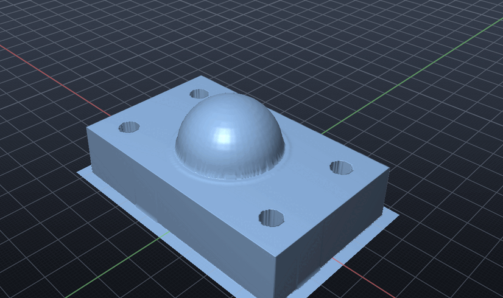

# CNC milling (CAM)

SI CDM makes milling and drilling toolpaths from a part, checks them in a stock simulation, and
posts G-code for the machine's controller. Use *Manufacture* in the menu, the `CAM` command, or
the `cam` MCP tool.


A full job (in [examples/cam-demo.txt](examples/cam-demo.txt)):

```text
CAM SETUP "Block 1" STOCK 4 TOP 1 MATERIAL aluminium
CAM TOOL 1 FLAT 8 LENGTH 40
CAM TOOL 2 BALL 6 LENGTH 40
CAM TOOL 3 DRILL 6
CAM TOOL 4 FACE 50
CAM FACE
CAM ROUGH TOOL 1 LEAVE 0.3 BOTTOM 0
CAM PARALLEL TOOL 2 SHALLOW SCALLOP 0.005
CAM WATERLINE TOOL 2 STEEP STEPDOWN 0.3
CAM DRILL CYCLE PECK
CAM CONTOUR TOOL 1 TABS 4
CAM SIMULATE SHOW
CAM POST bracket.nc FANUC
```

`CAM SIMULATE` on this job reports:

```text
Simulated 6 operations on a 0.375 mm grid:
  removed 100.9 cm3; stock left on the part: up to 1.444 mm, 0.032 mm on average
  no gouges
  no rapid moves through stock
  cycle time 28 min 51 s, 54.45 m cutting, 13.09 m rapid
```

The 1.4 mm is the concave corner where the dome meets the plate. A 3 mm ball can't reach into
it.



## How the paths are made

Every milling path starts from the *cutter location*: the lowest height the tool's tip can sit
at, at a point (x, y), without cutting into the part.

- **Drop-cutter:** the cutter location is found exactly for each triangle the tool could touch.
  The facet, edge and corner cases are each solved for flat, ball and bull-nose end mills.
- **Contours:** paths on a level follow where the cutter location crosses that level, using
  marching squares on a grid.
  - Each crossing is refined by bisection on the exact drop-cutter.
  - Corners the grid cut off are put back where they are sharp.
  - Chords that would cut into the part get more points.

So walls come out at exactly the tool radius plus the stock to leave, and rounded corners come
out as exact arcs (`G02 X3. Y46. I3. J0.`).

**Stock to leave** is handled by a cutter grown by that amount, which gives an exact offset
surface.

## Setup

```text
CAM SETUP ["body"] [STOCK margin | STOCK x,y,z | FROM x,y,z TO x,y,z] [TOP mm]
          [MATERIAL m] [ORIGIN CORNER|CENTRE|MODEL] [CLEARANCE mm] [RETRACT mm]
          [TOLERANCE mm] [MAXRPM n] [MAXFEED mm/min] [RAPID mm/min] [POST name]
```

- **Part:** the named body, the selection, or the part already set up.
- **Stock:** defaults to the part's box plus 2 mm around and 1 mm on top. Give one of:
  - `STOCK margin` for a margin all round;
  - `STOCK x,y,z` for a block of that size, centred on the part, from its bottom;
  - `FROM` / `TO` for two corners.

  Running `SETUP` again with only options keeps the stock.
- **Work zero (G54):**
  - `CORNER` (the default): the stock's top, front left corner;
  - `CENTRE`: the stock's top centre;
  - `MODEL`: the model origin.
- **Heights:**
  - The clearance plane (default 15 mm above the stock) is used between operations and at
    tool changes.
  - The retract plane (default 3 mm above the stock) is the highest any link inside an
    operation goes.
- **Materials:** `aluminium`, `steel`, `stainless`, `brass`, `castiron`, `titanium`,
  `plastic`, `wood`. Each has a cutting speed for carbide and for HSS, a chip load, a drill
  feed and a roughing depth.

## Tools and feeds

```text
CAM TOOL n FLAT|BALL|BULL|FACE|DRILL|SPOT|CHAMFER|TAP diameter
         [CORNER r] [FLUTES n] [LENGTH flute-length] [ANGLE deg] [PITCH mm]
         [STICKOUT l] [HOLDER diameter] [HOLDERLENGTH l] [HSS] [NAME "x"]
CAM TOOL DELETE n          CAM TOOLS            (the library with feeds and speeds)
```

**Defaults by tool type:**

| Type | Flutes | Flute length | Other |
| --- | --- | --- | --- |
| Flat or bull-nose end mill | 3 | 3 × diameter | |
| Ball end mill | 2 | 3 × diameter | |
| Face mill | 5 | 6 mm | |
| Drill | 2 | 5 × diameter | 118° point |
| Spot drill, chamfer mill | 2 | 3 × diameter | 90° |
| Tap | 3 | 3 × diameter | ISO coarse pitch (M6: 1.0 mm) |

*Manufacture → Add a Starter Tool Library* loads ten common tools.

**The holder:** `STICKOUT` is how far the tool sticks out of its holder. By default it is the
flute length plus a diameter, and at least 5 mm more than the flute length. `HOLDER` is the
holder's diameter, by default 3 tool diameters and at least 20 mm. The simulation checks the
holder against the stock and the part.

**Speeds and feeds:**

- Spindle speed: `rpm = Vc × 1000 / (π D)`, clamped to the machine's maximum.
- Feed: `rpm × flutes × chip load`.
- Plunge and ramp feed: 30% of the feed.
- Light stepovers thin the chip, so the feed rises by `D / (2 √(ae (D − ae)))` (at most 3×).
  This is how a 10% stepover in aluminium runs about 1.7× faster.
- Drills feed per turn. Taps feed exactly one pitch per turn.
- A tool with the maker's own cutting speed (`vc`) and chip load (`fz`, per turn for
  drills) from a catalogue uses those instead of the material table's.
- `RPM`, `FEED` and `PLUNGE` on an operation override the values from the tool and material.

### Tool libraries

The cutters you own live in your tool library, apart from any one job. Jobs take tools from
it, and vendor catalogues and other CAM systems' libraries feed into it.

```text
CAM LIBRARY [LIST [text]]                 the library, with each tool's maker, product and cutting data
CAM LIBRARY IMPORT file.csv|.json [REPLACE]
CAM LIBRARY USE #n|product|name [AS n]    into the job (its own T number, or the next free one)
CAM LIBRARY STORE n ...|ALL               the job's tools into the library
CAM LIBRARY DELETE #n|product|name
CAM LIBRARY EXPORT file [CSV|FUSION]      the library to a file
CAM LIBRARY LOAD file                     a file's tools straight into the job
CAM LIBRARY SAVE file [CSV|FUSION]        the job's tools to a file
```

**Where the library is:** `~/.config/sicdm/tools.json` on Linux,
`~/Library/Application Support/SI-CDM/tools.json` on macOS and `%APPDATA%\SI-CDM\tools.json` on
Windows. `SICDM_TOOL_LIBRARY` points it elsewhere, for example at a shared drive.

**File formats:**

| Format | Reads | Writes |
| --- | --- | --- |
| **SI CDM JSON** | `{"format": "sicdm-tools", "tools": [...]}` | `.json` by default |
| **CSV** (vendor catalogues, spreadsheets) | A header row naming the columns, in any order. Common names are understood: `Dia`/`DC`, `Flutes`/`Z`/`NOF`, `LOC`/`LCF`, `Corner Radius`/`RE`, `EDP`/`SKU`/`Product`, `Manufacturer`, `Vc` or `SFM` (feet per minute, converted), `Chipload`/`fz`, `Material` (HSS or carbide) | `.csv` |
| **Fusion 360 tool library** (`.json` export) | Flat, ball, bull-nose, face, chamfer and spot mills, drills and taps, with their geometry (`DC`, `NOF`, `LCF`, `RE`, `SIG`, `TA`, `TP`), post number, maker and product, and the first preset's `v_c` and `f_z` (or `f_n`). Inch libraries are converted | `FUSION` |

What a file doesn't say comes from the tool type's defaults. Tools of a type SI CDM doesn't
cut with (thread mills, slot mills...) are left out, and the import lists them. Importing
the same catalogue twice adds nothing twice.

## Operations

Each operation is added, generated and reported straight away:

```text
Added 2. Rough with T1  8 mm flat end mill: 7190 moves, 19.19 m cutting, 10 min 39 s, S11930 F2337 (plunge 701) mm/min
```

If no `TOOL` is given, the operation uses the first suitable tool in the library.

| Command | What it does |
| --- | --- |
| `CAM FACE` | Zig-zag passes over the whole stock, from the stock top down to the part's top. Default stepover 70%, depth steps up to 1 mm. |
| `CAM ROUGH` | 3D roughing (see below). |
| `CAM POCKET` | Roughing of the regions the part closes in on every side. |
| `CAM CONTOUR` | The profile at each depth down to `BOTTOM`. See below. |
| `CAM PARALLEL` | Passes across the part (`ANGLE` from X), following the surface. See below. |
| `CAM WATERLINE` | Constant-height loops around the part, level by level. See below. |
| `CAM DRILL` / `SPOT` / `PECK` / `TAP` | Drilling at the part's holes that fit the tool. See below. |
| `CAM BORE` | Helical interpolation of holes wider than the end mill. See below. |

**`CAM ROUGH`** clears the part at each depth:

- **Pattern:** rings a stepover apart, from the middle of each region outwards (default 40% of
  the diameter, taken from a distance field). `RASTER` gives zig-zag instead. The region's
  edge is always finished at that depth.
- **Depths:** extra depths are added at the part's flat faces, so floors come out exact.
- **Entries:** the tool ramps in at 3° along the ring. Tiny regions get a plunge.
- **Links:** inside a region the tool stays down when the link is clear. Otherwise it lifts
  only as high as the part under the way needs.
- **Depth of cut:** from the material (half the diameter in aluminium, a quarter in steel).
  `LEAVE` sets the stock to leave.

**`ADAPTIVE`** (on `ROUGH` or `POCKET`) is high-efficiency clearing:

- **Defaults:** a light stepover (12% of the diameter) and a deep stepdown (2 diameters, or
  up to the flute length). The chip-thinning feed rises to match.
- **Engagement:** the tool tracks the material it has cleared at each depth and measures the
  angle of its edge in uncut material ahead. Where going straight on would take more than
  1.5 times its share, it loops trochoidally instead: in slots, at the start of the middle
  ring, and at tight corners. Each loop is half a stepover beyond the last. The first loops
  of a run are smaller, so the load builds gradually. Loops shrink to clear the part.
- **Result:** on a 40 × 50 × 12 pocket with a 10 mm end mill, fewer than 2% of the path
  points see more than 90° of engagement. Offset rings at 40% run at 50–70° most of the way
  and up to about 120°, and a slot is 180°.

**`REST`** (on `ROUGH` or `POCKET`) is rest machining:

- **What it cuts:** only the material the operations before it left. Typically a smaller tool
  follows a big one into the corners and steps.
- **How:** those operations are simulated first. At each depth, the new tool clears only
  where it can reach material left between that depth and the one above. Material is counted
  only above the part plus `LEAVE`, and only when it is thicker than 0.08 mm.
- **Example:** after a 12 mm end mill, a 4 mm rest pass in a 40 × 50 pocket cuts only the four
  corners: under a quarter of the path the 4 mm tool needs from scratch.

**`CAM CONTOUR`** cuts the profile:

- `OUTSIDE` (the default) cuts the outside profile, `INSIDE` cuts the walls of pockets and
  holes, and `BOTH` cuts all of them.
- Climb milling is the default (`CONVENTIONAL` reverses it).
- Lead in and out is a quarter arc (`LEAD r`, default half the radius) on the free side.
- `TABS n` (with `TABWIDTH` and `TABHEIGHT`) adds holding tabs on the last depths.

**`CAM PARALLEL`** finishing:

- `SCALLOP h` sets the stepover from the cusp height left. With a ball end mill it is
  `2 √(h (2r − h))`.
- The passes are sampled densely. Points are added wherever a straight move would cut into the
  part, then dropped where they lie in a straight line.
- `SLOPE a b` or `SHALLOW` (0–50°) limits it to the gentler surfaces.

**`CAM WATERLINE`** finishing:

- Each level's loops are found exactly, like a contour.
- `STEEP` (45–90°) limits it to the walls, so it pairs with a shallow parallel pass.

**`CAM DRILL`** and its cycles:

- `CYCLE spot|drill|peck|chipbreak|tap|bore`, with `PECK q` and `DWELL s`.
- Depths:
  - Through holes are drilled past the bottom by the drill's point plus 0.5 mm.
  - Spot drills cut a spot just wider than the hole.
  - Taps stop two pitches short of a blind hole's bottom.
- `AT x,y x,y … [DEPTH d | THROUGH] [DIAMETER d]` gives the holes by hand.

**`CAM BORE`** cuts holes wider than the end mill:

- The tool goes down a helix at a 4.5° pitch, makes a flat turn at the bottom, then moves to
  the middle and out.
- The radius is checked against the part with the exact cutter test, so a faceted hole is not
  gouged.

**Options common to all the operations:**

`TOOL n`, `STEPDOWN`, `STEPOVER mm|n%`, `LEAVE`, `TOP z`, `BOTTOM z`, `DEPTH d` (below the
stock top), `ANGLE`, `NAME "x"`, `RPM`, `FEED`, `PLUNGE`.

**Holes:** `CAM HOLES` lists the part's round vertical holes. For each it gives the size
(fitted to a circle), the centre, the top and bottom, and whether it goes through.

## Multi-axis

**3+2 indexed.** Any operation takes `INDEX a c` (or `A deg`, `C deg`). The table turns to
those angles first, then the operation runs as a 3-axis operation on the part and stock as
turned. The angles follow a trunnion table: C turns the part about Z, then A tilts it about
X, both through the rotary centre (the stock's centre). So a face pointing −Y comes up with
`A -90`, and a face pointing +X with `INDEX -90 -90`.

```text
CAM POCKET TOOL 1 A -90            (the pocket on the front face)
CAM DRILL TOOL 2 INDEX -90 -90     (holes in the right face, found on the turned part)
```

**4-axis rotary.** The part turns on A about X while the tool, kept over the axis, follows it:

```text
CAM ROTARY [TOOL n] [STEPOVER s] [STEPDOWN d] [LEAVE l] [ALONG] [TOP x] [BOTTOM x]
```

- **Exact surface:** at each angle the part is turned and the tool dropped onto it, so the
  paths follow the true surface, flats and pockets included.
- **Patterns:** by default a helix advances a stepover along X each turn (A keeps turning).
  `ALONG` gives passes along the axis instead, a stepover apart at the largest radius.
- **Roughing:** `STEPDOWN` adds roughing levels from the stock's swing radius down before the
  finish. Each level rapids only to just above what the level before left.
- **X range:** `TOP` and `BOTTOM` limit it (it is the part's length by default).

**Simultaneous 5-axis.** A ball end mill finishes the surface with the tool leaning as it
cuts. On a table-table machine (`CAM MACHINE PRESET trunnion`) the table turns on A and C. On
a head-table machine (`CAM MACHINE PRESET head-table`) the head tilts on B and the table turns
on C:

```text
CAM 5AXIS [TOOL n] [SCALLOP h | STEPOVER s] [ANGLE deg] [SLOPE from to]
          [LEADANGLE deg] [SIDETILT deg] [MAXTILT deg]
```

- **Passes:** zig-zag rasters over the part at `ANGLE`, a scallop's stepover apart, as in
  parallel finishing. `SLOPE` keeps to surfaces in that range.
- **Tool axis:** the surface normal, leaned `LEADANGLE` forward along the cut (default 10, so
  the ball cuts off its centre, where it doesn't rub) and `SIDETILT` across it (default 0).
  It leans at most `MAXTILT` from vertical (default 60) and is smoothed along the pass.
- **Clear of the part:** the shank and holder are checked along the axis at each point;
  where they would touch, the axis stands back up towards vertical until they don't.
  Points that can't be cleared, or that the machine's A (or B) travel can't reach, are
  skipped.
- **Clear of the stock left:** the operations before are simulated (in voxels), and the
  stock they leave is checked too.
  - **The finish's to cut:** stock on top of the part, within roughing's steps and stock to
    leave, and stock within the stock to leave beside walls.
  - **In the way:** stock under an overhang, which roughing from above can't reach, and
    anything thicker.
  - **What it does there:** the shank and holder keep out of all stock and the flutes out
    of stock in the way, the axis standing up where they would touch. Moves in and out that
    would rub any stock go at feed, not rapid.
- **Turning:** each move turns the table at most 1.5 degrees. Where the table would flip
  (the axis passing upright), the run ends.
- **Links:** between runs close together the tool goes across lifted along its axis, at
  feed, where the ball, shank and holder stay clear of the part all the way. Elsewhere it
  goes up to the clearance height.
- **Needs:** a ball end mill, and a machine with A and C, or B and C. The table isn't indexed
  by hand (no `INDEX`).

**Posts:**

- The work zero is the rotary centre for the whole program.
- The table turns (`G0 A.. C..`) at the clearance height, the short way round.
- Rotary moves use inverse-time feed (`G93`): each move's F is the feed over its length along
  the part. Then the post returns to `G94`.
- **Head-table machines:** the 5-axis moves go out in the control's tool centre point mode,
  `G43.4 H..` on Fanuc and `G234 H..` on Haas. X, Y and Z are the tool's tip on the part,
  with B and C, and the control works out the head's pivot and the table's turn. Afterwards,
  at the clearance height, the head comes upright (`G0 B0`) and `G43 H..` turns plain length
  compensation back on. LinuxCNC has no standard tool centre point mode, so its post refuses
  these jobs. A head-table machine can't turn the part about X, so rotary wrapping and
  `INDEX A` are refused; `INDEX C` works.
- GRBL posts 3 axes, so it refuses multi-axis jobs.

**Simulation:** a job that turns the part is simulated in voxels instead of a height field:

- **Grid:** a fifth of the smallest tool's radius, up to about 6 million voxels.
- **Cutting:** each move cuts with the tool's tip shape and flutes along its own axis, in the
  part's frame. Turning moves are followed in steps under a voxel.
- **Gouges:** voxels of the part's inside that get cut (at least a voxel deep).
- **Stock left:** measured through the remaining stock to the part's skin.
- **Collisions:** the shank and holder are checked as for 3 axes.

`SIMULATE SHOW` gives the voxel stock as a body.

## The job

```text
CAM LIST       CAM GENERATE       CAM DELETE n       CAM CLEAR       CAM SHOW | HIDE
```

- **Saving:** the setup, tools and operations are saved in the project. The toolpaths are
  remade when needed.
- **Staleness:** a part that changes or moves after its paths were made gets them remade by
  the next CAM command.
- **Display:** the toolpaths show in the 3D view. Cuts are in each operation's colour, plunges
  are yellow and rapids are thin red.

## Simulation

```text
CAM SIMULATE [SHOW]
```

The stock is modelled as a fine height field: a grid of an eighth of the smallest tool's
radius, up to 2.5 million points (coarser when one tool would cover more than about 250 000).
Each move cuts it with the tool's real shape (flat, ball, bull nose or drill point), exactly
along the move: the lowest the cutting edge reaches over each point.

The report gives:

- **Volume removed.**
- **Stock left on the part:** the most and the average.
- **Gouges:** points cut into the part by more than twice the tolerance, measured square to
  the surface. A path may sit the tolerance sideways into a wall, so the part's height is taken
  as the lowest within that reach of each point.
- **Rapid moves through stock.**
- **Shank hits:** stock above a tool's flute length while it is cutting.
- **Holder collisions:** moves where the stock or the part, within the holder's radius,
  reaches above the holder's face (the tip plus the stickout), rapids included. The report
  gives the stickout that would clear them all.
- **Cycle time:** the feeds, the rapid rate and the tool changes.

`SHOW` adds the cut stock as a body, *Stock (simulated)*, and hides the part.

## Post processors

```text
CAM POST file.nc [FANUC | HAAS | GRBL | LINUXCNC] [FORCE]
```

Each program is read back and checked before it is written (see
[Machines and program checks](#machines-and-program-checks)).

| | Fanuc | Haas | LinuxCNC | GRBL |
| --- | --- | --- | --- | --- |
| Frame | `%`, `O1000 (NAME)`, `%` | the same | `%` | none |
| Units / modes | `G21 G17 G40 G49 G80 G90 G94` | `G00 G17 G40 G49 G80 G90`, `G21` | the same plus `G64 P` tolerance | `G21 G17 G90 G94` |
| Tool change | `T1 M06`, `G43 H01` | the same | `T1 M6`, `G43 H1` | `M0 (Change to T2 …)`, then touch off |
| Drilling | `G81 G82 G83 G73 G84 G85` with `G98`, `G80`; `M29` rigid tap | the same, no `M29` | the same; taps with `G33.1` | expanded to moves; tapping refused |
| End | `G91 G28 Z0.`, `M30` | `G53 Z0.`, `M30` | `G53 G0 Z0`, `M2` | `M30` |

**Coordinates and words:**

- Coordinates are relative to the work zero.
- Only the words that change are written.
- Fanuc and Haas numbers keep their decimal point (`25.`).

**Arcs:**

- Arcs (`G2`/`G3` with `I J`, and helical arcs with `Z`) are fitted to runs of cuts that lie on
  a circle within the tolerance.
- They make up rounded corners, bores and lead arcs.

**Tool length:** a fresh tool always moves over in X and Y first. It goes down in Z only after
`G43` puts its length offset on, so no Z move happens without it.

## Machines and program checks

```text
CAM MACHINE [PRESET name] [TRAVEL x y z] [LIMITS x0,y0,z0 x1,y1,z1] [ZERO x,y,z | OFF]
            [A min max | CONTINUOUS | OFF] [B ...] [C ...] [POCKETS n]
            [MAXRPM n] [MAXFEED mm/min] [RAPID mm/min] [TOOLCHANGE s] [NAME text]
CAM CHECK [post]                 (or Manufacture > Check the Program)
CAM CHECK file.nc [post]         a program on disk, against the job
CAM POST file.nc [post] [FORCE]
```

**The machine** is saved with the job. Its parts:

- **Travel:** the spindle nose's travel in machine coordinates. `TRAVEL 762 406 508` means
  X 0..762, Y 0..406 and Z -508..0. `LIMITS` gives the ranges exactly as the control's
  machine position shows them.
- **Work zero:** `ZERO` is where G54 sits in machine coordinates. With it, every move is
  checked against the travel. Without it, only each axis's span is checked.
- **Z:** Z is checked at the spindle nose, which is the tool tip plus the tool's length
  (holder and stickout).
- **Rotary axes:** A turns the table about X and C about Z. B tilts the spindle head about Y
  (a head-table machine has B and C, and no A). Each has limits in degrees, or is
  continuous, or absent.
- **Tool changer:** `POCKETS` is the highest T number the changer takes.
- **Spindle and feeds:** the spindle speed and feed limits. Feeds and speeds are worked
  out within them.

**Presets** are typical figures for each class of machine. Set your machine's real figures
over them.

| Preset | Travel X × Y × Z (mm) | Spindle | Rotary | Pockets |
| --- | --- | --- | --- | --- |
| `generic` | not checked | 12000 rpm | A, C unlimited | any |
| `vmc` | 762 × 406 × 508 | 8100 rpm | none | 20 |
| `vmc-4th` | the same | 8100 rpm | A unlimited | 20 |
| `trunnion` | 610 × 406 × 394 | 12000 rpm | A -35..120, C unlimited | 30 |
| `head-table` | 800 × 600 × 500 | 15000 rpm | B -110..110 (head), C unlimited | 40 |
| `benchtop` | 457 × 279 × 413 | 10000 rpm | none | 10 |
| `router` | 800 × 800 × 100 | 24000 rpm | none | manual |

**The read-back.** Every `CAM POST` reads its program back the way the control would run
it, then checks the result. Arcs, helices and canned cycles are expanded as the control
moves: drill, dwell, peck, chip-break, tap, bore, and LinuxCNC's `G33.1`.

- **Program:**
  - Every word and code must be one the dialect has. For example, GRBL has no canned
    cycles and no `M6`.
  - Fanuc and Haas lengths must have a decimal point. `X10` without one is 10 µm on those
    controls.
  - Units (`G21`) and the work offset (`G54`) must be set.
  - Before a fresh tool moves in Z, it needs `G43` with that tool's own `H`.
  - The spindle must be on, and a feed set, before any cut. In `G93` (inverse time),
    every cutting move needs its own `F`.
  - Each arc must end the same distance from its centre as it starts. Controls stop
    with an alarm otherwise.
  - Canned cycles need R above the bottom, and a peck depth.
  - `G28` must not go down to Z0 on its way home (as `G90 G28 Z0` does).
  - The program must end with `M30` or `M2`.
- **Machine:**
  - travel, with each tool's length on Z (in tool centre point mode, the tip turned with
    the table and the length along the tilted tool);
  - which rotary axes exist, and their limits;
  - spindle speed, feed, and the tool pockets.
- **Job:**
  - The read-back cutting path is compared with the toolpath, both ways: nothing is cut
    that the toolpath doesn't cut, and nothing in the toolpath is missed.
  - The tolerance covers the arc fitting (5 times the setup's tolerance) and the rounding
    of the numbers. A typical job reads back within 0.04 mm at the default 0.01 mm
    tolerance.
  - No rapid move the post adds may cross the stock below its top. The toolpath's own
    rapids, inside material already cut, are checked by `CAM SIMULATE`.

A program with errors is not written; `FORCE` writes it anyway. The report lists the
findings with their line numbers:

```text
Not written: reading the fanuc program back found 1 error (CAM POST ... FORCE writes it anyway)
  ERROR: X travel: the tool goes to 718..828 in machine coordinates, past the machine's 0..762
```

**What this does and doesn't prove.** The read-back proves that a program says what the
toolpath says, in words its dialect has, within the machine's limits. It runs the
program the way the published dialects behave. It doesn't know your control's parameters
and options: the peck retract distance, macro tool changes, rotary direction settings,
and similar. Before cutting, still prove a new post or machine on the real control:
single block, with the feed override low, above the part.

## Over MCP

The `cam` tool has these operations:

- `setup`, `tool`, `library`;
- `face`, `rough`, `pocket`, `contour`, `parallel`, `waterline`, `drill`, `bore`, `rotary`, `5axis`;
- `machine` (a preset);
- `holes`, `list`, `generate`, `simulate`, `post`, `delete`, `clear`.

Its parameters are listed in the tool's schema.

```json
{"operation": "setup", "body": "Bracket", "stock_margin": 3, "material": "aluminium", "post": "haas"}
{"operation": "tool", "number": 1, "type": "flat", "diameter": 6}
{"operation": "library", "library": "import", "path": "harvey.json"}
{"operation": "library", "library": "use", "entry": "H-8", "as": 3}
{"operation": "rough", "leave": 0.3, "stepover_percent": 35}
{"operation": "pocket", "adaptive": true}
{"operation": "tool", "number": 2, "type": "flat", "diameter": 4, "stickout": 20, "holder": 25}
{"operation": "pocket", "tool": 2, "rest": true}
{"operation": "pocket", "tool": 1, "index_a": -90}
{"operation": "rotary", "tool": 3, "stepover": 0.5, "stepdown": 3}
{"operation": "machine", "preset": "trunnion"}
{"operation": "5axis", "tool": 3, "scallop": 0.01, "lead_angle": 8, "max_tilt": 45}
{"operation": "simulate", "show": true}
{"operation": "post", "path": "bracket.nc"}
```

## Not yet

These are not modelled yet:

- **Machines:** 5-axis on head-head machines (two tilting head axes), and swarf (flank)
  cutting. (Lathes have their own job: see [lathe.md](lathe.md).)
