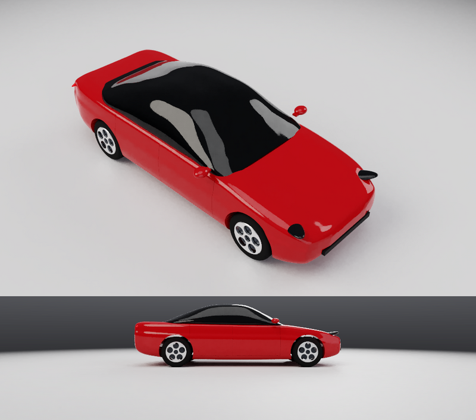
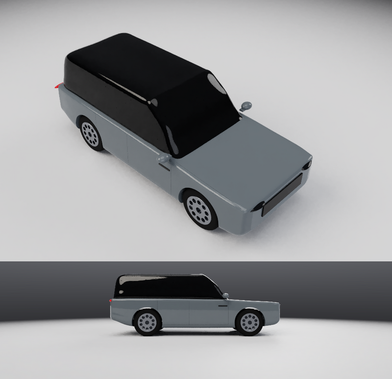
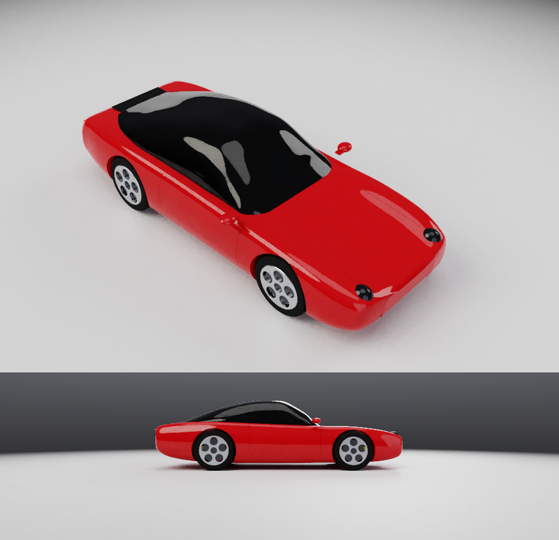

# Car design, A to Z

The plan for designing a whole car in SI-CDM, from the package to the clay mill, with tools of the
kind automotive studios use for concept and Class-A surfacing. Each step is a feature of its own,
built, tested and documented in turn. This page says what is there now and what comes next.

Status: **done** works and is documented; **planned** is not built yet. The wider plan for
industrial, Class-A and robot product design is the [design roadmap](design-roadmap.md).

## A sample: a fastback electric sedan

`RUN docs/examples/ev-sedan.txt` builds a fastback EV sedan exterior to its overall sizes:
4720 mm long, 1850 wide, 1440 high, a 2875 wheelbase, 140 ground clearance and 235/45 R18
tyres. `tools/ev_sedan.py` writes it from tables of the car's lines, so the form is tuned there.

- The body is a solid lofted through closed cross-sections: front fender crowns standing above
  the bonnet, a waist between the axles and haunches over the rear wheels, a shoulder crease,
  and the nose and tail drawn in small so the ends come out round.
- The arches, a lower air intake and the door shut lines are cut into it; the glasshouse is a
  second loft in tinted glass; headlamps (dark glass over a chrome reflector), glowing tail
  lamps and mirrors on arms sit on it.
- Each wheel is a revolved tyre with rounded shoulders and a revolved rim with five spoke
  windows cut in a circular pattern, a brake disc and a caliper behind.

A test builds it and checks every one of those sizes, that the parts are closed solids and that
the tyres stand on the ground.

It is a concept-stage model, well short of a production Class-A surface model of the kind a
studio builds in Alias: the body is one loft rather than separate panels matched G2 across
their edges, there is no interior, and the lamps are simple forms. Those come with the steps below
(surface matching A3, rail surfaces A4, surface fillets A5, evaluation A6, panels B5, lamps B6,
car paint B9).

## A sample: a full-size luxury SUV

`RUN docs/examples/suv.txt` (written by `tools/suv.py`) builds a full-size luxury SUV to its
overall sizes: 5052 mm long, 2047 wide, 1870 high, a 2997 wheelbase, 230 ground clearance and
285/45 R22 tyres. It shows the same tools giving a very different form:

- An upright body with near-vertical sides, a tall blunt nose and a long flat clamshell bonnet
  whose shut lines run along the fender tops; door shut lines and sills.
- A dark glasshouse set in from the shoulders with a flat roof, so the roof seems to float.
- A dark grille between slim headlamps, tail lamps with a dark band across the tailgate, side
  vents, mirrors on arms, and ten-spoke wheels that fill the arches.

A test builds it and checks those sizes, that the parts are closed solids, that the tyres stand on
the ground and that the nose points +X.

## A sample: a rear-engined sports coupe

`RUN docs/examples/sportscar.txt` (written by `tools/sportscar.py`) builds a rear-engined sports
coupe to its overall sizes: 4519 mm long, 1852 wide, 1298 high, a 2450 wheelbase, 110 ground
clearance, and staggered wheels: 235/40 R20 at the front, 305/30 R21 at the rear.

- Raised front fenders carry upright oval headlamps, the bonnet low between them.
- A teardrop glasshouse set well in from the shoulders; its roof runs in one slope down to the
  engine lid with its grille; wide haunches over the rear wheels; a full-width rear light bar
  and a diffuser.
- Five-spoke silver wheels, wider at the rear, with yellow calipers.

The arches are cut from each side only: one cylinder right across the car would cut through the
bonnet, which sits between the fenders lower than the arches' tops (the first try did exactly
that). A test builds it and checks the sizes, both tyre sizes, that the rears are wider, and that
the bonnet over the front axle is whole.

## A. Class-A curves and surfaces

| # | Step | Status | Where |
| --- | --- | --- | --- |
| A1 | CV curves: control vertices, degree 1-7, spans, knot insertion, rebuild, fit; ends matched at G0/G1/G2/G3 and measured | **done** | `CVCURVE`, [CAD: CV curves](cad.md#cv-curves-class-a) |
| A2 | Blend curve between two curves (G0-G3 at each end, tension); curves projected onto surfaces and solids (along a direction or to the nearest points, within a tolerance) | **done** | `CVCURVE BLEND`, `CVCURVE PROJECT` |
| A3 | Surface align: a surface's edge matched to another surface or curve at G0-G3 | planned | |
| A4 | Rail surfaces (profiles along one or two rails), square (four sides, G1/G2 to neighbours), skin | planned | |
| A5 | Surface fillet (rolling ball, curvature-continuous option), freeform blend, flange | planned | |
| A6 | Evaluation: highlight lines, curvature combs on curves and sections, edge continuity report, draft map | planned (zebra and curvature maps exist: `ANALYZE`) | |
| A7 | Dynamic shape modelling: lattice, bend, twist, taper on surfaces and curves | planned | |
| A8 | Subdivision cage modelling turned into B-spline patches | planned | |
| A9 | Reverse engineering: surfaces fitted to scans with a deviation map | planned (point clouds exist: `POINTCLOUD`) | |

Already there and used along the way: lofted, boundary (Coons), network (Gordon), extruded,
revolved, offset and blend surfaces, surface fairing, thicken and knit (`SURFACE`, `THICKEN`,
`KNIT`), zebra and curvature analysis.

## B. The car

| # | Step | Status |
| --- | --- | --- |
| B1 | Package: wheelbase, track, overhangs, ground clearance, wheel and tyre sizes, driver and passenger H-points with mannequins, vision angles, approach / departure / breakover angles, a package report | planned |
| B2 | Blueprint underlays: side, front, top and rear images scaled and aligned to the wheelbase | planned (reference images exist: `IMAGE`) |
| B3 | Body surfacing: symmetry plane with continuity across it, character lines, body side, bonnet, roof, glasshouse; a starting body from the package proportions | planned |
| B4 | Wheels and tyres from a size code (e.g. 245/40 R19): tyre, rim with spokes, brake disc and caliper, at the wheel centres | planned |
| B5 | Panel break-up: shut lines cut into the body as gaps with flush and return flanges; the panel list | planned |
| B6 | Lamps, glass and grille | planned |
| B7 | Interior basics: seats, instrument panel and steering wheel from the H-points | planned |
| B8 | Aerodynamics estimate: frontal area, drag coefficient and a pressure map, with its accuracy stated | planned |
| B9 | Visualisation: car paint (metallic flake, clear coat), tyre rubber, chrome, tinted glass; studio and turntable | planned (materials, rendering and turntable video exist: `MATERIAL`, `RENDER`, `VIDEO`) |
| B10 | Hand-off: panels thickened, STEP / IGES out, a package drawing, a 5-axis finishing path for a clay model | planned (STEP, IGES, drawings and 5-axis CAM exist) |
| B11 | A complete sample car, built from the package to the render, in the user guide | planned |
