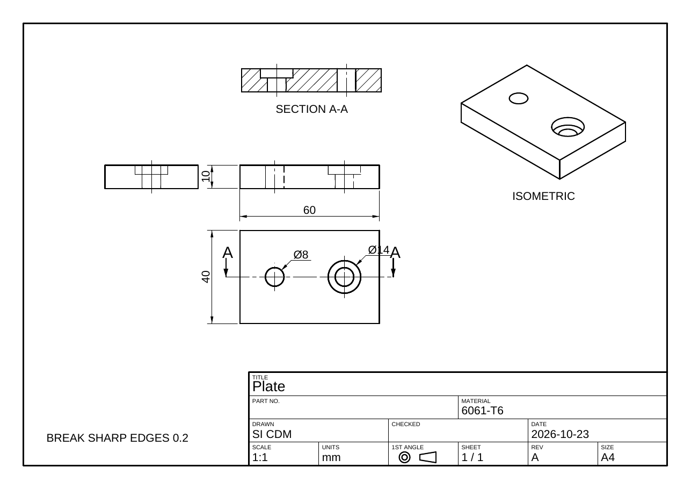

# Drawings

SI-CDM makes 2D engineering drawings from the 3D model: the sheet a machinist or an
inspector reads. The views come from the model itself, so a drawing follows the part as it
changes.



```text
SHEET NEW A3                     front, top, right and isometric views, at a scale that fits
SHEET SECTION                    a section through the front view's middle
SHEET AUTODIM                    overall sizes and hole diameters
SHEET TITLE MATERIAL 6061-T6
SHEET EXPORT bracket.pdf         (or .svg, .dxf)
```

In the app, everything is in the **Drawing** menu: *New Drawing*, *Show Drawing*,
*Dimension Automatically*, *Section Through Front / Top*, *Add View*, *Scale*,
*Export...* and *Delete*. The drawing opens in its own window over the 3D view. The
drawing is saved in the project file.

## The sheet

- **Sizes:** A4, A3 (the default), A2, A1, A0, LETTER (ANSI A), TABLOID (ANSI B), ANSI C and
  ANSI D. Landscape by default, or `PORTRAIT`.
- **Projection:** first angle (ISO, the default) or third angle (ASME, `THIRD`). The
  projection symbol in the title block shows which.
- **Scale:** a standard scale (1:1, 1:2, 1:5, 2:1, 5:1, ...) chosen so the views fit,
  or the scale you give.
- **Border and title block:** a 10 mm border, and a 180 × 40 mm title block in the bottom right
  corner. It has the title, part number, material, drawn, checked, date, scale, units,
  projection, sheet, revision and size. Fill a field with `SHEET TITLE field text`. The fields
  are TITLE, PART, MATERIAL, DRAWN, CHECKED, DATE, REV, SHEET and COMPANY.

## Views

`SHEET NEW` lays out four views:

- the **front** view;
- the **top** view: below the front in first angle, above it in third angle;
- the **right** view: left of the front in first angle, right of it in third angle;
- an **isometric** view in the top right corner.

The front, top and right views line up with each other.

| Command | What it does |
| --- | --- |
| `SHEET NEW [bodies] [A3] [PORTRAIT] [THIRD] [SCALE 1:2]` | A new drawing of the named bodies (default: every visible body) |
| `SHEET VIEW ADD FRONT\|BACK\|TOP\|BOTTOM\|LEFT\|RIGHT\|ISO [AT x,y] [SCALE 2:1] [NOHIDDEN]` | Another view, placed where the projection puts it unless `AT` gives a place |
| `SHEET VIEW MOVE name x,y` | Moves a view's centre (sheet mm from the bottom left corner) |
| `SHEET VIEW SCALE name 2:1` | A view at its own scale, noted under it |
| `SHEET VIEW HIDDEN name ON\|OFF` | Hidden lines dashed, or left out |
| `SHEET VIEW DELETE name` | Removes the view and its dimensions |
| `SHEET SCALE 1:2` · `SHEET SIZE A2 [PORTRAIT]` · `SHEET PROJECTION FIRST\|THIRD` | Changes the sheet and lays the views out again |

When views run off the sheet, sit on the title block or overlap each other, the command says
so. A smaller scale, a larger sheet or `SHEET VIEW MOVE` fixes it.

**Which lines are drawn:**

- **Visible edges** are thick lines.
- **Hidden edges** are dashed. They are found by a depth test against the model itself.
- **Edges:**
  - On exact solids (STEP and IGES imports, primitives, extrusions, revolves), the boundaries
    between faces.
  - Smooth (tangent) edges are left out, except as thin lines in the isometric view, where they
    show the shape.
  - On meshes, creases sharper than 30°.
- **Silhouettes** of curved faces.
- **Centre lines:**
  - centre marks on holes and bosses seen end on;
  - centre lines along the axes of those seen from the side.

## Sections

```text
SHEET SECTION [view] [VERTICAL|HORIZONTAL] [AT position] [FLIP] [LABEL B]
```

**The cut line:**

- It crosses the view: up and down (`VERTICAL`, the default) or across (`HORIZONTAL`).
- `AT` places it in model mm along the view's horizontal or vertical axis. Without `AT`, it
  goes through the middle of the bodies.
- The parent view shows the cut line with a letter and arrows that point the way the section looks.
- `FLIP` looks the other way.

**The section view:**

- It shows what is left behind the cut.
- The cut faces are outlined and hatched at 45°.
- It is labelled SECTION A-A (B-B, ...).
- It is placed in a free space near its parent, on the side the viewer of the cut stands.
- Sections cut from a top or bottom view are turned the right way up.

## Dimensions

```text
SHEET AUTODIM [view]
SHEET DIM HORIZONTAL|VERTICAL|ALIGNED view x,y,z x,y,z [OFFSET mm] [TEXT text]
SHEET DIM DIAMETER|RADIUS view centre-x,y,z point-on-circle-x,y,z
SHEET DIM DELETE n · SHEET DIM CLEAR
```

**Tied to the model:** a dimension measures between model points, so it follows the model.

**What each kind measures:**

- **Horizontal** and **vertical:** the distance along the view's axes.
- **Aligned:** the length as the view shows it.
- **Diameters** and **radii:** read Ø and R.

**Placement:**

- `OFFSET` is how far the dimension line stands from the feature, in sheet mm. A negative
  offset puts it below or to the left.
- `TEXT` replaces the measured value, for example with a tolerance.

**`SHEET AUTODIM` adds:**

- each orthographic view's overall width and height, where another view doesn't already
  show them;
- the diameters of round holes and bosses seen end on.

Running it again adds nothing twice.

**In the drawing window:**

1. Turn on *Dimension Tool*.
2. Click two points. They snap to vertices and edge ends.
3. The dimension is horizontal, vertical or aligned, whichever the points suggest.

## Export

| Format | Contents |
| --- | --- |
| **PDF** | Vector, the sheet at true size (print at 100% for a scale drawing). Text in Helvetica |
| **SVG** | Vector, mm units, dashed hidden and chain centre lines |
| **DXF** (R12) | Lines and text in mm on layers VISIBLE, HIDDEN, CENTER, THIN (dimensions and hatching), BORDER and CUT, with the HIDDEN and CENTER line types. Opens in AutoCAD, DraftSight, LibreCAD and QCAD |

Exports use a finer hidden-line test than the drawing window.

## For AI agents

The MCP tool `drawing` does all of this. Its operations are:

- `new`, `list` and `delete`;
- `view_add`, `view_move`, `view_delete`, `view_scale` and `view_hidden`;
- `section`, `dim`, `dim_delete` and `autodim`;
- `title` and `note`;
- `scale`, `size` and `projection`;
- `export`.

`run_command` takes any `SHEET` line too.
