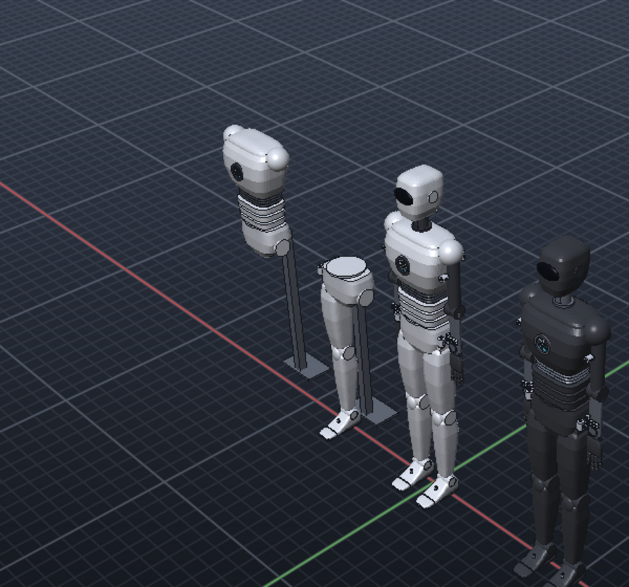
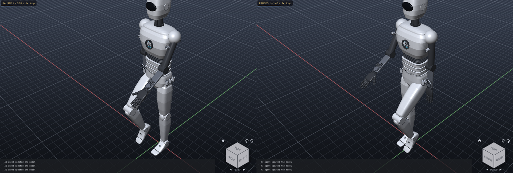

# Humanoid body library





Parametric humanoid robot parts for the **Library** panel (category *Humanoid body*) and the `PART`
command: head, neck, upper body (chest, heart, gut, midriff), low hip (pelvis), thighs, legs and feet.
Together with the [robot arm and hand](robot-arm.md) they make a complete **Humanoid Robot**, head to
toe. As with the arm and hand, every joint is a limited circular motion driven by the library **DC
motor** (used as a gear motor), so the robot moves in the Simulation window straight after it is
inserted.

## Human body vs robot body

| Human anatomy | Robot part (kind) | Joint(s) | Notes |
| --- | --- | --- | --- |
| Skull, face | **Head** (`robot_head`): rounded shell, dark **visor**, ear sensor pods | Neck pitch and roll at the head pivot | The visor stands in for the face / camera window |
| Cervical spine (C1–C7) | **Neck** (`robot_neck`): column with joint rings | Neck rotation at its base; nod and tilt at its top | Atlanto-occipital nod and atlanto-axial turn become 3 stacked revolute joints |
| Rib cage, shoulder girdle | **Chest** (`robot_chest`): thorax shell with shoulder caps | Carries both shoulders (see the arm) | The scapula / clavicle motion is left out |
| Heart | **Heart** (`robot_heart`): power core in the chest: housing, glowing core, coolant **pump impeller** | The pump turns continuously at the heart rate (72 rpm = 72 bpm by default) | Robots carry batteries and a coolant loop, not blood: the "heart" is the power and cooling core |
| Diaphragm / upper abdomen (midriff) | **Midriff** (`robot_midriff`): bellows boot over the lumbar actuator | Trunk flexion (bend forward) and lateral flexion at its base | Like the thoracolumbar spine |
| Abdomen (gut) | **Gut** (`robot_gut`): three armour plates over the dark **battery core** | Trunk rotation at its base (the waist) | The battery sits where the viscera are, low and central |
| Pelvis, hip sockets (low hip) | **Pelvis** (`robot_pelvis`): hip axle housings, waist bearing | Root of the body: the waist and both hips | The hip ball-and-socket joints (3 DOF each) become 3 stacked revolute joints |
| Femur (≈ 430 mm) | **Thigh** (`robot_thigh`): hip ball, tapered shell | Hip flexion, abduction, internal rotation | The knee motor sits on its back, like the hamstrings |
| Tibia + fibula (≈ 420 mm) | **Shin** (`robot_shin`): knee hub and knee cap, calf, ankle pin | Knee flexion | The ankle motors sit in the calf, like the calf muscles |
| Foot (tarsals, metatarsals) | **Foot** (`robot_foot`): ankle hub, rubber sole | Ankle plantarflexion and inversion | The subtalar and talocrural joints become 2 revolute joints |
| Toes (phalanges) | **Toe** (`robot_foot` part 1) with its own sole | Toe extension at the ball of the foot (MTP) | One hinged toe plate for all five toes |

The robot body has **20 joints** (neck 3, waist 1, trunk 2, each leg 7) plus **7 per arm** and the
hands (15 joints each), every one on its own DC gear motor.

## Joints and standard range of motion

All angles are measured from the standing pose (0°), arms hanging. Every joint moves **both ways**,
like a human joint, between two **hard stops** it can never pass: the main direction (flexion,
abduction, internal rotation, plantarflexion…) up to the part parameter's maximum, and the return
direction (extension, adduction, external rotation, dorsiflexion…) to the normal human value (AAOS /
clinical tables). Any value outside the stops, from a motor, a keyframe or a posture, is clamped to
them and the joint's speed there is zero.

| Joint (`PART` key) | + direction | Default | − direction | Hard stops | Human ROM |
| --- | --- | --- | --- | --- | --- |
| Neck rotation (`neck_yaw`) | turns the head left | 70° | turns right | −80° … 80° | 70–80° each way |
| Neck flexion (`neck_pitch`) | chin down | 45° | head back (extension) | −60° … 60° | 45–50° flexion, 60° extension |
| Neck lateral flexion (`neck_roll`) | tilts toward the right shoulder | 40° | toward the left | −45° … 45° | 45° each way |
| Trunk rotation (`waist_rot`) | turns the upper body | 40° | the other way | −45° … 45° | 30–45° each way |
| Trunk flexion (`trunk_flex`) | bends forward | 60° | leans back | −30° … 80° | 60–80° flexion, 25–30° extension |
| Trunk lateral flexion (`trunk_bend`) | bends sideways | 25° | the other side | −35° … 35° | 25–35° each way |
| Shoulder flexion (`shoulder_flex`) | arm forward and up | 90° | arm back (extension) | −60° … 180° | 180° flexion, 60° extension |
| Shoulder abduction (`shoulder_abd`) | arm out to the side | 90° | across the body (adduction) | −30° … 180° | 180° abduction, 30° adduction |
| Shoulder rotation (`shoulder_rot`) | upper arm inward | 70° | outward (external) | −90° … 90° | 70° internal, 90° external |
| Elbow, forearm, wrist, hand | as on the [robot arm](robot-arm.md#joints-and-standard-range-of-motion) | | | | |
| Hip flexion (`hip_flex`) | thigh forward | 90° | thigh back (extension) | −30° … 120° | 120° flexion, 30° extension |
| Hip abduction (`hip_abd`) | leg out to the side | 40° | across (adduction) | −30° … 45° | 45° abduction, 30° adduction |
| Hip rotation (`hip_rot`) | toes inward | 35° | toes outward | −45° … 45° | 45° each way |
| Knee flexion (`knee`) | heel up behind | 130° | — (no hyperextension) | 0° … 140° | 135–140° |
| Ankle (`ankle_pitch`) | toes down (plantarflexion) | 45° | toes up (dorsiflexion) | −20° … 50° | 50° plantar, 20° dorsiflexion |
| Ankle (`ankle_roll`) | sole inward (inversion) | 30° | sole outward (eversion) | −15° … 35° | 35° inversion, 15° eversion |
| Toe (`toe`) | toes up (MTP extension) | 60° | toes curl down | −40° … 70° | 70° extension, 40° flexion |

The parameter sets the main sweep of the range-of-motion demo and, with its maximum, the hard stop;
the return side is fixed by the standard.

## Parts

| Part (`PART` key) | Bodies | Main parameters |
| --- | --- | --- |
| **Humanoid Robot** (`HUMANOID`) | Head, neck, chest, heart, midriff, gut, pelvis, 2 legs, 2 arms with hands, 20 + 14 + hand motors | `SIZE`, `FINISH` White / Black shells, `DEMO` Range of motion / March in place / Still, `DRIVE` (hands), `RPM`, `GEAR`, every limit above, `HEART_RATE` |
| **Robot Head & Neck** (`HEADNECK`) | Head, visor, neck on a pedestal, 3 motors | `SIZE`, `FINISH`, `RPM`, `GEAR`, `NECK_YAW` `NECK_PITCH` `NECK_ROLL` |
| **Robot Upper Body** (`TORSO`) | Pelvis on a stand, gut, midriff, chest, heart, 3 motors | `SIZE`, `FINISH`, `RPM`, `GEAR`, `WAIST_ROT` `TRUNK_FLEX` `TRUNK_BEND`, `HEART_RATE` |
| **Robot Leg** (`LEG`) | Hip mount on a stand, thigh, shin, foot, toe, 7 motors | `SIZE`, `FINISH`, `SIDE` Right / Left, `RPM`, `GEAR`, hip, knee, ankle and toe limits |
| **Robot Head** (`HEAD`) | Shell + visor | `WIDTH` `DEPTH` `HEIGHT` |
| **Robot Neck** (`NECK`) | 1 | `LENGTH` `RADIUS` |
| **Robot Chest** (`CHEST`) | 1 | `WIDTH` `DEPTH` `HEIGHT` |
| **Robot Heart (Power Core)** (`HEART`) | Housing, core, pump impeller (turning) | `RADIUS`, `HEART_RATE` |
| **Robot Gut (Abdomen)** (`GUT`) | Armour plates + battery core | `WIDTH` `DEPTH` `HEIGHT` |
| **Robot Midriff** (`MIDRIFF`) | Bellows | `WIDTH` `DEPTH` `HEIGHT` |
| **Robot Pelvis (Low Hip)** (`PELVIS`) | 1 | `WIDTH` `DEPTH` `HEIGHT` (waist above the hips) `HIP_SPACING` |
| **Robot Thigh** (`THIGH`) | 1 | `LENGTH` `WIDTH` `DEPTH` |
| **Robot Shin (Lower Leg)** (`SHIN`) | 1 | `LENGTH` `WIDTH` `DEPTH` |
| **Robot Foot** (`FOOT`) | Foot, toe, 2 rubber soles | `LENGTH` `WIDTH` `ANKLE` |

Single parts are set down on the ground at the insertion point; their kinds take the origin on the
joint they turn about (head pivot, neck base, waist, trunk joint, hip, knee, ankle), so they line up
when you build your own robot from them.

**Proportions (size 1, mm):** ankle 85 above the sole, shin 420, thigh 430 (hips 935 up, 190 apart),
waist 120 above the hips, gut 130, midriff 60, chest 290 (shoulder joints 400 apart, 1470 up), neck 80,
head 230: **1.83 m** overall. Arms: upper arm 300, forearm 250, so the fingertips hang at mid-thigh.

### Frame and design

- The robot stands on z = 0 **facing −Y**, toward the *Front* view; its right side is at −X (on your
  left in the Front view).
- Shells are swept rounded-box sections (like the hand): a domed head, a rib cage that widens to the
  shoulder caps, gut plates with the dark battery core showing between them, a bellows midriff, a
  pelvis with hip axle housings, tapered thighs, calves with a knee cap.
- **Finish:** white shells with dark joints (default) or black shells (Figure-style), in both cases
  with a dark glossy visor, a glowing cyan heart core and rubber soles.
- **Body orientation:** the arms are the library robot arm turned −90° about X, so they hang with the
  elbow bending forward and the palms facing back. Bodies now carry a `rotation` (degrees about X, then
  Y, then Z) for this; it is saved in the project and shown by `LIST`.

## How the DC motors drive the joints

As on the arm and hand ([details](robot-arm.md#how-the-dc-motors-drive-the-joints)): each joint has
its own DC gear motor named `<part> Motor <joint>` with a `… Drive` motion on its rotor, and the joint
follows the drive at `1 / GEAR`. The default motor runs at 120 rpm, so at gear 4 a joint moves at up
to 180°/s, a typical humanoid servo speed (`RPM` and `GEAR` change it).

Drives are **keyframed**: every move goes from key to key on a **minimum-jerk** path (position
10s³ − 15s⁴ + 6s⁵), which starts and ends at rest with no jump in acceleration, the way people and
well-tuned servos move. Its peak speed is 1.875 × the average, and moves are always timed so this peak
stays within the motor's rated speed.

Where the motors sit: waist and hip motors on the pelvis (hips on its sides), trunk motors on the back
of the gut, neck and shoulder motors on the upper back, the knee motor behind the thigh, the ankle motors
in the calf, the toe motor on the instep, the elbow motor on the upper arm and the forearm, wrist and
hand motors on the forearm, as on the arm.

Joints chain from the pelvis out: waist → trunk → neck → head and waist → trunk → shoulders → arm → hand;
hip → knee → ankle → toe. Every joint comes before every motor drive in the motion list, so a motor's
rotor turns in its housing however the body around it moves.

## Postures and gestures

`POSE` moves a robot into a **posture**, and `GESTURE` plays a timed sequence of them. They work on every
library robot: the humanoid, the robot arm, hand, finger, thumb, leg, and head & neck. Joints are named
by standard ids: `neck yaw`, `trunk flex`, `right shoulder abduction`, `left elbow`, `right index pip`,
`left knee`, `right ankle pitch`. A group sets several at once: `elbow` sets both elbows, `right index`
the three index joints, and `*` sets every joint.

```text
POSE squat                                 preset posture, on the selected (or first) robot
POSE "Humanoid Robot 1" t_pose hand_fist   presets combine; later entries win
POSE right elbow 90 neck yaw -30 IN 1.5    joint angles in degrees, in 1.5 s
POSE JOINTS                                every joint: id, angle, hard stops
POSE LIST          GESTURE LIST            presets, and the robots in the project
GESTURE wave       GESTURE wave MIRROR     right arm, or the left
GESTURE march LOOP SPEED 1.5               loop it, 1.5x faster
```

How a move is made:

1. **Clamped to the hard stops.** An angle past a stop is set to the stop, with a note.
2. **Turned into motor angles.** Joints that share a motor (the underactuated fingers' MCP, PIP and DIP,
   and the thumb's MCP and IP) get the best least-squares fit, with a note on how far it lands.
3. **Timed by the motors.** A posture takes the time you give (`IN s`); without one it takes as little
   as the motors allow, at least 0.6 s. A move is never faster than a motor's rated speed: a gesture step
   that would be is lengthened, with a note.
4. **Feet stay level and on the floor.** Unless a posture names an ankle, both ankle joints are solved
   from the real hip, knee and ankle axes so each sole stays exactly flat, all along the move, not only at
   its end. A foot that cannot lie flat (its ankle at a hard stop) is reported. The body rises and
   sinks with a `<robot> Stance` motion so the lowest sole stays on the ground, as in a squat.

Joints a posture does not name hold still. Every move starts from the posture the robot holds, so you can
chain them: `POSE squat`, then `POSE stand`.

**Postures:** `stand`, `t_pose`, `a_pose`, `arms_up`, `arms_forward`, `squat` (parallel: thighs level,
shins forward 20°, arms forward for balance), `sit`, `bow`, `balance` (on the right leg), `point`,
`wave_ready`, `salute` (fingertips to the brow), `thumbs_up`, `look_left`, `look_right`, `look_up`,
`look_down`. Hand shapes work on either hand: `hand_open`, `hand_relaxed`, `hand_fist`, `hand_point`,
`hand_thumbs_up`, `hand_peace`, `hand_ok`, `hand_pinch`, `hand_grasp`, `hand_spread`.

**Gestures:** `wave`, `nod`, `shake`, `bow`, `point`, `thumbs_up`, `salute`, `grasp`, `count` (one to five
on the fingers), `squat`, `look_around`, `stretch`, `march` (loops: legs alternate, arms swing with the
opposite leg), `walk` (below). A right-handed gesture on a left hand or arm plays mirrored automatically.

### Walking: a real gait cycle

`GESTURE walk` plays normal human walking, built from normative gait kinematics (Perry / Winter), one
stride every 1.1 s (about 109 steps a minute), the left leg half a cycle behind the right:

| Phase (% of the cycle) | Hip | Knee | Ankle |
| --- | --- | --- | --- |
| 0 % initial contact (heel strike) | 30° flexion | 5° | 0° |
| 10 % loading response | 25° | 18° (shock absorbing flexion) | 5° plantarflexion |
| 30 % mid stance | 5° | 8° | 8° dorsiflexion |
| 50 % heel off | 10° extension | 8° | 6° dorsiflexion |
| 60 % pre-swing, push-off (toe off ≈ 62 %) | 5° extension | 35° | 15° plantarflexion |
| 70 % initial swing | 15° | 58° (peak, foot clearance) | 8° plantarflexion |
| 90 % terminal swing | 32° | 20° | 2° dorsiflexion |

Each arm swings with the opposite leg (shoulder ±15°, elbow 14–30°). The joints follow a smooth
periodic spline through these values (no stop at any key or at the wrap), and the robot **walks over the
ground**: the points of the foot on the floor stay where they are while the stance leg carries the body
forward, so it does not slide. A `<robot> Walk` motion keeps advancing a stride every cycle (about 1 m at
the default size), and the lowest sole stays on the floor through heel strike, roll-over and toe off.

The swing knee of a human reaches about 350°/s. At the default 120 rpm (180°/s per joint) the
robot plays the same cycle more slowly, 1.93 s per stride, and says so. `PART HUMANOID RPM 210` or more
walks at the natural pace. `GESTURE walk ONCE` plays one stride, and `SPEED 0.8` walks more slowly.

In the app: **Simulation → Motion Study → Robot pose** picks the robot, a posture (**Pose**) or a gesture
(**Play**, with *Loop* and *Other side*), and plays it from the start. Over MCP: the `set_pose` and
`play_gesture` tools.

Sign conventions, from the standing pose: + is flexion, abduction, internal rotation, plantarflexion,
inversion, toe extension and ulnar deviation. Neck yaw + turns left and neck roll + tilts right. Forearm
rotation + supinates from the pronated zero.

## Demos

`DEMO` on the Humanoid Robot:

- **Range of motion** (default): every joint moves through its full standard range,
  0 → + direction → − direction → 0, holding 0.25 s at each end, at its motor's rated speed.
- **March in place:** the legs alternate (hip 50°, knee 75°, ankle 15°) and each arm swings with the
  opposite leg (shoulder 30°, elbow 30°); the other joints hold still.
- **Still:** only the heart pump turns; pose it with `POSE`, `GESTURE` or the Motion Study panel.

## Examples

```text
PART HUMANOID                                 white humanoid, every joint sweeping its range
PART HUMANOID FINISH 1 DEMO 1 @900,0,0        black humanoid marching in place
PART HUMANOID DEMO STILL KNEE 120 SIZE 0.8    smaller robot, standing still
PART HEADNECK NECK_YAW 60                     head and neck on a pedestal
PART TORSO HEART_RATE 90                      pelvis to chest, heart pump at 90 bpm
PART LEG SIDE LEFT @-700,0,0                  left leg on its stand
PART THIGH   PART SHIN   PART FOOT            single parts
POSE squat    POSE stand IN 2                 squat, then stand up in 2 s
GESTURE wave  GESTURE march LOOP              wave, then march in place
PART HUMANOID RPM 300    GESTURE walk          walk forward at the natural pace
SIM PLAY      SIM AT 0.7                       joint angles at 0.7 s
MOTION CIRCLE "Humanoid Robot 1 Motor Right Knee Drive" KEYS 0:0,1:240,2:0   knee 0-60-0 deg at gear 4
```
