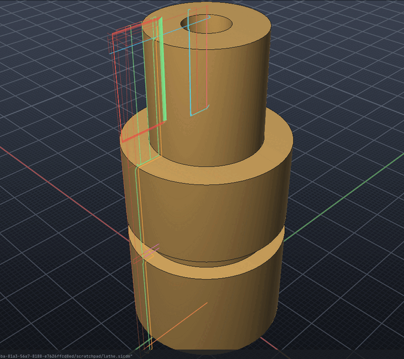
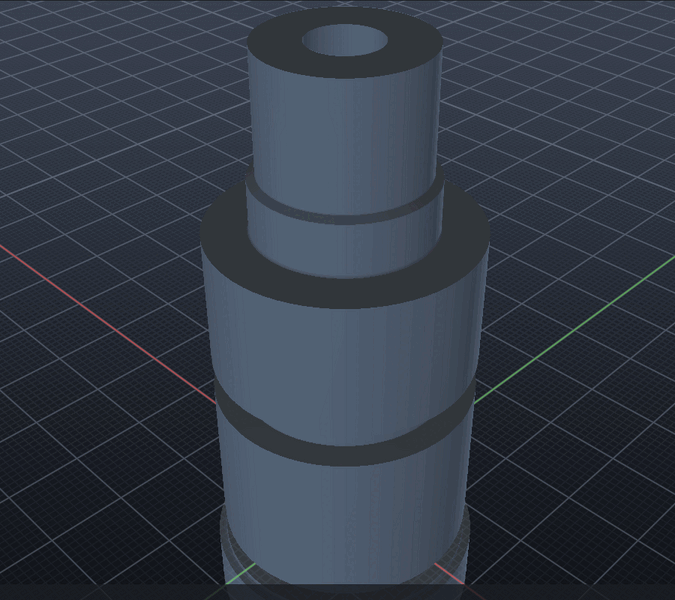

# CNC turning (lathe)

SI CDM turns a part from bar stock on a 2-axis lathe. It makes facing, turning, boring,
grooving, drilling, threading and parting-off paths, checks them in a simulation of the turned
profile, and posts G-code for the lathe's controller. Use *Manufacture → Turning (Lathe)* in the
menu, the `LATHE` command, or the `lathe` MCP tool.



A full job (in [examples/lathe-demo.txt](examples/lathe-demo.txt)). The part is a 60 mm
shaft: 20 mm across at the front with an 8 mm bore, 30 mm across behind it with a 24 mm neck,
then 30 mm again.

```text
LATHE SETUP "Cylinder 1" MATERIAL aluminium
LATHE TOOL 1 TURN NOSE 0.8 INSERT C
LATHE TOOL 2 TURN NOSE 0.4 INSERT D
LATHE TOOL 3 GROOVE 3
LATHE TOOL 4 DRILL 6
LATHE TOOL 5 BORE 5 NOSE 0.2
LATHE TOOL 6 THREAD
LATHE FACE
LATHE ROUGH TOOL 1 LEAVE 0.2
LATHE FINISH TOOL 2
LATHE GROOVE
LATHE DRILL
LATHE BORE LEAVE 0.1
LATHE FINISH INSIDE
LATHE THREAD PITCH 1.5 FROM 0 TO -14
LATHE PARTOFF
LATHE SIMULATE SHOW
LATHE POST shaft.nc FANUC
```

`LATHE SIMULATE` on this job reports:

```text
Simulated 9 lathe operations on 0.005 mm stations:
  removed 19.5 cm3; stock left on the part: up to 0.4 mm, 0.001 mm on average
  no gouges
  no rapid moves through stock
  parted off the bar
  cycle time 1 min 01 s, 0.46 m cutting, 0.89 m rapid
```

The 0.4 mm is the finishing insert's nose radius, left in the inside corners where a shoulder
rises.



## Coordinates

- **Z** runs along the spindle. Z0 is the part's front face (after facing), and Z is negative
  towards the chuck.
- **X** is across the axis. Paths are worked out as radii; programs show diameters.
- **Toolpaths** are kept as each tool's reference point:
  - turning inserts and boring bars: the centre of the nose;
  - grooving blades: the middle of the cutting edge;
  - threading inserts: the tip;
  - drills: the point.

  The post moves each to the point the control expects (see [Posts](#posts)).

## Setup

```text
LATHE SETUP [body] [AXIS X|Y|Z] [FLIP] [BAR d] [FRONT f] [MATERIAL m] [POST p] [MAXRPM n]
```

- **The part:** the selected body, or the one named.
- **AXIS:** the model axis the part turns about. The default is the part's longest side. The
  axis goes through the middle of the part's bounding box.
- **Which end:** the lathe faces the part's +axis end. `FLIP` faces the other end.
- **BAR:** the bar's diameter. The default is the part's diameter plus 2 mm, rounded up to a
  whole millimetre.
- **FRONT:** how much bar sticks out in front of the part, to face off (default 1 mm).
- **MATERIAL:** sets the cutting speeds and depths. The materials are the same as for milling.
- **MAXRPM:** the spindle's limit (default 4000). Constant surface speed is clamped to it.
- **Other options:** `CLEARANCE`, `TOLERANCE` and `RAPID`.

`LATHE PROFILE` describes the part as the lathe sees it:

- **The outside:** at each station along the axis, the farthest the part reaches from the
  axis. Flats and holes across the part don't count, so turning never cuts into them.
- **The bore:** the nearest the part's material comes to the axis.

Stations are about 0.005 mm apart along a 60 mm part.

## Tools

```text
LATHE TOOL n TURN   [NOSE r] [INSERT C|W|D|V|T|S|angle]
LATHE TOOL n BORE d [NOSE r] [INSERT ...] [REACH l]      (d: the smallest bore the bar fits)
LATHE TOOL n GROOVE w [CORNER r] [REACH l]               (grooving and parting blade, w wide)
LATHE TOOL n THREAD                                      (a 60 degree insert)
LATHE TOOL n DRILL d [ANGLE a] [REACH l]
```

Every tool also takes `HSS`, `VC` (m/min), `FEED` (mm/turn) and `NAME`.

**How steeply an insert can go down behind a shoulder** comes from its included angle. A
turning insert leads at 93 degrees (95 for the 80 degree shapes). What is left of 180 degrees
behind its trailing edge, less 2 degrees of clearance, is how steeply it can go down while
moving towards the chuck:

| Insert | Angle | Goes down at up to |
| --- | --- | --- |
| C, W | 80° | 3° |
| T | 60° | 25° |
| D | 55° | 30° |
| V | 35° | 50° |

Where the part falls away more steeply than that (a neck, a recess, a reverse taper), the
insert leaves the material. A sharper insert, or a groove, takes it.

## Operations

All operations take `TOOL n`, `NAME "..."` and cutting data: `SPEED` (m/min), `FEED`
(mm/turn), and `RPM` for a constant spindle speed instead of constant surface speed. Without
`TOOL`, an operation uses the first tool of the right kind; a finish uses the one with the
sharpest nose.

| Command | What it does |
| --- | --- |
| `LATHE FACE [STEPDOWN d]` | Faces the bar's end down to Z0, in passes towards the chuck, past the middle. |
| `LATHE ROUGH [STEPDOWN d] [LEAVE l] [LEAVEZ l] [FROM z] [TO z]` | Rough turning in passes along Z, each a depth of cut deeper. See [Rough turning](#rough-turning). |
| `LATHE FINISH [LEAVE l]` | One pass along the whole profile, the nose touching the part as far as the insert reaches. |
| `LATHE ROUGH INSIDE`, `LATHE BORE` | The same in the bore, with a boring bar. The bore must be drilled first. |
| `LATHE FINISH INSIDE` | Finishes the bore. |
| `LATHE GROOVE [LEAVE l]` | Finds the recesses the job's turning insert can't reach and plunges a blade across each, side by side. |
| `LATHE GROOVE INSIDE` | The same in the bore: the recesses the boring bar can't reach, with a grooving bar (`LATHE TOOL n GROOVE w DIAMETER d`: d is the smallest bore it fits). |
| `LATHE DRILL [DEPTH d] [PECK p]` | Drills on the axis, to the bore's depth (or through) by default. |
| `LATHE THREAD PITCH p [FROM z] [TO z] [DIAMETER d] [INSIDE]` | Single-point threading, outside or in the bore. See [Threading](#threading). |
| `LATHE PARTOFF [PECK p]` | Parts the part off the bar. See [Parting off](#parting-off). |

### Rough turning

- **Depth of cut:** `STEPDOWN`, or by default from the material (2 mm in aluminium, 1 mm in
  mild steel).
- **Stock to leave:** `LEAVE` is radial and `LEAVEZ` is on faces.
- **Where the part is higher:** each pass follows the part (plus the stock to leave), lifts
  over what earlier passes already took, and comes back at a safe height.
- **Behind the part:** the outside is turned on behind the part's back face by a parting
  blade's width, so the back corner comes off sharp when the part is parted off.

### Drilling

The job refuses a drill that is wider than the bore anywhere along its depth. The drill's
point is narrower, and that is allowed for near the tip.

### Threading

- **Passes:** to ISO metric depth on the radius, in passes of falling depth, then a spring
  pass. Outside the depth is 0.613 × pitch, going in towards the minor diameter. In a bore
  (`INSIDE`) it is 0.541 × pitch, going out from the minor diameter (the bore) to the major.
- **Infeed:** along the flank, at 29.5°.
- **Diameter:** by default the part's outside between `FROM` and `TO`; in a bore, its bore
  there plus the depth. `DIAMETER` gives the major diameter (M20: 20).
- **In a bore:** the insert comes and goes along the bore's middle. A threading bar too big for
  the bore (`LATHE TOOL n THREAD DIAMETER d`) is refused.
- **Program:** `G32` (Fanuc, Haas) or `G33` (LinuxCNC).

### Parting off

- **Where:** the blade's front side stays on the part's back face.
- **How far:** just past the middle, or just into a bore that goes through.
- **Refusals:** a blade too short for the bar is refused.

`LATHE LIST`, `LATHE TOOLS`, `LATHE DELETE n`, `LATHE CLEAR`, `LATHE GENERATE` and
`LATHE PATHS [ON|OFF]` manage the job. The job saves with the project.

## Simulation

`LATHE SIMULATE [SHOW]` cuts the bar with each operation in turn.

The bar is held as its outside and inside radius at each station. Each tool cuts with its own
shape:

- **Turning inserts and boring bars:** the round nose, and the trailing edge in front of it.
- **Grooving blades:** the flat edge with rounded corners.
- **Threading inserts:** a 60 degree point.
- **Drills:** the point, then the full diameter.

It reports:

- **Removed volume.**
- **Stock left:** over the part's outside and bore.
- **Gouges:** cuts inside the part. A thread's cut is meant and doesn't count.
- **Rapid crashes:** rapid moves through stock.
- **Parting off:** whether the part came off.
- **Cycle time:** at constant surface speed, clamped to the spindle's limit, with tool changes.

`SHOW` adds the turned stock as a body, revolved about the axis, and hides the part.

## Posts

`LATHE POST file.nc [FANUC|HAAS|LINUXCNC]`

| | Fanuc, Haas | LinuxCNC |
| --- | --- | --- |
| Modes | `G21 G18 G40 G80 G99` (feed per turn) | `G7 G18 G21 G40 G90 G95` (diameter mode, feed per turn) |
| Tool | `G28 U0. W0.`, `T0101` (tool 1, offset 1) | `G28`, `T1 M6 G43` |
| Constant surface speed | `G50 S4000`, `G96 S270 M03` | `G96 D4000 S270 M3` |
| Constant rpm (drilling, threading) | `G97 S.. M03` | `G97 S.. M3` |
| Threading | `G32 X.. Z.. F1.5` | `G33 X.. Z.. K1.5` |
| End | `G28 U0. W0.`, `M30` | `G28`, `M2` |

- **X:** always a diameter. Fanuc-style controls get a decimal point on every number.
- **Arcs:** runs of cuts that lie on a circle within the setup's tolerance (the path between
  points included) are written as `G2`/`G3` arcs with `R`, each under half a turn. These are
  the nose's round corners at shoulders, and round parts of a profile from exact geometry. A
  faceted mesh stays straight moves where its facets are further from a circle than the
  tolerance. `G2` turns clockwise with Z across and X up, seen from +Y, as G18 defines it.
- **Programmed points:** what the control expects for each tool.
  - Turning inserts: the imaginary tip, the nose's tangents towards −X and −Z (tip direction 3).
  - Boring bars: towards +X and −Z (tip direction 2).
  - Blades: the corner towards the chuck. Set the blade's offset to that corner.
  - Threading inserts and drills: the tip.

GRBL is a milling control and is refused.

## Over MCP

The `lathe` tool has these operations:

- `setup`, `tool`, `tools`, `profile`;
- `face`, `rough`, `finish`, `bore`, `groove`, `drill`, `thread`, `partoff`;
- `list`, `generate`, `simulate`, `post`, `delete`, `clear`.

Its parameters are listed in the tool's schema.

```json
{"operation": "setup", "body": "Shaft", "axis": "z", "material": "steel", "bar": 32}
{"operation": "tool", "number": 1, "type": "turn", "nose": 0.8, "insert": "C"}
{"operation": "tool", "number": 3, "type": "groove", "size": 3}
{"operation": "rough", "tool": 1, "leave": 0.2, "stepdown": 1.5}
{"operation": "finish", "inside": true}
{"operation": "thread", "pitch": 1.5, "from": 0, "to": -14}
{"operation": "simulate", "show": true}
{"operation": "post", "path": "shaft.nc", "post": "linuxcnc"}
```

## Not yet

These are not modelled yet:

- **Machines:** live tooling and C-axis milling on the lathe, sub-spindles, tailstocks and
  steady rests.
- **Programs:** canned roughing cycles (`G71`, `G72`). The posts write every pass out, so any
  control runs them.
