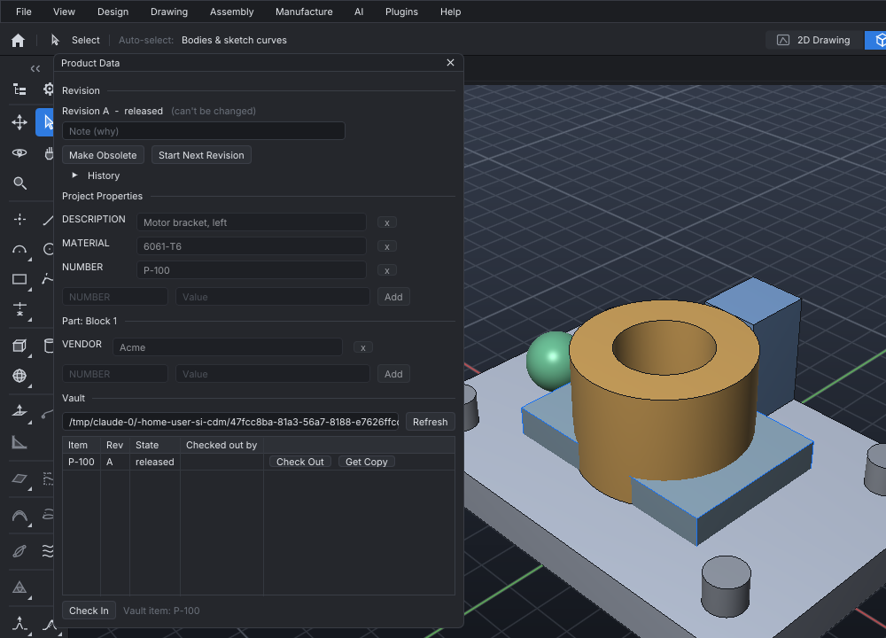

# Product data, revisions and the vault

A project carries its product data: a part number, a description and any other properties,
on the project and on each part. It has a revision (A, B, C...) whose state goes from
*in work* to *in review* to *released*. A team shares projects through a **vault**, a
folder everyone can reach (a network drive or a synced folder). Each person checks a project
out of the vault, changes it, and checks it back in. While one person has a project checked
out, no one else can check it out.



**File > Product Data...** (or `PANEL PRODUCT`) shows all of this in one window. Every button there runs one of
the commands below, so the command log keeps a record of each step.

## Properties

```text
PROPERTY NUMBER P-100                      the project's part number
PROPERTY DESCRIPTION Motor bracket, left
PROPERTY MATERIAL 6061-T6
PROPERTY "Spacer 1" NUMBER B-1             a part's own properties
PROPERTY "Spacer 1" VENDOR Acme
PROPERTY                                   list the project's properties
PROPERTY "Spacer 1"                        list a part's properties
PROPERTY DELETE VENDOR
```

Property names are single words, stored in upper case. Several features use them:

- **The drawing's title block** fills any empty PART NO., REV, MATERIAL, TITLE or COMPANY
  field from the project's NUMBER, revision, MATERIAL, DESCRIPTION and COMPANY.
  `SHEET TITLE` still overrides any of them.
- **The parts list** (`ASSEMBLY BOM`) shows part numbers and descriptions. Bodies with the
  same NUMBER count as one part, whatever their names.
- **COMPARE** reports any property that was added, removed or changed.

`UNDO` takes back a property change. Part properties are steps in the feature history, so
`REGEN` keeps them.

## Revisions and release

```text
REVISION                          "Revision A, in work"
REVISION REVIEW                   submit it for review
REVISION STATE in work            send it back for more work
REVISION RELEASE NOTE first issue release it
REVISION NEXT NOTE wider flange   start revision B, in work
REVISION STATE obsolete           retire a released revision
REVISION SET 01                   use a scheme of your own (only while in work)
REVISION HISTORY                  every change of revision and state: who, when and why
```

**A released revision cannot be changed.** While a project is released, commands that would
change the design are refused with a message such as "Revision A is released: it can't be
changed (REVISION NEXT starts revision B)". These include modelling, sketching, moving,
materials, properties, variables, mates, the drawing and UNDO. You can still view the model,
query it (`MASSPROPS`, `MEASURE`, `ASSEMBLY BOM`, `HISTORY`, `MATERIAL "x"`), export it,
render it, and make toolpaths for it with CAM.

The revision after A is B. Revisions skip I, O, Q, S, X and Z, which can be mistaken for
digits (ASME Y14.35): after Y comes AA. A numeric revision counts up and keeps its width:
01, 02 ... 09, 10. With a dotted scheme, the last number counts up: 1.9 becomes 1.10.

## Comparing versions

```text
COMPARE old.sicdm                 the open project against a file
COMPARE a.sicdm b.sicdm           two files
COMPARE REV A                     the open project against revision A in the vault
```

Each difference is one line:

- bodies added, removed, reshaped (with the change in volume and size), moved, turned,
  recoloured or given another material;
- parameters, properties and variables that changed;
- steps added to or removed from the feature history;
- the number of mates and drawing views;
- the revision and its state.

## The vault

```text
VAULT FOLDER "//server/cad/vault"         set once (a preference, like PREFERENCES SET vault)
VAULT                                     list the items: latest revision, its state, who has it
VAULT CHECKIN NOTE first model            save the project and put this revision in the vault
VAULT CHECKOUT P-100                      lock it to you and open it
VAULT CHECKOUT P-100 TO work/p100.sicdm   ...into a file you choose
VAULT GET P-100 REV A                     a copy of an older revision (no lock)
VAULT UNDO P-100                          give the checkout up and leave the vault unchanged
VAULT UNLOCK P-100 FORCE                  an administrator takes someone else's lock away
VAULT HISTORY P-100                       each revision: state, date, who, note
```

An item is named by the project's vault item, or else by its NUMBER, or else by the file's
name (`VAULT CHECKIN AS key` names it yourself). The first check-in of a new item needs no
checkout. After that, each change follows the same cycle: check out, change, check in.

The rules:

- **One person at a time.** A checkout writes a lock file into the item's folder. The file
  is created atomically, so if two people check out at the same moment, only one of them
  gets the lock. Everyone else is told who has the item and since when. Only the person
  holding the lock can check the item in.
- **Released revisions are never overwritten.** Checking in a revision that is still in work
  replaces that revision's file. Once a revision is checked in as released, no later
  check-in can change it. Start the next revision with `REVISION NEXT`, then check that in
  alongside the released one.
- **Every revision is kept**, each with its own record of who checked it in, when and why.

The vault has no shared index file that two people could write at the same time. Each item
is a folder:

```text
vault/
  P-100/
    item.json         its description and part number
    rev-A.sicdm       revision A, as checked in
    rev-A.json        its state, date, author and note
    rev-B.sicdm
    rev-B.json
    checkout.lock     while someone has it: who and since when
```

The name recorded in the vault is `$SICDM_USER` if it is set, otherwise your login name and
computer's name (`ann@cad-07`).

From an AI assistant, the MCP tool `product_data` does all of the above: `set_property`,
`set_state`, `next_revision`, `compare`, `vault_checkin`, `vault_checkout` and the rest.
