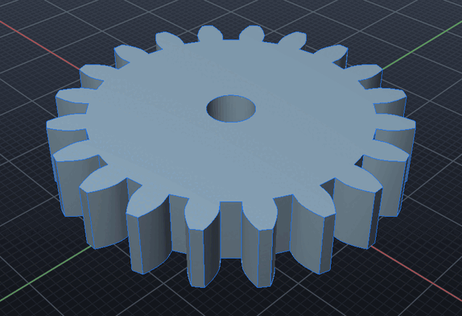

# Plugins

A plugin adds commands to SI CDM. It is a folder with a `plugin.json` manifest and a program,
written in any language: Python, JavaScript, C++ or a shell script. The program runs in its
own process, so a plugin that fails or crashes can't take SI CDM down with it. It drives the
open document through the same tools AI agents get over MCP:

- `run_command` for any command line;
- `create_solid`, `boolean`, `sketch`, `cam`, `lathe`, `drawing` and the rest;
- `get_scene` to read the model back.



The example plugin, [examples/plugins/gears](examples/plugins/gears), adds `SPURGEAR teeth
module thickness [BORE d]`. It works out an involute gear's outline in Python, then draws and
extrudes it:

```text
SPURGEAR 20 2 8 BORE 6
  Spur gear: 20 teeth, module 2: pitch 40.00 mm, tips 44.00 mm, roots 35.00 mm across, 8 thick, 6 bore
```

## Installing a plugin

Put the plugin's folder in the plugins folder, then run `PLUGINS RELOAD` (or restart SI CDM).

| Platform | Plugins folder |
| --- | --- |
| Linux | `$XDG_CONFIG_HOME/sicdm/plugins` (`~/.config/sicdm/plugins`) |
| macOS | `~/Library/Application Support/SI-CDM/Plugins` |
| Windows | `%APPDATA%\SI-CDM\Plugins` |

- **More folders:** `SICDM_PLUGIN_PATH` lists more, separated by `:` (`;` on Windows). Each is
  either a plugin's folder or a folder of plugins.
- **Using them:** a plugin's commands work like built-in ones, on the command line, from
  `RUN` scripts and from AI agents (`run_command`).
- **Where they show:** in `HELP`, and with their menu items under *Plugins* in the menu bar.

```text
PLUGINS            the plugins found, their commands, and anything that kept one from loading
PLUGINS RELOAD     reads the manifests again
PLUGINS FOLDER     where to put them
```

A plugin is a program you run, with your rights, like any other you install. Install plugins
from people you trust.

## The manifest

```json
{
  "name": "gears",
  "version": "1.0",
  "description": "Involute spur gears from a tooth count, a module and a thickness",
  "author": "SI CDM examples",
  "commands": [
    {
      "name": "SPURGEAR",
      "usage": "SPURGEAR teeth module thickness [BORE d]",
      "help": "An involute spur gear (20 degree pressure angle) on the active plane, extruded",
      "run": ["python3", "gears.py"],
      "run_windows": ["python", "gears.py"]
    }
  ],
  "menu": [
    {"label": "Spur Gear (20 teeth, module 2, 8 thick)", "command": "SPURGEAR 20 2 8"}
  ],
  "timeout": 60
}
```

### Commands

- **`name`:** one word of letters, digits and `_`. Commands are case-insensitive.
- **Name clashes:**
  - A plugin can't take a built-in command's name (`PLUGINS` says so).
  - If two plugins name the same command, the first one found keeps it.
- **`run`:** the program and its first arguments. The command's own arguments follow,
  quoted ones whole.
- **Finding the program:**
  - A word in `run` that names a file in the plugin's folder is run from there, like a script
    passed to an interpreter.
  - A first word that isn't such a file is looked for on the `PATH`.
- **Per platform:** `run_windows`, `run_macos` and `run_linux` replace `run` there.

### Menu items and timeout

- **`menu`:** entries for the *Plugins* menu. Each runs a command line.
- **`timeout`:** seconds a command may take (default 120). After that the program is stopped
  and the command fails.

## Writing the program

SI CDM starts the program with the command's arguments. The program gets these environment
variables:

- `SICDM_PLUGIN_DIR`: its folder;
- `SICDM_VERSION`: the SI CDM version.

It talks to SI CDM over its standard input and output: one JSON-RPC 2.0 message per line,
the protocol the `sicdm-mcp` server speaks.

| The program sends | SI CDM answers |
| --- | --- |
| `{"jsonrpc":"2.0","id":1,"method":"tools/list"}` | the tools and their parameters |
| `{"jsonrpc":"2.0","id":2,"method":"tools/call","params":{"name":"run_command","arguments":{"command":"BOX 10 10 10"}}}` | `{"result":{"content":[{"type":"text","text":"Created Block 1 ..."}],"isError":false}}` |
| `{"jsonrpc":"2.0","method":"sicdm/say","params":{"text":"Done"}}` | (a notification: no answer) a line in the command's output |

### Messages

- **Requests** (with an `id`) get one answer line each, in order.
- **Notifications** (no `id`) get none.
- **Other lines** the program writes, that aren't JSON-RPC, are shown as output too, so a plain
  `print` works for messages.
- **`run_command`** reads bare numbers in the document's units. The other tools take
  millimetres.

### Results

- **Success:** the command succeeds when the program exits with 0.
- **Failure:** with any other exit code it fails, and the last lines the program wrote to its
  standard error are shown.

### History and undo

- **History:** what the plugin did is recorded in the feature history as the commands it ran,
  so `REGEN` rebuilds the model without the plugin.
- **Undo:** steps back one of those commands at a time.

### A minimal plugin in Python

```python
import json, sys

def call(tool, arguments):
    sys.stdout.write(json.dumps({"jsonrpc": "2.0", "id": 1, "method": "tools/call",
                                 "params": {"name": tool, "arguments": arguments}}) + "\n")
    sys.stdout.flush()
    return json.loads(sys.stdin.readline())["result"]

size = sys.argv[1] if len(sys.argv) > 1 else "10"
call("run_command", {"command": f"BOX {size} {size} {size}"})
print(f"A {size} mm cube")
```

The test suite drives a C++ plugin through every part of this: tool calls, notifications,
plain output, arguments, failures and the timeout ([tests/sample_plugin.cpp](../tests/sample_plugin.cpp)).
