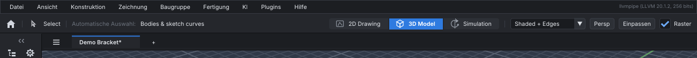

# Preferences, recent files and updates

## Preferences

*File → Preferences* (`Ctrl+,`) holds the settings that apply to every project. Each change
is saved at once and is kept for the next session.

| Setting | What it does |
| --- | --- |
| Units | The units new projects start in. *As the last project* keeps the units of the project before. |
| Autosave | How old unsaved changes get (in seconds) before a recovery copy is written; off writes none. See [autosave and recovery](#autosave-and-recovery). |
| Material, post processor, machine | What *Set Up the Selected Part* on the CAM panel starts a job with. A lathe job takes the material, and the post when the lathe has it. |
| Updates | Look for a newer release when SI CDM starts, from the release feed your administrator gives you. |
| Language | The language of menus, buttons and tooltips: English or Deutsch built in, or one installed as a [language file](#languages). |

The same settings can be typed:

```text
PREFERENCES                          list them, and the file they are kept in
PREFERENCES SET units in             mm, cm, m, in, ft, pt, or LAST
PREFERENCES SET autosave 120         seconds (5 to 3600), or OFF
PREFERENCES SET material steel       a CAM material, or DEFAULT
PREFERENCES SET post haas            fanuc, haas, grbl, linuxcnc, or DEFAULT
PREFERENCES SET machine vmc          a machine preset, or DEFAULT
PREFERENCES SET updates on           ON or OFF
PREFERENCES SET update-url https://example.com/sicdm/latest.json
PREFERENCES SET language de          en, de, or an installed language's code; shown at once
PREFERENCES LANGUAGES                the languages there are
PREFERENCES RESET                    back to the defaults (the recent files stay)
```

**Where they are kept:**

| Platform | Location |
| --- | --- |
| Linux | `$XDG_CONFIG_HOME/sicdm/preferences.json` (`~/.config/sicdm/preferences.json`) |
| macOS | `~/Library/Application Support/SI-CDM/preferences.json` |
| Windows | `%APPDATA%\SI-CDM\preferences.json` |

Set `SICDM_PREFERENCES` to use another file. A value in the file that SI CDM wouldn't accept
from `PREFERENCES SET` is ignored, and the default is used.

## Keyboard shortcuts

Every menu key, view key, panel key and tool key can be changed. In the app, *Preferences →
Keyboard Shortcuts* lists them: click an action's keys, then press the new ones (with Ctrl,
Shift or Alt as you like; a click on its button again leaves them as they were). The list says when two actions share
a key, and asks before giving one a key another action has. *Default* puts one back, *Clear*
takes its keys away, *Reset All Shortcuts* puts them all back. Menus, tool tips and *Help →
Viewport Controls* show the keys as they are now.

```text
KEYS                                       every action and its keys
KEYS SET edit.hide Ctrl+H                  new keys for an action
KEYS SET edit.redo "Ctrl+Shift+Z, Ctrl+Y"  more than one
KEYS SET tool.sphere Shift+S FORCE         share a key another action has
KEYS SET view.grid none                    no keys
KEYS RESET edit.hide | KEYS RESET ALL
```

- **Actions:** `file.*`, `edit.*` (with `edit.cancel`, Esc, and `edit.finish`, Enter),
  `view.*`, `panel.*`, `help.help`, `commandline.focus` (Space), the simulation player's
  `sim.play`, `sim.rewind`, `sim.back`, `sim.forward`, the brush's `brush.smaller`,
  `brush.larger`, `brush.weaker`, `brush.stronger` (`[` `]`, with Shift), and `tool.<name>` for
  every tool (`tool.move`, `tool.block-cuboid` ...). With Shift added, a tool's key still steps
  through the tools in its slot.
- **Places:** the player's keys act only in the Simulation window, the brush keys only with a
  sculpt brush, `commandline.focus` everywhere else; actions whose places never meet may share a
  key (Space plays in the Simulation window and opens the command line elsewhere). Anything else
  sharing a key is a clash, and is refused unless you `FORCE` it.
- **Keys:** a letter, digit, `F1`–`F12`, `Num0`–`Num9`, `Escape`, `Enter`, `NumEnter`, `Delete`,
  `Backspace`, `Insert`, `Home`, `End`, `PageUp`, `PageDown`, the arrows, `Tab`, `Space` and
  punctuation, with `Ctrl` (`Cmd` on a Mac), `Shift` and `Alt`. The modifiers must be held exactly
  as named. In the window, a click on the action's button again stops listening (so Esc can be
  set as a key too).
- **Dialogs:** `dialog.close` (Esc) closes a dialog as its Cancel would; it acts only while a
  dialog is open, so it may share a key with anything else.
- **Not keys:** the mouse.
- **Typing:** while you type in a field, only keys with Ctrl or Alt act, so a single-letter
  shortcut never takes a typed letter.
- **Where they are kept:** with the preferences (above), so they apply to every project.

## Languages



The interface is in English or German (*Deutsch*) out of the box. Choose one in
*Preferences*, or start the app in one for a single run with `sicdm --language de`.

- **What changes:** the menus, buttons, panels, tooltips and tool names.
- **What stays in English:** commands and their replies (`EXTRUDE`, `Created Block 1`).
  Scripts, the MCP tools and the history then work the same in every language.

**Adding or correcting a language:** put a language file in the `lang` folder next to the
preferences file (or in the folder `SICDM_LANG_DIR` names). Call it after the language's code,
for example `fr.json`:

```json
{"name": "Français", "strings": {"File": "Fichier", "Save As...": "Enregistrer sous..."}}
```

- **Keys** are the English words as the interface shows them.
- **Format markers** such as `%d` and `%s` must stay, in the same order.
- **A new code** adds a language to the list.
- **A built-in code** (`de.json`) corrects or completes the built-in translation, and its
  words win.

To find what still needs translating, use the app in that language for a while, then type
`PREFERENCES UNTRANSLATED fr.json`. It writes every word the language lacked, ready to fill
in. From the sources, `tools/i18n_extract.py --json fr.json` lists every word there is.

## Autosave and recovery

While a project has unsaved changes, SI CDM keeps a recovery copy of it, written once the
changes are as old as the autosave setting (a minute by default) and again after further
changes. Saving, closing or quitting normally removes the copy. If SI CDM stops
unexpectedly (a crash, a power cut, a killed process), the next start offers the work back:
*Restore All* opens it in new tabs, *Discard* deletes it, *Later* asks again next time.

```text
RECOVER              the copies left by sessions that ended
RECOVER 1            open the first
RECOVER DISCARD ALL  delete them
```

Recovery copies are kept in `%LOCALAPPDATA%\SI-CDM\Recovery` (Windows),
`~/Library/Application Support/SI-CDM/Recovery` (macOS) or `~/.local/state/sicdm/recovery`
(Linux); set `SICDM_RECOVERY_DIR` to use another folder.

## Recent files

*File → Open Recent* lists the last ten projects opened or saved, newest first. A project
that has been moved or deleted is greyed out; hover over a name for its folder.

```text
RECENT            the list
RECENT 2          open the second
RECENT CLEAR      empty the list
```

## Checking for updates

SI CDM has no built-in update server: your organisation publishes a small *release feed*, a
JSON file on a web server or a shared drive, and sets its address as the `update-url`
preference:

```json
{
  "version": "1.3.0",
  "date": "2026-11-02",
  "notes": "Lathe threading cycles; faster STEP import",
  "url": "https://example.com/sicdm/1.3.0/",
  "downloads": {"windows": "https://example.com/sicdm/1.3.0/SI-CDM-1.3.0-win64.exe",
                "macos": "https://example.com/sicdm/1.3.0/SI-CDM-1.3.0.dmg",
                "linux": "https://example.com/sicdm/1.3.0/SI-CDM-1.3.0-Linux.tar.gz"}
}
```

*Help → Check for Updates*, *Check Now* in Preferences, or `UPDATES` reads the feed and says
whether a newer version is out, and where to download it. With *Check for a newer release
when SI CDM starts* on, the check runs in the background at start, and a newer release is
shown in the status bar.

`https://` and `http://` feeds are fetched with the system's `curl` program (part of
Windows 10 and later, macOS and Linux); `file://` addresses (`file:///S:/software/sicdm/latest.json`)
are read directly. Nothing about the computer or its user is sent. SI CDM never downloads or
installs an update by itself.
