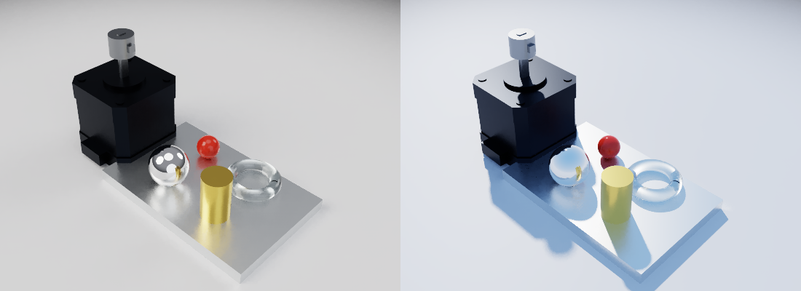
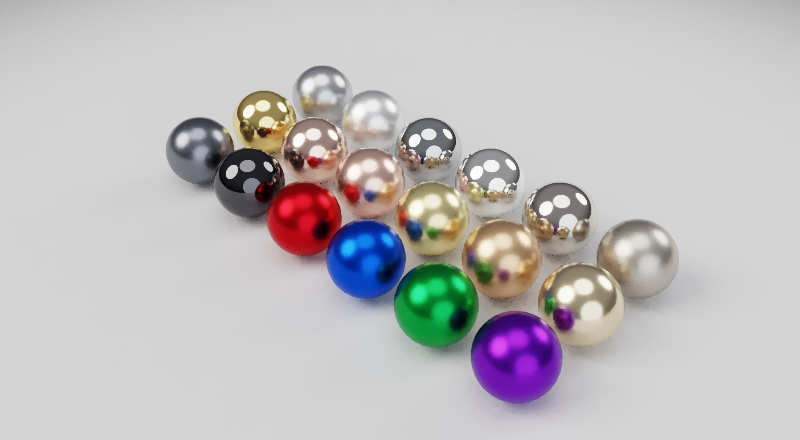
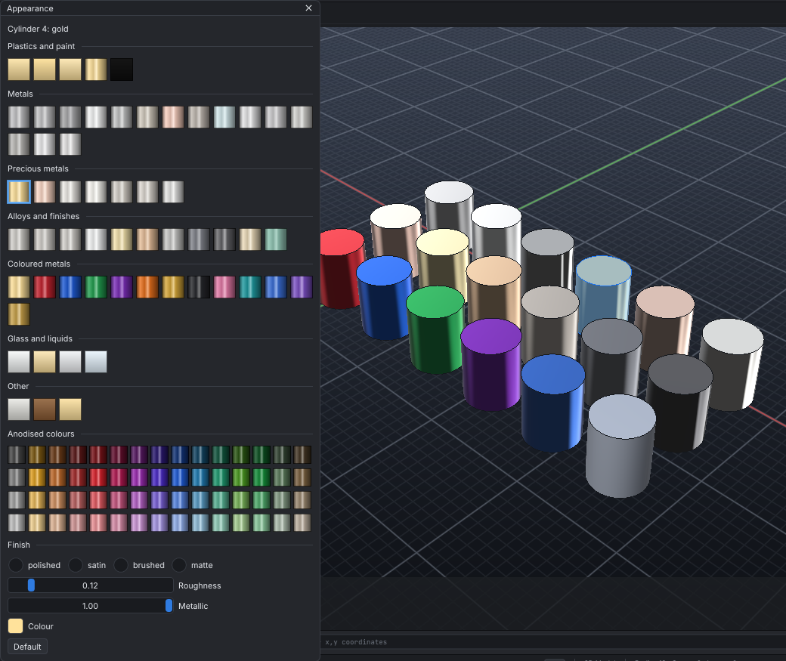
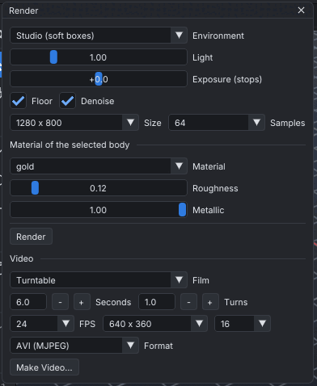
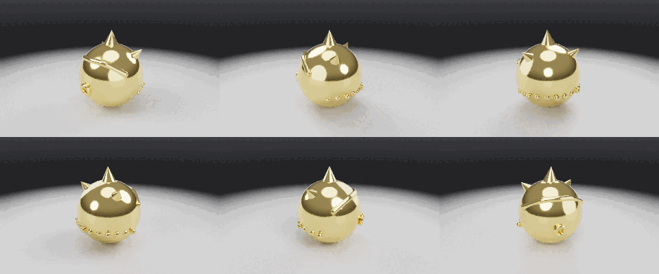

# Rendering



`RENDER` makes a photoreal picture of the model: metals that mirror their surroundings,
clear glass, glossy paint, soft shadows and contact shadows on a floor. It is a path tracer,
written for SI CDM. Rays from the camera bounce around the scene, and each bounce picks up
light the way real surfaces do.

## Materials

Each body has a material. A new body is glossy plastic in its own colour.

```text
MATERIAL LIST                          the presets
MATERIAL "Bracket" aluminium           a preset (metals and glass bring their own colour)
MATERIAL "Cover" paint COLOR #c0392b   car paint in a colour of your own
MATERIAL "Knob" ROUGHNESS 0.2          one setting at a time
MATERIAL "Lens" glass                  clear: refracts what is behind it
MATERIAL "Screen" light COLOR white    glows
MATERIAL "Head retopo" COLORMAP head_colour.png NORMALMAP head_normal.png
MATERIAL "Bracket" DEFAULT             back to plastic
```

| Setting | Meaning |
| --- | --- |
| `METALLIC` | 0 for plastic, paint or wood; 1 for a metal, which tints its reflections with its colour |
| `ROUGHNESS` | 0 for a mirror finish, 1 for fully matte. Machined metal is about 0.3, polished chrome 0.05. |
| `TRANSMISSION` | 1 for clear (glass, water); refracts by `IOR`: glass 1.5, water 1.33 |
| `EMISSION` | Glows with its colour, this bright |
| `COLORMAP`, `NORMALMAP` | Images on the body's texture coordinates, such as the maps `BAKE` writes (see [sculpting](sculpting.md#uv-unwrapping-and-baking)) |

### The materials



Each metal's colour is its measured reflectance at normal incidence. The renderer gives back
those exact values, so gold, copper and brass are the right colours, not guesses.
`MATERIAL LIST` shows them by family:

| Family | Materials |
| --- | --- |
| Plastics and paint | plastic, matte, paint, metallic-paint (flakes under the gloss), rubber; all but rubber in the body's colour |
| Metals | steel, iron, cast-iron, aluminium, chrome, nickel, copper, titanium, zinc, tin, lead, cobalt, tungsten, magnesium, mercury |
| Precious metals | gold, rose-gold, white-gold, silver, platinum, palladium, rhodium |
| Alloys and finishes | stainless, brushed, polished-steel, brushed-aluminium, brass, bronze, pewter, gunmetal, black-chrome, champagne, patina |
| Coloured metals | anodised (in the body's colour), anodised-red, -blue, -green, -purple, -orange, -gold, -black, -pink, -teal; titanium-blue, -purple, -gold (heat-tinted) |
| Glass and liquids | glass, tinted (in the body's colour), frosted, water |
| Other | ceramic, wood, light (glows in the body's colour) |

`aluminum`, `anodized-…`, `stainless steel`, `chromium` and other spellings work too. Any
material takes a finish: `FINISH polished` (roughness 0.04), `satin` (0.25), `brushed` (0.45)
or `matte` (0.75). A metal in any colour is `anodised COLOR #RRGGBB`.

```text
MATERIAL "Ring" rose-gold
MATERIAL "Housing" stainless FINISH brushed
MATERIAL "Knob" anodised COLOR #1E5BD6
```

### The Appearance window



**View > Appearance...** (or `PANEL APPEARANCE`) gives the selected body its material from
swatches. Each swatch is shaded the way its material reflects. The window also has:

- a card of anodised colours: 15 hues, each in four shades;
- the finishes;
- roughness and metallic sliders;
- the colour.

Every click is a `MATERIAL` command, so it is logged and can be undone.

The 3D window shows materials as well, not only the rendered picture. Metals reflect a photo
studio (a dark floor, a bright ceiling, soft boxes) tinted with their colour, and rougher
finishes blur it.

Polypaint shows in the picture too. Materials are saved in the project and undone with
`UNDO`.

## Making the picture

```text
RENDER picture.png                          the 3D view as it is now, with the settings below
RENDER SIZE 1920 1080 SAMPLES 256           a bigger, cleaner picture (the settings are kept)
RENDER ENV sky SUN 135 40                   a sky, the sun at azimuth 135, 40 degrees up
RENDER picture.png VIEW front               from the front (without the app: iso by default)
RENDER                                      the settings now
```

| Setting | Default | Meaning |
| --- | --- | --- |
| `ENV` | studio | `studio`: a photo studio's soft boxes (key, fill, rim and top light); `sky`: a blue sky and its sun; `white`: even white light; `dark`: soft boxes in a dark room |
| `SUN az el` | 135 45 | `sky`: where the sun is, in degrees |
| `LIGHT` | 1 | How bright the environment is |
| `EXPOSURE` | 0 | Stops brighter (+) or darker (−) |
| `FLOOR` | ON | A floor under the bodies, for contact shadows and reflections. It fades into the environment far away. |
| `SIZE w h` | 1280 800 | Pixels |
| `SAMPLES` | 64 | Rays a pixel. More gives less noise and takes longer: 16 for a preview, 256 or more for a final picture. |
| `BOUNCES` | 6 | How many times light may bounce (glass and mirrors need a few) |
| `DENOISE` | ON | Takes out the remaining noise, keeping edges, textures and paint sharp |

The settings are saved in the project.

**In the app:** *View → Render / Video...* opens the render window.



- **Settings:** the environment, light, exposure, floor, size and samples.
- **Material:** the material of the selected body, with its roughness and metallic sliders.
- **Render:** makes the picture in the background from the 3D view as it is, with a progress
  bar and *Stop*.
- **Save Picture:** writes the result.

**MCP:** the `render` tool sets a body's material and makes the picture in one call.

## Videos



`VIDEO` renders a video frame by frame with the same path tracer, environment and materials as
`RENDER`:

- **Turntable:** the camera goes round the model, which stays still. This is the default when
  nothing moves.
- **Animation:** the motions, robots and physics are played as the simulation shows them, with
  the camera still. This is the default when there are motions. `TURNS` sends the camera round
  as well.

```text
VIDEO model.avi                                   a 6 s turntable, 640 x 360, 24 frames a second
VIDEO model.avi TURNS 2 ELEVATION 35 SECONDS 8    twice round, looking down more steeply
VIDEO mechanism.avi ANIMATION FROM 0 TO 4         the motions over their first 4 s
VIDEO mechanism.png ANIMATION VIEW front          an animated PNG, filmed from the front
VIDEO frames/ SIZE 1920 1080 SAMPLES 64           numbered PNG frames, for an editor
```

| Setting | Default | Meaning |
| --- | --- | --- |
| `TURNTABLE` / `ANIMATION` | by the scene | What is filmed |
| `SECONDS` | 6 (an animation: its own length) | How long the video is |
| `FROM t` / `TO t` | 0 | Which part of the motions is played (s) |
| `FPS` | 24 | Frames a second |
| `TURNS` | 1 (an animation: 0) | Times the camera goes round; negative goes the other way |
| `ELEVATION` | 20 | Degrees the turntable camera looks down from |
| `SIZE w h` | 640 360 | Pixels |
| `SAMPLES` | 16 | Rays a pixel in each frame |
| `QUALITY` | 90 | The AVI's JPEG quality, 1 to 100 |
| `VIEW` | iso | The still camera of an animation; `current` is the app's 3D view |

**Formats**, by the file's extension:

| Path | Written as | Plays in |
| --- | --- | --- |
| `.avi` | Motion JPEG in an AVI | VLC, Windows, video editors (Premiere, DaVinci Resolve), ffmpeg |
| `.png` | Animated PNG: lossless | Web browsers |
| `.gif` | GIF: 256 colours shared by all frames, ordered dithering so it doesn't crawl | Anywhere; best kept short and small |
| `folder/` | `frame_00001.png`, `frame_00002.png`... | Any editor that takes an image sequence |

MP4 is not written. To get one, run `ffmpeg -i video.avi video.mp4`.

**Steady pictures:**

- The floor and the lights are fitted to the space the bodies take over the whole video, so they
  don't jump as the bodies move.
- The turntable camera is fitted to that space too, so the model never leaves the frame.
- A frame comes out the same each time it is rendered, so still parts don't flicker.

**Time:** each frame takes as long as a picture of its size and samples. At 640 x 360 with 16
samples that is about 2 s on four cores, so a 6 s turntable at 24 fps takes about 5 minutes.
Lower `SAMPLES` or `SIZE` for a quick look.

**In the app:** the render window's *Video* section has the kind, length, turns, frame rate,
size, samples and format. *Make Video...* asks where to save it, then makes it in the background
with a progress bar and *Stop*. The camera starts from the 3D view's direction. A stopped video
keeps the frames made so far.

**MCP:** the `make_video` tool takes the same settings.

## How it works

- **Surfaces:**
  - Diffuse colour plus glossy reflection from microfacets (GGX), with Fresnel. Metals tint
    their reflection with their own colour.
  - Glass reflects or refracts by the exact Fresnel term.
- **Light:** the environment's lights (soft boxes, the sun) are aimed at directly from every
  bounce, as well as found by the bounces themselves. Weighting the two by how likely each was
  (multiple importance sampling) makes small bright lights and mirror-like surfaces both clean.
- **Noise:** each pixel's spread of samples is measured. An edge-aware filter, guided by the
  surfaces' colours, normals and distances, smooths only the light, and only within each
  surface.
- **Tone:** a filmic curve (ACES), then sRGB.
- **Speed:** a few seconds for a preview on a modern laptop. It uses every core and the
  bounding-volume hierarchy used for picking.
- **Repeatable:** the same scene and settings always give the same picture.
