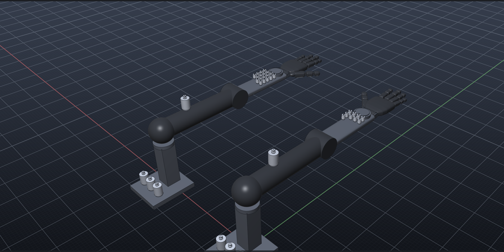
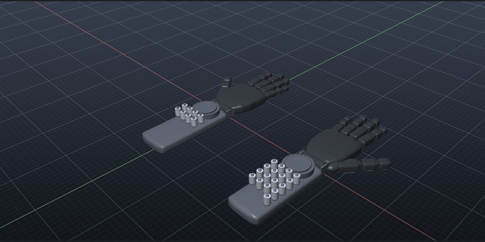

# Robot arm and hand library





Parametric humanoid arm and hand parts for the **Library** panel (category *Robot arm & hand*) and the
`PART` command, from the shoulder to the fingertips. Every joint is a limited circular motion driven by
the library **DC motor** (`dc_motor`, used as a gear motor), so an arm moves and a hand opens and closes
in the Simulation window straight after it is inserted.

## Human arm vs robot arm

| Human anatomy | Robot part | Joint(s) | Notes |
| --- | --- | --- | --- |
| Shoulder girdle + glenohumeral ball joint (scapula, clavicle) | **Shoulder pedestal** (`robot_shoulder`) with 3 motors on its base | Shoulder flexion, horizontal abduction, internal rotation | The ball joint (3 DOF) becomes 3 stacked revolute joints with crossing axes; the scapula / clavicle motion is left out |
| Humerus (≈ 300 mm) | **Upper arm link** (`arm_link`): shoulder ball, bar, elbow hub | Elbow motor sits on it (like the biceps) | |
| Elbow (hinge, humero-ulnar) | Elbow hub | Elbow flexion | |
| Radius + ulna (≈ 250 mm), radio-ulnar joints | **Forearm** deck (`robot_forearm`, 250 mm) with the hand motors | Forearm rotation (supination) about the forearm axis | Humans roll the radius around the ulna; the robot turns the whole forearm deck |
| Wrist and hand | See the hand tables below | Wrist flexion, deviation, 15 hand joints | |

The human arm has 7 DOF from shoulder to wrist (3 + 1 + 1 + 2); the robot arm has the same 7, plus the
hand.

### Zero pose and arm limits

The arm's zero pose is **straight out in front, horizontal, palm down** (the usual robot "zero"
configuration; for a human this is 90° shoulder flexion with the forearm pronated). The shoulder joint is
220 mm above the pedestal base, the wrist 550 mm ahead of it. Each joint moves **both ways**
between two hard stops, the main direction set by the parameter and the return direction by the human
standard:

| Joint (`PART` key) | + direction from the zero pose | Default | Hard stops | Human ROM (from anatomical position) |
| --- | --- | --- | --- | --- |
| Shoulder flexion (`shoulder_flex`) | raises the arm overhead; − swings it down | 90° | −90° … 100° | 0–180° flexion (90° of it above horizontal), 60° extension |
| Shoulder horizontal abduction (`shoulder_abd`) | swings the arm out to the side; − across the body | 90° | −45° … 120° | 0–180° abduction, 45° horizontal adduction |
| Shoulder rotation (`shoulder_rot`) | turns the upper arm inward; − outward | 70° | −90° … 90° | 70° internal, 90° external |
| Elbow flexion (`elbow`) | bends the forearm up | 145° | 0° … 150° | 0–150°, no hyperextension |
| Forearm supination (`forearm_rot`) | turns the palm from down to up | 160° | 0° … 180° | 80° pronation + 80° supination |

On the humanoid the arm hangs (zero = anatomical position), so its shoulder stops are the human
values instead: flexion −60° … 180°, abduction −30° … 180° ([table](humanoid-body.md#joints-and-standard-range-of-motion)).

Motors: shoulder and elbow motors are 1.2 × the library DC motor, the forearm-rotation motor sits on the
forearm deck with the hand motors. Joints are chained shoulder flexion → abduction → rotation → elbow →
forearm rotation → wrist → fingers, so each joint carries everything after it.

## Human hand vs robot hand

| Human anatomy | Count | Robot part (kind) | Notes |
| --- | --- | --- | --- |
| Forearm (radius, ulna) + extrinsic flexor / extensor muscles | 2 bones | **Forearm** (`robot_forearm`) with the DC motors on top | Like the long finger muscles, the motors sit in the forearm and drive the fingers remotely (tendon-style) |
| Carpals (wrist) | 8 bones | Wrist hinge (palm knuckle + forearm clevis) | 8 sliding bones become 2 revolute joints: flexion and deviation |
| Metacarpals II–V (palm) | 4 bones | **Palm** (`robot_palm`) | One rigid plate; the human palm arch (metacarpal IV / V motion) is left out |
| Thumb metacarpal (on the saddle CMC joint) | 1 bone | Thumb **Metacarpal** link (`phalanx`) | Saddle joint becomes one opposition joint |
| Phalanges | 14 bones | **Finger links** (`phalanx`): proximal, middle, distal; thumb: proximal, distal | Each link has a hinge barrel at its base; the distal link ends in a fingertip pad |
| Intrinsic muscles (interossei, lumbricals, thenar) | — | Abduction / thumb motors (fully actuated hand) | Underactuated hands drop them |
| Muscle + tendon | — | DC gear motor + reduction (`gear`) | Joint angle = motor angle / gear |

**Degrees of freedom.** The human hand has about 27 bones and roughly 20+ DOF (wrist 2, each finger 4,
thumb 5). Robot hands simplify:

| Drive | Motors (hand) | Joints | Comparable to |
| --- | --- | --- | --- |
| **Underactuated** (default) | 6 + 2 wrist | 15 + 2 wrist | Linkage hands (e.g. Inspire RH56: 6 motors, 12 joints): one motor curls a whole finger |
| **Fully actuated** | 15 + 2 wrist | 17 + 2 wrist | Tendon hands (e.g. Shadow Hand: 20 motors, 24 joints) |

In both, the **DIP joint is coupled to the PIP joint**, as in the human finger (the DIP cannot be
bent on its own).

## Joints and standard range of motion

All angles are measured from the straight, flat hand (0°). Every joint moves **both ways** between two
hard stops: the main direction up to the parameter's maximum, and the return direction (hyperextension,
radial deviation, retroposition…) to the normal human value (AAOS / clinical tables). Values outside the
stops are clamped.

| Joint | + direction | Default | − direction | Hard stops | Human ROM |
| --- | --- | --- | --- | --- | --- |
| Finger **MCP** (`mcp`) | flexion | 90° | hyperextension | −30° … 110° | 80–90° flexion, 0–45° hyperextension |
| Finger **MCP abduction** (`abduction`) | spread | 20° | the other way | −30° … 30° | ~20° each side |
| Finger **PIP** (`pip`) | flexion | 100° | — | 0° … 120° | 90–115° |
| Finger **DIP** (`dip`) | flexion, coupled to PIP | 80° | — | 0° … 90° | 65–90° |
| Thumb **CMC** (`thumb_cmc`) | opposition (swings under the palm) | 60° | retroposition | −20° … 90° | 60–70° palmar abduction |
| Thumb **MCP** (`thumb_mcp`) | flexion | 50° | hyperextension | −10° … 70° | 50–55° flexion |
| Thumb **IP** (`thumb_ip`) | flexion | 80° | hyperextension | −20° … 90° | 80–90° flexion, 20° hyperextension |
| **Wrist flexion** (`wrist_flex`) | toward the palm | 80° | extension | −70° … 90° | 80° flexion, 70° extension |
| **Wrist deviation** (`wrist_dev`) | ulnar | 30° | radial | −20° … 45° | 30° ulnar, 20° radial |

On an **underactuated** finger the one motor drives MCP, PIP and DIP together. Its range stops where the
first coupled joint reaches a stop, so the finger never hyperextends its PIP or DIP. A fully actuated
finger reaches the whole MCP range.

Abduction direction: index and middle toward the thumb, ring and little away from it.

## Parts

| Part (`PART` key) | Bodies | Main parameters |
| --- | --- | --- |
| **Robot Arm** (`ROBOTARM`) | Shoulder pedestal, upper arm, forearm, hand, 5 arm + 2 wrist + 6 or 15 hand motors | `SIZE`, `HAND` Right/Left, `DRIVE` (hand), `RPM`, `GEAR`, arm, wrist and hand limits |
| **Robot Hand** (`ROBOTHAND`) | Palm, Forearm, 15 links, motors | `SIZE`, `HAND` Right/Left, `DRIVE` 0 underactuated / 1 fully actuated, `WRIST` 0 fixed / 1 2-DOF, `RPM`, `GEAR`, all limits |
| **Robot Finger** (`ROBOTFINGER`) | Base, 3 links, 1 or 3 motors | `FINGER` Index/Middle/Ring/Little, `DRIVE`, `RPM`, `GEAR`, `MCP` `PIP` `DIP` `ABDUCTION` |
| **Robot Thumb** (`ROBOTTHUMB`) | Base, 3 links, 2 or 3 motors | `HAND`, `DRIVE`, `RPM`, `GEAR`, `THUMB_CMC` `THUMB_MCP` `THUMB_IP` |
| **Finger Link (Phalanx)** (`PHALANX`) | Link shell + grip pad | `LENGTH` `WIDTH` `THICKNESS` `TIP` |
| **Robot Palm** (`PALM`) | Palm shell + grip pad | `WIDTH` `LENGTH` `THICKNESS` `HAND` |
| **Robot Forearm** (`FOREARM`) | Motor deck, wrist yoke and actuator puck | `WIDTH` `LENGTH` `THICKNESS` `CLEVIS` |
| **Upper Arm Link** (`UPPERARM`) | 1 link | `LENGTH` `RADIUS` |
| **Shoulder Pedestal** (`SHOULDER`) | 1 base | `HEIGHT` (joint above the ground) `WIDTH` |

Link sizes (size 1) are adult bone lengths (Buryanov & Kotiuk 2010); the distal links include the
fingertip pad:

| Digit | Link 1 | Link 2 | Link 3 | Width |
| --- | --- | --- | --- | --- |
| Index | 39.8 | 22.4 | 18.5 | 19 → 16 |
| Middle | 44.6 | 26.3 | 20.0 | 19.5 → 16.5 |
| Ring | 41.4 | 25.7 | 19.5 | 18 → 15.5 |
| Little | 32.7 | 18.1 | 17.5 | 16 → 13.5 |
| Thumb (metacarpal, proximal, distal) | 46 | 31 | 26 | 24 → 19.5 |

Palm 84 × 96 × 26 mm, forearm deck 70 × 180 × 22 mm (250 mm on the arm), all times `SIZE`.

### Design

The shells follow the look of current humanoid hands (e.g. Figure 02): satin-black sculpted covers
over the mechanism, grey grip pads where the hand touches things.

- **Shells** are swept through rounded-rectangle sections: a domed palm that narrows into the wrist,
  with a thenar bulge under the thumb; finger links with rounded ends, so the knuckle gaps and hinge pins
  show; bullet-shaped fingertips.
- **Grip pads** (`… Pad` bodies) sit on the palm side of the palm and of every link. They are separate
  bodies so they can have their own colour, and they move with their link in every joint.
- **Wrist:** a yoke holds the hand's wrist knuckle; behind it a round actuator puck sits on the forearm
  deck, with the DC motors further back.

**Frame** (right hand): wrist axis along X through the insertion point, fingers along +Y, palm facing
−Z, thumb on the −X side, back of the hand up. The hand is lifted 15 mm so the forearm rests on the
ground. A left hand is the mirror image. Every link's origin is its proximal joint: the hinge axis
runs across the link (along X before its rest splay).

## How the DC motors drive the joints

Each actuated joint has its own DC motor, named `<hand> Motor <joint>`, with the usual housing and
rotor bodies and a `… Drive` motion on the rotor.

- The joint motion **follows** the drive with ratio `1 / GEAR`; its hard stops clamp it.
- The drive is **keyframed**: from key to key it moves on a minimum-jerk path (smooth start and stop,
  peak speed 1.875 × the average), never faster than its rated speed (`RPM`, default 120 rpm; at gear 4
  a joint moves at up to 180°/s). Inserted parts run the range-of-motion cycle
  0 → + direction → − direction → 0. `POSE` and `GESTURE` re-key the drives for postures and gestures
  ([details](humanoid-body.md#postures-and-gestures)).
- **Underactuated:** one motor per finger (`Index Flex`…) drives MCP, PIP and DIP with ratios
  `1/G`, `PIP/(G·MCP)`, `DIP/(G·MCP)`: all three reach their limits together (fist). The thumb has a
  `Thumb CMC` and a `Thumb Flex` motor (MCP + IP).
- **Fully actuated:** per finger `Abduction`, `MCP` and `PIP` motors (DIP rides on PIP); thumb `CMC`,
  `MCP` and `IP`.
- Joints are chained wrist → MCP → PIP → DIP: the wrist carries the hand, the MCP carries the whole
  finger, and so on.

Motions are named `<part> <Digit> <Joint>`, e.g. `Robot Hand 1 Index PIP`, `Robot Hand 1 Thumb CMC`,
`Robot Hand 1 Wrist Flex`, `Robot Arm 1 Shoulder Flex`, `Robot Arm 1 Elbow`, `Robot Arm 1 Forearm Rotation`.

### Connecting your own DC motor

Any joint can be re-wired to another DC motor (or stepper / servo) placed from the library:

```text
PART DCMOTOR @0,-250,0
MOTION CIRCLE "DC Motor 1 Drive" RANGE 360 OSC                          # motor sweeps 0-360-0 deg
MOTION CIRCLE "Robot Hand 1 Index MCP" FOLLOW "DC Motor 1 Drive" RATIO 0.25   # 360 / 4 = 90 deg
```

The joint's hard stops still apply whatever the motor does. To give a joint your own move, key its
motor: `MOTION CIRCLE "Robot Hand 1 Motor Index Flex Drive" KEYS 0:0,0.8:240,1.6:0 MODE ONCE` (the
underactuated index finger curls to MCP 60° and back, at gear 4). `KEYS t:v,...` sets the keyframes
(seconds : degrees, or mm on a linear motion), `KEYS NONE` removes them, and `LIMITS lo hi` / `LIMITS OFF`
set or clear a motion's hard stops.

## Examples

```text
PART ROBOTARM                                    right arm: shoulder to fingertips, 13 motors
PART ROBOTARM HAND LEFT DRIVE 1 ELBOW 120 @-400,0,0
PART ROBOTHAND                                   right hand, 6 + 2 motors
PART ROBOTHAND HAND LEFT DRIVE 1 @300,0,0        fully actuated left hand
PART ROBOTHAND SIZE 1.2 MCP 80 PIP 90 GEAR 6 RPM 45
PART ROBOTFINGER FINGER INDEX DRIVE 1            single finger test rig
PART ROBOTTHUMB THUMB_CMC 75
PART PHALANX LENGTH 30 TIP YES
POSE "Robot Hand 1" hand_ok    GESTURE "Robot Hand 1" count      hand shapes and finger counting
POSE "Robot Arm 1" right elbow 90 right wrist flex -40 IN 1.2   joint angles in degrees
SIM PLAY      SIM AT 1.5                          joint angles at 1.5 s
```
