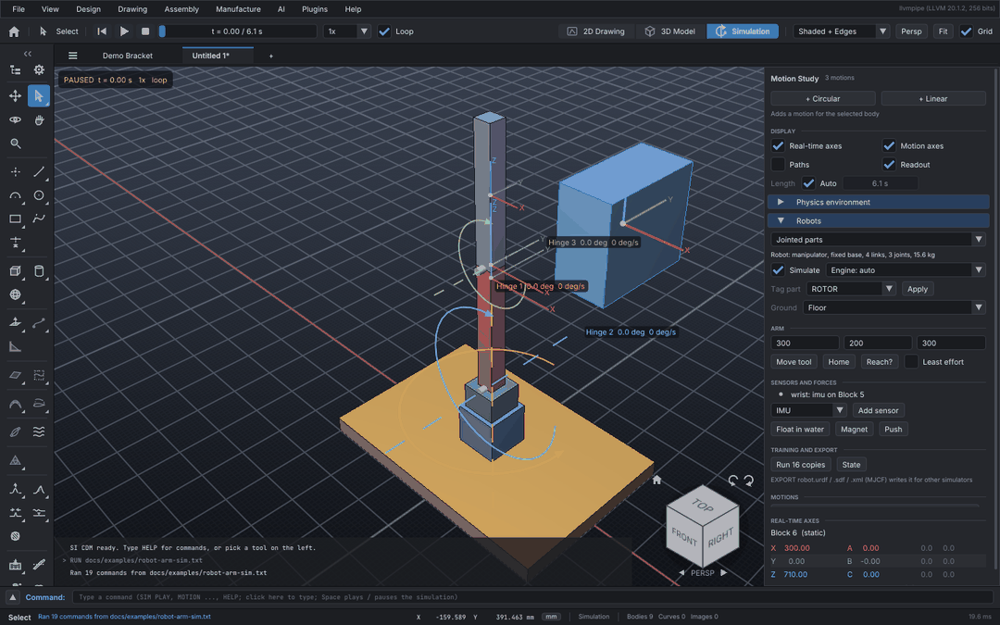

# Robot simulation

SI CDM simulates robots straight from the parts you modelled: the joints are the scene's motions,
the links are the parts they move, and the masses come from the meshes. There is nothing to export
first. Everything here is SI CDM's own code (no third-party physics, planning or learning
libraries).



In the app: **Simulation → Motion Study → Robots**. Every control there runs one of the commands
below, so the same things work headless, from scripts (`RUN`), from AI agents and plugins (MCP),
and from Python.

| Area | Commands | What you get |
| --- | --- | --- |
| Robot from the scene | `RIG`, `RIG TAG`, `RIG MORPHOLOGY`, `RIG BASE` | Links with mass and inertia, joints with limits and couplings, tags for rotors, wheels, end effectors, feet, knees |
| Asset export | `EXPORT robot.urdf / .sdf / .xml` | URDF, SDF 1.7 and MJCF with a mesh per link |
| Engines | `RIG ENGINE`, `RIG SIMULATE ON`, `RIG STATE` | Articulated dynamics, vehicles, trajectory optimisation, or the particle engine |
| Ground | `TERRAIN` | Slopes, stairs, rough ground, blocks, DEM files |
| Drones and rovers | `RIG MISSION` | Rotor thrust and drag, wind, a flight controller; a drive controller |
| Sensors | `RIG SENSOR` | IMU, GPS, force-torque, camera (RGB, depth, segmentation), LiDAR, with noise |
| Arms | `ARM MOVE_TO`, `ARM IK`, `ARM HOME` | Inverse kinematics, collision-free planning, least-effort trajectories |
| Learning | `RIG ENV`, MCP `robot_env`, `python/sicdm_env.py` | Batches of robots, headless and fast-forward, for PyTorch or JAX |
| Sandbox | `RIG FORCE` | Wrenches, buoyancy, magnetic adhesion, scripted forces (expressions or C++) |

## The robot from the scene

`RIG` reads a robot from a component, an assembly, or (with neither) every jointed part:

- **Joints** are motions: a circular motion is a revolute joint (continuous when it has no range),
  a linear one is prismatic. Limits come from the motion's limits or range.
- **The tree** comes from which parts each motion moves. A joint's parent is the joint that moves
  the smallest set of parts containing its own. Three motions on the same parts (a ball joint) make
  a chain of three joints.
- **Couplings**: motions geared to a drive motor become joints that follow the first one on it
  (a finger's three joints on one tendon motor), with the gear ratio.
- **Mass and inertia** are integrated over each part's mesh (divergence theorem), at the part's
  density (or `RIG DENSITY`).
- **Morphology** (manipulator, humanoid, quadruped, drone, rover, custom) is guessed from the tags
  and the tree, or set with `RIG MORPHOLOGY`. It picks the engine and whether the base floats.

```
RIG                                   # the robot, its links and joints
RIG "Robot Arm 1" TAG "Gripper" END_EFFECTOR
RIG TAG "Prop 1" ROTOR                # auto-rigging: a spin joint about the prop's thin axis
RIG TAG "Left knee" KNEE              # a knee bends one way only
RIG BASE FLOATING
EXPORT robot.urdf                     # or robot.sdf, robot.xml (MJCF)
```

## Engines

| Engine | For | What it does |
| --- | --- | --- |
| `articulated` | arms, humanoids, quadrupeds, custom | Featherstone's articulated-body algorithm on the joint tree, a floating base when it walks, soft contacts with stick-slip friction, implicit servos and joint stops, 0.5 ms steps |
| `vehicle` | drones, rovers | The same with rotor thrust (kT ω²) and drag torque (kQ ω²), air drag and wind, wheel grip |
| `optimize` | custom arms | The articulated model, with every `ARM` move planned for the least effort |
| `particle` | anything | The scene's physics engine (`PHYSICS`) |

`RIG SIMULATE ON` plays the robot with its engine: the motions become the servos' targets, so the
robot does what it was programmed to under gravity, with its contacts and its motors' limits. The
run is computed once and then plays and scrubs. `RIG STATE AT 2.5` prints its pose, centre of mass
and joint values at a time.

Checked against free fall, torque-free tumbling, a pendulum's period, a resting box, sliding on a
slope (exactly g(sin θ − μ cos θ)), hover and flight, and rover turns.

## Ground

```
TERRAIN SLOPE ANGLE 15 DIRECTION 90
TERRAIN STAIRS RISE 150 RUN 300 STEPS 6
TERRAIN ROUGH AMPLITUDE 40 WAVELENGTH 400 SEED 3
TERRAIN BLOCKS HEIGHT 60 BLOCK 250
TERRAIN DEM hills.asc                 # ESRI ASCII grid, or a greyscale image: CELL mm HEIGHT mm
TERRAIN OFF
```

The terrain is a body named "Terrain" that the engines walk and drive on (heights and normals).

## Drones and rovers

A drone is three or more `ROTOR` parts; a rover has `WHEEL` parts. A mission tells their
controllers what to do:

```
RIG MISSION HOVER AT 0
RIG MISSION VELOCITY 1,0,0.5 YAW 20 AT 2      # m/s, deg/s
RIG MISSION GOTO 2000,0,1500 AT 6             # mm
RIG MISSION DRIVE 0.5 TURN 30 AT 0            # rover: m/s, deg/s
PHYSICS WIND 2,0,0                            # m/s
```

The flight controller works like an autopilot's offboard mode: velocity error → thrust vector →
attitude → body torques → each rotor's speed (a least-norm mixer). The drive controller runs a
differential drive with yaw-rate feedback.

## Sensors

```
RIG SENSOR ADD IMU imu ON "Body" RATE 200
RIG SENSOR ADD GPS gps ON "Body" ORIGIN 51.5,-0.12,30
RIG SENSOR ADD FORCE wrist ON "Forearm"
RIG SENSOR ADD CAMERA cam ON "Head" LOOK 1,0,0 SIZE 640 480 FOV 70
RIG SENSOR ADD LIDAR lidar ON "Mast" CHANNELS 16 SAMPLES 720 RANGE 30
RIG SENSOR READ imu AT 1.5
RIG SENSOR CAPTURE cam shot AT 2              # shot_rgb.png, shot_depth.png (mm), shot_segmentation.png
RIG SENSOR CAPTURE lidar scan.pcd AT 2
RIG SENSOR LOG imu imu.csv FROM 0 TO 5
```

Noise models: white Gaussian noise on every reading, and a bias that wanders as a random walk for
IMUs, at typical MEMS and survey levels scaled by `NOISE` and `BIAS` (0 makes them ideal). The
noise is drawn from the sensor's seed and the sample's time, so a reading is the same every time
it is asked for.

## Arms

```
ARM MOVE_TO 450,0,300                         # the END_EFFECTOR part's centre to a point
ARM MOVE_TO 450,0,300 POINT 0,0,150           # a point on the tool, from its centre
ARM MOVE_TO 300,200,250 APPROACH 0,0,-1       # pointing the tool down
ARM MOVE_TO 0,-400,400 SPEED 0.3 OPTIMIZE     # slower, least effort
ARM IK 300,200,300                            # the joint values only
ARM HOME
```

- **Inverse kinematics**: damped least squares within the joint limits, coupled joints moving with
  their leader, restarted from spread-out guesses; the collision-free solution nearest to where the
  arm is wins.
- **Collisions**: each link's parts turn with it and are tested against the other links, the parts
  around the robot, the floor and the terrain. Each part's box finds what might touch, and the parts'
  exact shapes decide (triangle trees walked together, plus a test for one part wholly inside another).
  So an L-shaped link, a gripper around a shaft, or a tool reaching down into a bin is not stopped by
  a box that covers empty space. Three kinds of pair are left out: parts that touch at rest (at the
  joints), parts that stay rigid to each other during the move (fingers on a hand the arm carries),
  and parts already touching where the arm starts.
- **Checking a program**: `SIM CHECK` plays the whole timeline, including keyed motions, poses,
  gestures, arm moves and physics. It reports every pair of parts that run into each other, with the
  time and the place.
- **Planning**: RRT-Connect in joint space, each edge checked about every degree, then shortcut.
- **Timing**: each straight move at `SPEED` × the slowest joint's top speed, on a minimum-jerk
  profile.
- **Least effort** (`OPTIMIZE`, or `RIG ENGINE OPTIMIZE`): inverse dynamics (recursive
  Newton-Euler) gives the motor torques along the path. Each segment is then bent by smooth shapes
  to lower ∫τ² dt, within the joints' ranges and speeds and clear of collisions.
- **The program**: the path is keyed into the joints' motions (or their drive motors) after what is
  already programmed, so moves follow one another and the Simulation plays them. `UNDO` takes a
  move back.

## Learning

A batch of copies of a robot runs headless and as fast as the machine goes: no drawing, no
real-time pacing, every core. A humanoid runs about 45 × real time for 16 copies on an ordinary
machine.

```
RIG ENV COUNT 16 TASK STAND SECONDS 5         # a check: speed, and episodes on random actions
```

- **Actions**: one per motor in [−1, 1]. With position control, a target across the joint's range
  (a speed for wheels and rotors). With `TORQUE`, a share of the joint's effort.
- **Observations**: the motors' values and rates; the base's height, up vector, velocity and turn
  rate in its own frame; then the task's terms.
- **Tasks**: `STAND`, `WALK` (along +X), `REACH x,y,z`, `HOVER`, `NONE`. An episode ends on a fall,
  a failed simulation or time, and that copy starts again on its own.

From Python, `python/sicdm_env.py` starts the `sicdm-mcp` server and wraps its `robot_env` tool as
a vectorised environment (standard library and numpy only):

```python
from sicdm_env import VecEnv
env = VecEnv(project="arm.sicdm", count=64, task="reach", target=(300, 200, 300))
obs = env.reset()                                   # (64, observation_size) numpy array
obs, reward, terminated, truncated, info = env.step(actions)
# PyTorch: torch.as_tensor(obs); JAX: jax.numpy.asarray(obs)
```

`python/examples/train_reach.py` teaches an arm to reach with augmented random search. Leave it
running overnight with `--iterations 2000`.

## Sandbox forces

Forces of any kind on any part, on top of gravity, the motors and the contacts. They act in the
Simulation's playback, the sensors and the learning environments, and are saved with the project.

```
RIG FORCE ADD WRENCH push ON "Body" FORCE 20,0,0 FROM 1 UNTIL 1.2
RIG FORCE ADD WRENCH thrust ON "Hull" FORCE 0,0,15 LOCAL          # in the part's own axes
RIG FORCE ADD BUOYANCY water ON "Hull" DENSITY 1025 LEVEL 300 DRAG 20
RIG FORCE ADD MAGNET feet ON "Foot" STRENGTH 80 RANGE 15          # to the ground
RIG FORCE ADD MAGNET pad ON "Pad" STRENGTH 50 ONTO "Steel wall"
RIG FORCE ADD SCRIPT hold ON "Body" FZ "mass*g + (0.5 - z)*400 - vz*60"
RIG FORCE LIST
RIG FORCE REMOVE push
```

- **Buoyancy**: each part is split into cells. Each cell pushes up by the weight of the fluid it
  displaces, counting how much of it is under the surface, at its own place. Parts therefore float
  at their waterline and right themselves or roll.
- **Magnetic adhesion**: every bit of the part within `RANGE` of the steel is pulled to it, by
  `STRENGTH` (all of a face flush) × (1 − d/range)².
- **Scripts**: expressions of `t`, `x y z`, `vx vy vz` (the force's point), `wx wy wz`, `mass` and
  `g`, with `+ - * / ^`, `sin cos tan asin acos atan atan2 exp log sqrt abs sign min max pow clamp
  step` and `pi`.
- **C++**: a function registered with `registerForceScript("name", ...)` (`core/ForceField.hpp`),
  named by `FUNCTION name`.
- **Python**: `env.step(actions, wrenches=[{"part": "Body", "force": (0, 0, 50)}])` applies a
  wrench until the next step.
