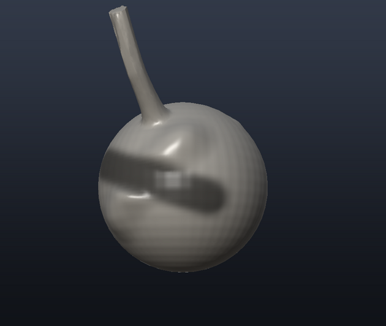
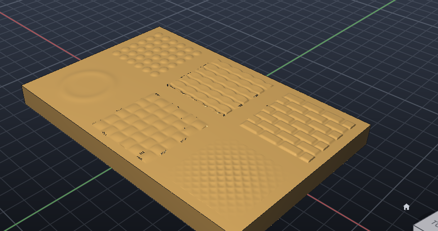
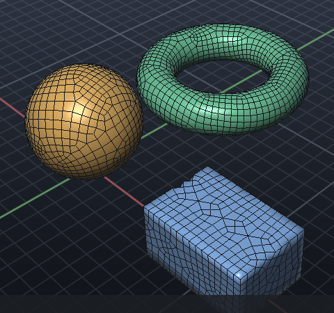
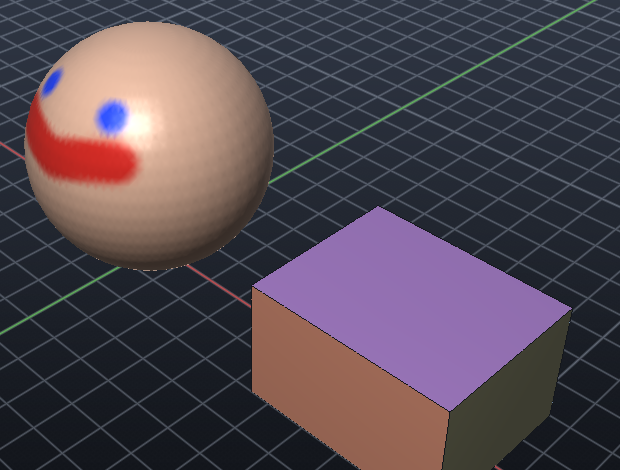
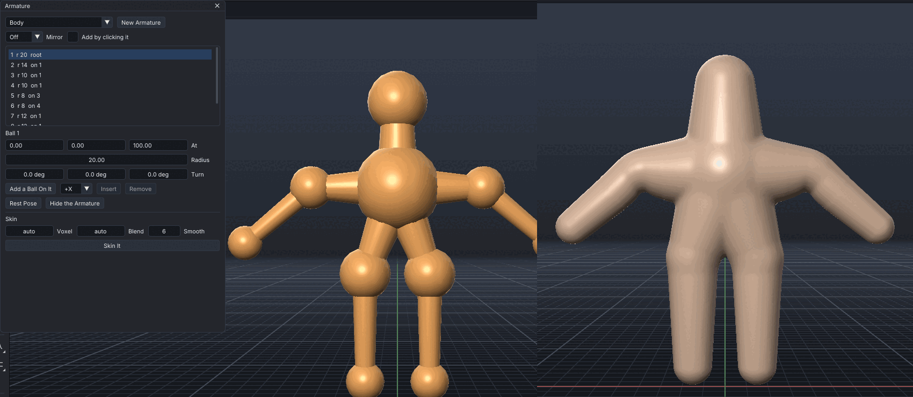
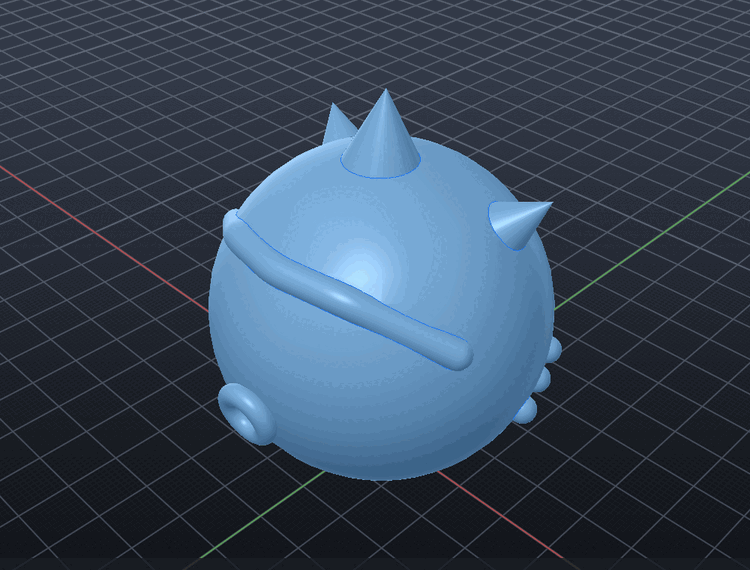

# Digital sculpting and cuts

Any body can be shaped like clay and cut like a CAD solid. The two tool sections at the bottom of the
tool rail hold the tools, the options bar holds their settings, and every edit can be undone and
redone (`UNDO`, `REDO`, or the buttons in the options bar).

The toolset follows the common ground of the professional sculpting tools: ZBrush, Blender,
3DCoat, Mudbox and Nomad Sculpt. It covers:

- eighteen brushes;
- falloff curves;
- mirror and radial symmetry;
- masking;
- alphas;
- sculpt layers;
- multiresolution levels;
- polypaint and polygroups;
- dynamic topology;
- voxel remesh;
- subdivision, symmetrize and decimation;
- undo and redo.

The code is our own. No code from those tools is used.


## Sculpting brushes

Drag over a body. **Ctrl** inverts the brush, and **Shift** smooths with any brush.

### Brush size and strength

| Keys | Does |
| --- | --- |
| `[` and `]` | Brush 20 % smaller or larger |
| `Shift+[` and `Shift+]` | Strength 0.05 down or up |
| `F`, then move the mouse | Size the brush live: a circle follows the pointer and shows the radius. Click or Enter keeps it; Esc or a right click puts it back |
| `Shift+F`, then move the mouse | The same for the strength: the filled circle is the strength, the faint ring is full strength |

The Radius box and Strength slider in the options bar take exact values; the radius can be in
any unit (`5`, `0.25in`). The status bar shows each new value.

While a sculpt tool is active, `F` sizes the brush, as in Blender. Elsewhere, `F` still fits
the view, and the Fit button always does.

**Pen pressure.** With a drawing tablet, pressing harder makes each dab stronger. Pressing
also makes the brush larger when **Pen: size** is on in the options bar. **Pen: strength** is
on by default. The values set above are the brush at full pressure, and a light touch still
leaves at least 5 % of them. A mouse gives no pressure and leaves the brush as set.

Pressure is read on:
- Windows 8 and later, through its pointer messages;
- macOS, through the tablet data on mouse events;
- Linux on X11, through the tablet's XInput2 pressure axis.

There is no pressure on Wayland.


| Brush | Does | Ctrl |
| --- | --- | --- |
| **Draw** | Pulls the surface out along the brush normal, like pressing clay from behind | Pushes in |
| **Clay** | Builds material in flat layers, up to a plateau above the surface | Removes in layers |
| **Carve** | Digs material away with a sharp falloff | Raises a ridge |
| **Inflate** | Swells the surface along its own normals | Deflates |
| **Grab** | Picks up the surface under the brush and drags it with the mouse | |
| **Pinch** | Draws the surface towards the stroke, for creases and hard-edge transitions | Spreads |
| **Crease** | Cuts a sharp valley along the stroke | Sharp ridge |
| **Smooth** | Laplacian smoothing: each vertex moves towards the average of its neighbours | |
| **Flatten** | Presses the surface onto the average plane under the brush | |
| **Scrape** | Shaves off the high spots down to that plane, like a trimming knife | Fills the low spots |
| **Clay Strips** | Lays flat-topped strips of clay under a square brush, along the stroke | Removes |
| **Layer** | Raises the surface to an even height over the stroke, at most once a stroke however often it passes | Lowers |
| **Blob** | Swells rounded blobs that spread out from the centre | Dents |
| **Snake Hook** | Pulls the surface out along the stroke, for horns, tentacles and strands; it keeps the strand's girth | |
| **Nudge** | Pushes the surface along itself in the stroke's direction | |
| **Fill** | Raises the low spots up to the plane under the brush | Scrapes |
| **Mask** | Paints a mask; masked surface (shown darker) holds still under every other brush | Unmasks |
| **Paint** | Polypaint: lays colour on the surface; the mask holds it off | Paints the body's own colour back |



The settings in the options bar:

- radius and strength (0 to 1);
- **Symmetry X / Y / Z**: mirrors each dab across the body's centre planes, in any combination;
- **radial count**: copies of each dab around the body's vertical axis, for wheels, flowers and
  rosettes;
- **falloff**: smooth, sphere, sharp, linear or flat, from the centre to the rim;
- **Dyntopo**.

A copy that lands almost on another, such as a dab on a mirror plane, is left out, so the plane
does not get double strength.

**Front faces only.** A dab moves only the surface that faces the way its own spot does. A brush
larger than a thin part, such as an ear or a 10 mm slab, does not reach through to the far side or
pull its plane there.

**Masking.** The Mask brush paints a mask from 0 to 1 on the vertices. `MASK CLEAR`, `INVERT`,
`SMOOTH`, `GROW`, `SHRINK` and `ALL` edit the whole mask. A masked vertex moves by (1 − mask) of
what the brush would do. The mask follows the surface through dynamic topology and is saved with
the project.

**Subdivide, symmetrize, decimate.**

- `SUBDIVIDE` is Loop subdivision. Each level splits every triangle in four and smooths: corners
  round off, and borders stay put.
- `SYMMETRIZE` cuts the body on the plane through its origin, mirrors the kept side exactly and fuses
  the halves into one closed solid.
- `DECIMATE TO n` collapses the shortest edges until about n triangles are left. The surface stays
  closed and its volume stays within a few per cent.

**Dynamic topology.** Each dab first splits the edges that pass under the brush and are longer than
the detail size (default: a quarter of the radius), and the longest edge of each triangle it touches.
After the dab it collapses edges under the brush that became much shorter than the detail. The splits
stay conforming, so the surface stays closed. A 12-triangle block can be sculpted as freely as a dense
scan.

- One dab may add only about as many triangles as its own disc needs.
- A stroke has at most about 1000 dabs.
- The brush is never smaller than 0.2 % of the body's size, so a tiny radius cannot run away.
- Slivers that a boolean leaves (a corner lying on the far edge, or two corners a hair apart) are
  flipped or merged first, so a refined boolean result stays closed.

**How a dab works.**

- Every vertex within the radius *R* of the hit point moves.
- The amount is weighted by a smooth falloff, *f* = 3t² − 2t³ with *t* = 1 − d/R.
- The brush plane is the falloff-weighted average position and normal under the brush.
- Dabs are spaced a quarter radius apart along the stroke, each snapped to the surface.

Hard CAD edges stay crisp in the shading: normals are smoothed only across edges that turn less than 40°.

## Alphas



An alpha is a grey pattern the brush is pressed through: white gets the brush's full effect,
black none. Any brush takes one (Draw, Clay, Inflate, Carve, Paint...), for scales, bricks,
pores, rivets or a logo.

- **Built in:** `NOISE`, `RING`, `SQUARE`, `DOTS`, `SCALES`, `CROSSHATCH`, `BRICKS`, `PORES`,
  `WEAVE` and `STRIPES` (`SCULPT ALPHAS` lists them).
- **Your own:** `ALPHA "pattern.png"` reads any image (PNG, JPEG, BMP, TGA...) as an alpha by
  its brightness. Transparent parts count as black.
- **Placing it:** the alpha covers the brush's square, laid on the surface under it.
  - `ALPHAANGLE deg` turns it.
  - `FOLLOW` turns it along the stroke.
  - `TILE n` repeats it n times across.
- **Stamps:** a single point is one stamp. `SPACING 2` sets stamps side by side along a
  stroke (the gap between dabs, in radii; strokes default to a quarter).
- **The falloff still applies,** spread over the square: `FALLOFF CONSTANT` gives a crisp,
  even stamp, and `SMOOTH` fades it out to the edges.
- **Detail:** under an alpha, dynamic topology divides the surface to about a thirtieth of
  the radius, so the pattern comes out. Larger brushes give larger, cleaner patterns.
- **In the app:** the options bar has an alpha list, its angle and *Follow*. *Stamp* drags
  out one stamp: press where it goes, then drag to size and turn it.

```text
SCULPT "Armour" DRAW AT 0,0,40 RADIUS 20 STRENGTH 0.35 ALPHA scales FALLOFF constant
SCULPT "Wall" DRAW AT -40,0,10 40,0,10 RADIUS 12 STRENGTH 0.4 ALPHA bricks SPACING 2 FALLOFF constant
SCULPT "Head" DRAW AT 0,-30,60 RADIUS 8 STRENGTH 0.1 ALPHA pores SPACING 0.6
SCULPT "Badge" DRAW AT 0,0,5 RADIUS 15 STRENGTH 0.3 ALPHA "logo.png"
```

## Sculpt layers

A layer holds what the strokes did while it recorded: how far each vertex moved. Its
strength dials that in and out, so a detail pass, a wrinkle set or an expression can be
tried at half strength, turned off, pushed further, or thrown away without touching the
rest.

```text
LAYER "Head" NEW Wrinkles RECORD      a new layer; strokes now go into it
SCULPT "Head" CREASE AT ...           (sculpt as usual)
LAYER "Head" STRENGTH Wrinkles 0.5    half as deep
LAYER "Head" OFF Wrinkles             the shape beneath (ON brings it back)
LAYER "Head" RECORD Brow              strokes go into another layer; STOP: into none
LAYER "Head" DELETE Wrinkles          its strokes taken out
LAYER "Head" BAKE ALL                 the shape kept, the layers dropped
LAYER "Head" LIST
```

- **Every brush records,** including Grab, Snake Hook and alpha stamps. Strokes made with no
  layer recording go into the shape beneath all the layers.
- **Strength** goes from -1 (the strokes reversed) through 0 (off) and 1 (as sculpted) to 2
  and beyond. A layer that is off doesn't record.
- **Layers follow dynamic topology:** new vertices take their neighbours' offsets. So you
  can add detail on top of a layer and still dial the layer.
- **Kept:** layers are saved in the project, and UNDO takes back a layer change.
- **Subdivision and decimation keep the layers.** Voxel remesh, booleans and cuts (holes,
  pockets, the knife) build a new mesh and drop them: bake or finish with the layers first.
- **In the app:** *Layers* in the sculpt options bar lists the selected body's layers. Each
  row has an on/off box, a record button, a strength slider, and Bake and Delete buttons.

## Multiresolution

A body can keep several subdivision levels at once. Level 0 is the coarse cage, and each
level above is the one below subdivided once, plus its own detail.

- **Big forms low:** at a low level a few vertices move a lot of surface, so posing a limb
  or pulling out a horn is quick and smooth.
- **Detail high:** pores, wrinkles and scales go on at the top.
- **The detail follows:** when the form changes at a low level, every level above keeps its
  detail on the moved surface. The detail is carried in the surface's own frame, so a bump
  stays a bump when the surface under it tilts.

```text
MULTIRES "Head" ADD 3           three levels over the current mesh; the top is shown
SCULPT "Head" DRAW AT ...       detail at the top
MULTIRES "Head" LEVEL 1         a coarse level (DOWN / UP step one at a time)
SCULPT "Head" GRAB AT ...       move the big form
MULTIRES "Head" LEVEL 3         back to the top: the detail rode along
MULTIRES "Head" APPLY           keep what is shown, drop the levels
MULTIRES "Head" DELETE LOWER    drop the levels below the one shown (or HIGHER: above)
```

- **Dynamic topology is off** while a body has levels: each level keeps its vertices.
  `SUBDIVIDE` on the top level adds a level.
- **Edits that change the triangles drop the levels,** keeping the shape shown. Those are
  a remesh, a boolean or a cut. The next level change says so.
- **Kept:** the levels are saved in the project (the cage's triangles and every level's
  points) and undone with UNDO.
- **In the app:** the sculpt options bar shows *Level n/N* with arrows to step, and
  *+ Level*.

## Retopology



`RETOPO` lays an even, all-quad mesh over a body: ready to subdivide, animate, unwrap or
hand to another program. The edges follow the surface's principal curvature where it is
clearly curved, and run straight along sharp edges, which are kept with their corners.

```text
RETOPO "Head" FACES 3000             about 3000 quads: a new body "Head retopo", the original hidden
RETOPO "Head" FACES 1500 DETAIL 3    quads plus three levels of detail laid on the original
RETOPO "Block" FACES 600 REPLACE     the body itself gets the quads
RETOPO "Head" NOCURVATURE            smooth flow everywhere, ignoring the curvature
```

- **How it is made** (our own method): an even triangle remesh, a four-way direction field
  over it (from the curvature and the sharp edges, smoothed), triangles paired into quads
  along the field, every face split once into quads, then relaxed while held on the
  original surface.
- **The report** gives the quad count, the mean edge, how square the corners are and how
  many vertices are not on four quads (the poles).
- **With DETAIL** the quads become level 0 of a multiresolution body, and each level above
  is moved onto the original surface, so the sculpted detail is kept on a clean base.
- **Kept:** the quads are saved in the project, and OBJ export writes them as quad faces.
- **MCP:** the sculpt tool's `retopo` operation (`faces`, `levels`, `replace`).

## UV unwrapping and baking


The usual end of a sculpt: a light quad mesh (`RETOPO`) whose textures carry the sculpted
detail. `UV` gives a body texture coordinates and `BAKE` writes the maps.

```text
UV "Head retopo" UNWRAP                     charts, flattened and packed into the square
UV "Head retopo" SHOW CHECKER               see the unwrap: even squares mean little stretch
UV "Head retopo" LAYOUT head_uv.png         the layout as a picture
BAKE "Head retopo" NORMAL FROM "Head" SIZE 2048 FILE head_normal.png
BAKE "Head retopo" OCCLUSION FROM "Head" FILE head_ao.png
UV "Head retopo" SHOW NORMAL head_normal.png      the low mesh, lit with the sculpt's detail
```

- **Unwrapping** (our own method):
  - The faces are grown into charts that each face roughly one way (`ANGLE`, default 66°).
    Polygroups are borders too (`NOGROUPS` ignores them), and a quad's two triangles stay
    together.
  - Ragged borders are smoothed and slivers merged into a neighbour.
  - Each chart is flattened with least-squares conformal maps. If a map would fold, the
    chart is projected instead.
  - Every chart is scaled to the surface's own size (even texel density), turned to its
    smallest box, and packed by its outline in whichever of four turns fits lowest, with
    a gap (`MARGIN`) between charts.
  - The report gives the chart count, how much of the square is used and the mean stretch.
- **Baking:** each texel of the body is found on the source (`FROM`, often the hidden
  original). The cage is the body's normal, out and back by `DISTANCE` (default 3% of
  the size). The maps:

  | Map | What it holds |
  |---|---|
  | `NORMAL` | The source's normals, tangent space (blue = straight out) |
  | `OBJECTNORMAL` | The same normals in world directions |
  | `HEIGHT` | The source above or below the body, 16-bit grey (range in the report) |
  | `OCCLUSION` | How much sky each point sees (`RAYS`, default 32) |
  | `COLOR` | The polypaint |

  The charts are grown by `PADDING` texels so filtering doesn't bleed across seams.
- **Kept:** sculpting keeps the texture coordinates (new corners from dynamic topology get
  coordinates half way along their edge). Subdividing keeps them too. Projects save them,
  and OBJ writes and reads them (`vt`), so they round-trip with ZBrush, Blender and the
  rest. A remesh or a boolean drops them.
- **In the app:** the sculpt options bar's *UV* popup unwraps, shows the checker, and bakes
  any map from any body. Normal and colour maps are then shown on the body.
- **MCP:** the sculpt tool's `uv_unwrap`, `uv_clear`, `uv_layout` and `bake` (`map`,
  `from`, `size`, `file`) operations.

## Polypaint and polygroups



**Polypaint** colours the surface vertex by vertex. A painted model carries its colour into
renders, OBJ files and 3D printers that print in colour.

- **The Paint brush** (the brush beside Mask, with a colour box in the options bar) lays its
  colour on, blending by strength and falloff. **Ctrl** paints the body's own colour back.
- **Fill:** `PAINT [body] FILL colour` paints the whole body, or one polygroup with
  `GROUP n` or `GROUP AT x,y,z`. `PAINT CLEAR` takes the paint off.
- **The mask holds paint off,** as far as it is masked, under the brush and under a fill.
- **Colours** are names (red, green, blue, yellow, orange, purple, pink, cyan, white, black,
  grey, brown, skin, bone, gold, silver, steel, copper, clay), `#RRGGBB`, or `r,g,b` (0 to 1,
  or 0 to 255).
- **Resolution:** paint is as fine as the surface is divided. Refine or subdivide a coarse
  body before painting detail; dynamic topology carries the paint with the surface as you
  sculpt on.

**Polygroups** give each face a group number: a way to pick out parts of a surface.

- `POLYGROUP AUTO [ANGLE 20]` groups faces that meet at less than the angle: a box gets six
  groups, a cylinder three.
- `POLYGROUP ISLANDS` groups each connected piece, `POLYGROUP MASK` makes the masked faces a
  group of their own, and `POLYGROUP PAINT` groups regions of one colour.
- `MASK GROUP n` (or `MASK GROUP AT x,y,z`) masks exactly one group, ready to sculpt the rest
  or that group alone (`INVERT`).
- **View > Polygroups** (or `POLYGROUP SHOW` / `HIDE`) draws each group in its own colour.
- Groups follow the faces through dynamic topology, subdivision and decimation.

**Kept and exchanged:**

- Paint, groups and masks are saved in the project.
- OBJ export writes paint as vertex colours (`v x y z r g b`) and groups as OBJ groups
  (`g`). ZBrush, Blender and MeshLab read both, and OBJ import reads them back.
- A painted or grouped CAD body becomes a mesh body of the same shape. It keeps its exact
  geometry for STEP.

## Armatures: sketching with balls



An armature is a tree of balls joined by tapered links, like ZBrush's ZSpheres. It is a quick way
to block out a figure, a creature or a handle before sculpting.

Build and size it:

- Add balls on balls, mirrored across the plane through the root ball if you like.
- Insert a ball halfway along a link.
- Move a ball, or a ball with everything that hangs from it (`CHAIN`), and size it.

Then turn it into a mesh:

- `SKIN` makes one smooth, closed mesh round the balls and links, with rounded blends where they
  meet.
- The skin stays bound to the armature: `POSE` turns a ball and everything on it, and bends the skin
  with it.
- Edits made to the skin since (sculpting, smoothing) are kept: its rest shape is taken back from it
  before each pose.
- Editing the armature after skinning fits the skin to it, keeping what was sculpted and painted
  on it:
  - moving or sizing a ball (`MOVE`, `RADIUS`) carries each skin vertex with the links it follows:
    the same mesh, reshaped;
  - `INSERT` shares a link's vertices between its two halves, so the new ball bends what is past it;
  - adding or removing a ball (`ADD`, `REMOVE`) skins it again with the same settings, and puts
    back what the old skin carried, from its nearest points:
    - what was sculpted, fading out smoothly over a few voxels where nothing of the old skin is
      near (a new ball's own skin starts unsculpted, with no step where the old detail ends;
      `DETAIL` below gives it some);
    - the bone weights, weights set by hand included: where the old skin was, each vertex keeps
      the weights it had (blended from the old vertices about it, under the balls' new numbers
      after a `REMOVE`), sharing with a new ball's link only what that link's own weights give
      it; a new ball's own skin follows its link;
    - the paint, which also flows on over a new ball's skin from where it joins;
    - the polygroups and UVs, each new triangle from the old triangle nearest it (its UVs by
      where its corners fall on that one triangle, so no triangle straddles a seam);
    - a new ball's own skin, away from the old, gets a UV island of its own instead of being
      stretched over the old triangles: unwrapped by itself, at the old skin's texel density
      (smaller if it must be, to fit), in the largest square the old layout leaves empty. If
      the layout leaves no room, its UVs come from the nearest old triangles as above.
  - A skin remeshed since it was skinned (Dynamesh, retopology, subdivision) is bound again as it
    is: each vertex takes the weights the old skin had about it (blended from the old vertices
    nearest it; one sitting on an old vertex takes its weights exactly), so weights set or
    adjusted by hand are kept. Only links the armature no longer has fall back to weights by
    distance. Its rest pose is taken back from that, and its unsculpted shape from a fresh skin
    of the armature, so what was sculpted stays on later edits too.

- `DETAIL FROM n TO m` copies what was sculpted round ball n onto ball m's skin: each vertex on
  m's link takes the detail of the place that matches it on n's (as far along the link, turned
  and sized with it), blended in by how much m's link weights it, so it runs smoothly into what is
  about it. With `MIRROR X|Y|Z` the detail comes from the mirror image across the plane through
  the root ball (`FROM` defaults to m's mirror twin): sculpt one hand, then
  `ARMATURE Body DETAIL TO 6 MIRROR X` gives the other the same, mirrored. In the Armature
  window: *Copy Detail Onto It*.

```text
ARMATURE NEW Body AT 0,0,100 RADIUS 20
ARMATURE Body ADD AT 0,0,140 RADIUS 14                       a head on the root (on the last ball by default)
ARMATURE Body ADD TO 1 AT 40,0,100 RADIUS 10 MIRROR X        a shoulder each side
ARMATURE Body ADD TO 3 AT 80,0,100 RADIUS 8 MIRROR X         hands
ARMATURE Body ADD TO 1 AT 15,0,60 RADIUS 12 MIRROR X         hips
ARMATURE Body ADD TO 7 AT 15,0,10 RADIUS 9 MIRROR X          feet
ARMATURE Body SKIN                                           "Body skin": the armature is hidden
ARMATURE Body POSE 3 AXIS 0,1,0 ANGLE 40 MIRROR X            both arms down
ARMATURE Body POSE RESET
```

The whole command:

```text
ARMATURE                                   the armatures and their skins
ARMATURE NEW [name] [AT x,y,z] [RADIUS r]
ARMATURE name ADD [TO n] AT x,y,z [RADIUS r] [MIRROR X|Y|Z]
ARMATURE name INSERT n | REMOVE n | LIST | SHOW | HIDE
ARMATURE name MOVE n TO x,y,z | BY dx,dy,dz [CHAIN] [MIRROR X|Y|Z]
ARMATURE name RADIUS n r [MIRROR X|Y|Z]
ARMATURE name SKIN [NAME skin] [VOXEL v] [BLEND b] [SMOOTH k]
ARMATURE name POSE n TURN ax,ay,az | AXIS x,y,z ANGLE a | RESET [MIRROR X|Y|Z]
ARMATURE name POSE RESET
```

**Building it:**

- A new ball is joined to ball `TO`, or by default to the one added last. Its radius defaults to
  0.8 of that ball's.
- `MIRROR` adds, moves, sizes or turns the ball's twin across the plane through the root ball.
- `REMOVE` takes away a ball and everything on it.

**The skin:**

- Each link is the solid hull of its two balls, a cone tangent to both. The links are joined with a
  smooth minimum over `BLEND` (default a quarter of the smallest ball's radius).
- The surface is marched on voxels (`VOXEL`, default a quarter of the smallest ball's radius) and
  smoothed (`SMOOTH`).
- Every vertex is then put onto the exact surface: the field is known exactly, so each vertex steps
  along its gradient to where the field is zero. A single ball's skin is the sphere to its facets,
  and two balls' is the capsule within 1% of its volume.

**Binding and posing:**

- Each skin vertex follows the links nearest its surface, up to four, weighted by inverse distance.
  This is linear blend skinning.
- A link moves with the ball at its near end. So turning a ball swings what hangs from it, and the
  skin bends smoothly round the joint.
- Where a vertex follows two links, their turns are blended as dual quaternions, so a joint
  twisted far about its link keeps its volume rather than pinching (as linear blending does).
  `SKIN ... LINEAR` makes a skin that blends linearly instead, as glTF viewers pose skins, and
  `ARMATURE name SKINNING DUAL|LINEAR` switches the skins bound to it, keeping their pose and
  edits. Skins saved before dual quaternions came in stay linear. In the Armature window:
  *Linear blending* (for a new skin) and *Use Dual Quaternions* / *Use Linear Blending*.
- The armature and its skin are saved with the project. UNDO takes back a pose.

**In the app:** *Design → Armature (Sketch with Balls)...* (or `PANEL ARMATURE`). The window lists
the balls, and edits the chosen one's place, radius and turn. *Add a Ball On It* puts one on a side
of it. With *Add by clicking it*, a click on a ball adds a new one on its surface where you
clicked, as with ZSpheres. *Skin It* makes the skin. Over MCP, use the `armature` tool.

**Limits:**

- glTF has only linear blending: a skin exported from here is posed linearly in other viewers, so
  a joint twisted far may thin there though not here (the export says so). `SKINNING LINEAR`
  poses it the same way here.

## Insert-mesh and curve brushes



These are like ZBrush's insert-mesh (IMM) and curve brushes. They put shapes on a surface where you
click or drag, rather than sculpting them out of it.

- **Insert Mesh** (`INSERTMESH`) puts one shape where you click. It stands along the surface's
  normal, with `SINK` of its height (0 to 1) sunk into the surface. The shape is a sphere, cube,
  cylinder, cone or torus, or any other body's shape (`BODY "name"`), fitted to `SIZE`. `DIR` stands
  it along another direction, and `SPIN` turns it about its axis.
- **Curve Brush** (`CURVE`) works on a stroke over the surface. `TUBE` lays a tube of `RADIUS`
  along it, with its centre line `SINK` of its height below the surface (half in by default).
  `PROFILE` sets its cross-section: `ROUND` (the default, with round ends), `SQUARE`, `FLAT` (a
  ribbon a third as thick as it is wide), `TRIANGLE` (a point up) or `STAR` (five points); flat
  sides lie along the surface, and those ends are flat. `TAPER a b` sizes it from `a` × the radius
  where the stroke starts to `b` × where it ends (`TAPER 1 0` runs to a point). `INSERT shape` lays a row of shapes along it, every `SPACING` mm (their size by
  default), each facing along the stroke. The stroke is evened out and smoothed a little, as a
  hand's stroke wobbles.

What it does with the shape:

- `UNION` (the default) fuses it with the body exactly, into one closed solid.
- `APPEND` fuses it exactly as well, so the body is one closed solid at once, and what shows of the
  shape becomes a polygroup of its own, to mask or sculpt apart. `REMESH` later blends the joins.
  The body becomes a mesh body. Where an exact union can't be made (an open body), the shape's
  triangles are added as they are and the command says so; `REMESH` fuses them.
- `NEW` makes it a body of its own ("Insert 1", "Tube 1").

Points given away from the body are put onto its surface first. A point further away than the
shape's size (or a twentieth of the body's, if that is larger) is refused.

```
INSERTMESH "Head" CONE AT 0,0,60 SIZE 14
INSERTMESH "Head" BODY "Ear" AT 28,0,40 SIZE 20 SPIN 90
CURVE "Head" TUBE PATH -25,-10,40 0,-24,50 25,-10,40 RADIUS 2.5
CURVE "Head" TUBE PATH 0,-28,30 0,-30,10 RADIUS 2 PROFILE FLAT TAPER 1 0.2
CURVE "Head" INSERT SPHERE PATH -28,0,20 0,28,22 28,0,20 SIZE 5 SPACING 7
INSERTMESH "Head" TORUS AT 0,-29,25 SIZE 12 APPEND
```

**In the app:** *Insert Mesh* and *Curve Brush* are in the toolbar's cuts group, with *Add Volume
(Boss)* (right-click or hold it). The options bar has the shape (the primitives, then the scene's
bodies), its size, the tube's radius or the row's spacing, *Sink*, and *Union*, *Append* or *New
body*; for a tube, its profile and taper. Click a surface to insert; drag over one to lay a
curve. Over MCP, use the `insert_mesh` tool.


## Voxel remesh

`REMESH` (like ZBrush's DynaMesh or Blender's voxel remesh) rebuilds a body as one closed solid with
evenly sized triangles. Given several bodies, it fuses them, so a form can be blocked out from
overlapping primitives and then sculpted.

- `VOXEL v` sets the voxel size, and the new triangles are about that size. The default is the parts'
  size / 160.
- `BLEND b` fills in where parts meet, with a fillet of about `b` mm. Elsewhere each surface stays
  where it was.
- `SMOOTH s` rounds over detail finer than `s` mm, such as the flats of a faceted primitive (default:
  one voxel).
- Open or self-overlapping input works. Inside is whatever a flood from outside cannot reach.
- The other bodies are used up. The result keeps the first body's name, colour and place.

How it works:

1. Each part's exact distance is computed in a thin band of voxels at its surface.
2. Each voxel takes the nearest surface point its neighbours know. Two raster sweeps carry this out
   to the fillet's reach in linear time.
3. The parts' signed distances are joined with a smooth minimum, then lightly blurred.
4. The surface at distance 0 is extracted with marching tetrahedra, smoothed, and coarsened to the
   voxel size.

`SCALE body sx,sy,sz` stretches a body along x, y and z, and `ROTATE body rx,ry,rz` tilts it. Both
work about the body's origin, which is the base point of a primitive. Together with `SPHERE` they
give ellipsoids of any proportion to block out with.

**Strokes on dense meshes.** A stroke works on the part of the surface it can reach: the triangles
within twice the brush radius of its path, and of its mirror. The edges on the window's border are
pinned, so the surface stays closed. On a 150,000-triangle head, the dabs cost about as much as on a
small mesh; only copying the surface in and out goes over all of it.

## Example: a head bust


[examples/head-bust.txt](examples/head-bust.txt) sculpts this bust in 92 commands. Run it in the app
(it opens a new file tab and takes about 25 s):

```text
RUN docs/examples/head-bust.txt
```

It works the way a sculptor works in clay:

1. **Block out.** Twelve stretched balls give the big forms:
   - the skull, the face and the mouth over the teeth;
   - a broad forehead, the lower jaw and its sides, the chin;
   - the cheekbones and the cheeks.

   `REMESH ... BLEND 24` fuses them into one smooth solid. The forms flow into each other with no
   seams, and the mesh is even.
2. **Features.** A grab pushes in the eye sockets. Then the eyeballs, the nose and the ears are added
   as smaller forms. The nose is a bridge, a body, a tip and two wings, fused with each other first
   (`BLEND 7`) so it reads as one form. They are fused on with tight 3 mm fillets.
3. **Neck and shoulders.**
   - The neck is a cylinder leaning forward, deeper than it is wide.
   - The shoulders, their caps and the chest are stretched balls.
   - They are fused with 30 mm fillets, cut flat underneath, and joined to the head with an exact
     union. The join under the jaw is smoothed.
4. **Detail with the brushes:**
   - brows;
   - eyes: the upper lid drawn over the ball, its fold, the lower lid and the inner corner;
   - mouth: the lips with the upper lip's bow, the line between them, the corners and the groove
     under the lower lip;
   - ears: the bowl, the rim and the inner ridge;
   - neck: the muscles from behind the ears to the notch, the notch, the collarbones.

   Strokes use `SYMMETRY`, so each is placed once.

Points in a script only need to be near the surface. Each one is snapped onto it, and a stroke runs
along the surface between the snapped points. The result is one closed body of about 160,000
triangles, ready for `EXPORT bust.stl`.

The test suite runs the script and checks the result:

- it is closed;
- the nose stands out over the lips;
- the mouth line lies between the lips;
- the eyes sit under the brow;
- the ears stand out from the skull;
- the two sides of the face match to within 1 mm.

## Cuts and booleans

| Tool | Use |
| --- | --- |
| **Drill Hole** | Click a surface. Through, or blind to a depth with a 118° drill point. Drills along the surface normal |
| **Pocket** | Click a surface. Box (width, length, depth, angle), round, or ball end |
| **Channel** | Drag along a surface. A round-bottomed groove follows the stroke (cable runs, vents) |
| **Knife / Trim** | Drag a line across a body. The plane through it cuts the body, the smaller side goes, and the cut face is capped |
| **Add Volume** | Click a surface to fuse on a cylinder boss, a square pad or a dome |
| **Boolean Bodies** | Click the body to keep, then the tool body. Union, subtract or intersect. The tool body is used up unless *Keep* |

**How the booleans work.** They are exact, and the result is a closed mesh. Each operation runs these steps:

1. **Snap to a grid.** Both meshes go onto a shared integer grid, 2²⁶ steps across the larger one. That
   is finer than their float coordinates.
2. **Find the intersection segments.** Every pair of triangles that cross gives a segment.
   - The ends are canonical points: an edge of one mesh crossing the plane of a triangle of the other.
   - Each point is computed once and shared by every triangle that meets it, so the two sides of a seam
     match exactly.
   - Which side of a plane a vertex is on, and whether a crossing is inside a triangle, are decided with
     exact 128-bit determinants. Neighbouring triangles never disagree.
3. **Re-triangulate.** Each cut triangle is triangulated again, with its segments as constraints. The
   constraints are inserted by edge flips with exact orientation tests.
4. **Keep or drop each region.** The regions between seams are classified by their generalised winding
   number in the other mesh. That number is exact near the point and approximated far from it.

**Results.** Holes, pockets, bosses and two-body booleans on clean solids come out with the exact
volume (for example a Ø20 through hole removes exactly its 48-sided prism) and with no open edges.

**Faces in contact.** Bodies that touch face to face (blocks side by side, a slab cut off the end of a
block) are handled with the coplanar rule:

- Where both solids lie on the same side of a shared face, one copy stays in a union or intersection.
- Where they meet back to back, both faces go.

A region's test point is never taken on such a face. Faces that only partly overlap go through a
retry with the tool nudged by a hundred-thousandth of its size. That result is closed, and its
volume is accurate to about 1e-5.

**Precision.** Booleans and cuts run in the body's own frame, so a part far from the origin is cut
as exactly as one at it.

**Limits.**

- Self-intersecting input can leave a few open edges, for example a brush stroke folded through
  itself. The command reports them ("N open edges").
- A cut that would add material, or an addition that would remove it, is refused, and the body is
  left unchanged.
- A channel path that comes back within its own width is refused. Draw it as separate channels.

**Undo.**

- `UNDO` steps back through the last 16 shape edits (sculpt, cuts, booleans, armour, joints, shells,
  lattices), within about 2 million vertices of history.
- A joint's swing goes with its pin.
- Moves, colours and renames made since the edit are kept.
- If bodies were added, removed or rebuilt since the edit, `UNDO` says so and does nothing, rather
  than sweep them away.

**Export.** Results are ordinary triangle meshes. `EXPORT part.stl` sends them to a slicer for 3D
printing, or to CAM for CNC machining.

## Commands

```text
SCULPT [body] brush [AT] x,y,z [x,y,z...] [RADIUS r] [STRENGTH 0-1] [INVERT] [SYMMETRY [X|Y|Z...]]
       [RADIAL n [X|Y|Z]] [FALLOFF smooth|sphere|sharp|linear|constant] [DETAIL d] [NOREFINE] [MOVE dx,dy,dz]
       [COLOR colour] [ALPHA name|"image" [ALPHAANGLE deg] [FOLLOW] [TILE n]] [SPACING radii]
       brushes: DRAW CLAY CLAYSTRIPS LAYER CARVE INFLATE BLOB GRAB SNAKEHOOK NUDGE PINCH CREASE
                SMOOTH FLATTEN SCRAPE FILL MASK PAINT
SCULPT [body] REFINE edge-length           refine the whole body before sculpting
SCULPT LIST                                the brushes
SCULPT ALPHAS                              the built-in alphas
HOLE    [body] [AT] x,y,z [DIR x,y,z] DIAMETER d [DEPTH h | THROUGH]
POCKET  [body] [AT] x,y,z [DIR x,y,z] [BOX|ROUND|BALL] WIDTH w [LENGTH l] DEPTH d [ANGLE deg]
CHANNEL [body] [PATH] x,y,z x,y,z ... WIDTH w [DEPTH d]
TRIM    [body] [PLANE] x,y,z NORMAL x,y,z [SMALLER]        removes the side the normal points to
BOSS    [body] [AT] x,y,z [DIR x,y,z] [CYLINDER|BOX|BALL] DIAMETER d HEIGHT h
BOOLEAN body UNION|SUBTRACT|INTERSECT other [KEEP]
UNDO
REMESH  [body ["other"...]] [VOXEL v] [BLEND b] [SMOOTH s]   voxel remesh: fuse into one even, closed solid
ARMATURE name ADD|INSERT|MOVE|RADIUS|REMOVE|SKIN|POSE ...      balls joined by links, skinned and posed (above)
INSERTMESH [body] SPHERE|CUBE|CYLINDER|CONE|TORUS|BODY "name" AT x,y,z [SIZE s] [DIR x,y,z] [SPIN deg] [SINK f] [UNION|APPEND|NEW]
CURVE   [body] TUBE PATH x,y,z ... [RADIUS r] | INSERT shape PATH ... [SIZE s] [SPACING d]  [SINK f] [UNION|APPEND|NEW]
SCALE   body sx,sy,sz                      stretch along x, y, z (about the body's origin)
ROTATE  body rx,ry,rz                      orient: degrees about X, then Y, then Z
MASK    [body] CLEAR|INVERT|SMOOTH|GROW|SHRINK|ALL [n]   edit the mask (the MASK brush paints it)
MASK    [body] GROUP n | GROUP AT x,y,z [INVERT]       mask one polygroup
PAINT   [body] FILL colour [GROUP n | GROUP AT x,y,z] | CLEAR    polypaint (the PAINT brush paints strokes)
POLYGROUP [body] AUTO [ANGLE deg] | ISLANDS | MASK | PAINT | CLEAR | LIST | SHOW | HIDE
LAYER   [body] NEW name [RECORD] | RECORD name | STOP | STRENGTH name s | ON name | OFF name | DELETE name | BAKE name|ALL | LIST
MULTIRES [body] ADD [n] | LEVEL n | UP | DOWN | APPLY | DELETE LOWER|HIGHER | LIST
RETOPO  [body] [FACES n] [ITERATIONS k] [NOCURVATURE] [DETAIL levels] [REPLACE]   all-quad remesh
UV      [body] UNWRAP [ANGLE deg] [MARGIN m] [NOGROUPS] | CLEAR | INFO | LAYOUT file.png [SIZE n]
        [body] SHOW CHECKER | SHOW [COLOR file] [NORMAL file] | HIDE                 texture coordinates
BAKE    [body] NORMAL|OBJECTNORMAL|HEIGHT|OCCLUSION|COLOR [FROM "src"] [SIZE n] [RAYS n] [DISTANCE d] [PADDING px] FILE f.png
SUBDIVIDE [body] [LEVELS n]                Loop subdivision
SYMMETRIZE [body] [X|Y|Z] [-]              mirror the + side (or the - side) across the body's origin
DECIMATE [body] TO n | RATIO r             reduce to about n triangles
REDO                                       put back what the last UNDO took away
RUN script.txt                             the commands in a file, one a line (# comments); stops at a failure
```

Points are snapped to the nearest surface, and the tool goes in against the surface normal there
(unless `DIR`). A stroke runs along the surface between its snapped points. The body defaults to
the selection. A point far from the body is refused. Each command reports the triangle count and
whether the result is closed.

Over MCP: the `sculpt` tool (`operation` = a brush name, `hole`, `pocket`, `channel`, `trim`, `boss`,
`boolean`, `refine`, `remesh`, `subdivide`, `symmetrize`, `decimate`, `mask_clear`, `mask_invert`,
`mask_smooth`, `mask_group`, `paint_fill`, `paint_clear`, `polygroup_auto`, `polygroup_islands`,
`polygroup_mask`, `polygroup_paint`, `polygroup_clear`, `layer_new` (recording), `layer_record`, `layer_stop`,
`layer_strength` (`value`), `layer_on`, `layer_off`, `layer_delete`, `layer_bake`, `layer_list`, `multires_add`
(`levels`), `multires_level` (`value`), `multires_up`, `multires_down`, `multires_apply`, `undo` or `redo`; `symmetry_axes`, `radial`,
`falloff`, `color`, `alpha`, `alpha_angle`, `alpha_follow`, `alpha_tile` and `spacing` for the brushes).
The `armature` tool sketches, skins and poses armatures: `new`, `add`, `insert`, `move`, `radius`,
`remove`, `skin`, `pose`, `reset`, `show`, `hide` and `list`.
